# CSS 03 Cours
CSS, commonly known as Cascading Style Sheets, is used to enhance the styling of web pages that are written in HTML. It allows for better management of the content's presentation. CSS was later adopted by the W3C consortium to promote standardization. The core idea behind CSS is to separate content from its presentation. These style sheets define fonts, the positioning of elements, margins, colors, and more, allowing for a consistent and flexible design across web pages.

# ///////////////////////////////////////////////////////

### Where to Declare CSS Styles?
A style can be declared in the following ways:

1. **Inline Style:**
   - CSS is applied directly within an HTML tag using the `style` attribute. While this method is the easiest way to apply styles, it is not recommended for adjusting HTML template pages as it can make updates more cumbersome and less maintainable.


**HTML File:**


```python
<p style="color: blue; font-size: 16px;">This is a paragraph with inline style.</p>
```

2. **Internal Style Sheet:**
   - CSS is written within the `<style>` tag inside the `<head>` section of the HTML document.

**HTML File:**


```python
<head>
    <style>
      p {
        color: green;
        font-size: 18px;
      }
    </style>
</head>
<body>
    <p>This is a paragraph with internal style.</p>
</body>
```

3. **External Style Sheet:**
   - CSS is stored in a separate file (e.g., `styles.css`) and linked to the HTML document using the `<link>` tag.
   
**HTML File:**


```python
<head>
    <link rel="stylesheet" href="styles.css">
</head>
<body>
    <p>This is a paragraph with external style.</p>
</body>
```

**CSS File (styles.css):**


```python
<style>
p {
    color: red;
    font-size: 200px;
}
</style>
```

When there is a conflict, CSS resolves it based on the following order of priority:

1. **Inline Styles** (highest priority)

2. **Internal Styles**

3. **External Styles** (lowest priority)

# ///////////////////////////////////////////////////////

### Basic Structure of a CSS Style

```css
selector {
  property1: value1;
  property2: value2;
  ...
}
```

- **Selector:** Specifies the identifier, class, or HTML element to which the style (formatting) will be applied.
- **Property:** Defines the styling attribute, such as `color`, `font-size`, etc.
- **Value:** Provides the specific characteristics for the properties.

Properties are separated by semicolons (`;`).

Comments in CSS are written like this: `/* This is a CSS comment */`.

# ///////////////////////////////////////////////////////

### CSS Selectors:
1. **Universal Selector**
    - This selector targets **all** elements in an HTML document.

**CSS File:**


```python
<style>    
* {
  color: blue;
}
</style>
```

**HTML File:**


```python
<body>
    <h1>Heading Level 1</h1>
    <p>The first paragraph of the page!</p>
</body>
```

 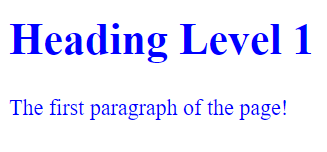

In this example, the `color: blue` property will apply to **all HTML elements** on the page, including `<h1>`, `<p>`, and any other elements present in the document.

2. **Selector as an HTML Element:**
   - Targets all `<p>` elements on the page.

**CSS File:**


```python
<style>
p {
    color: red;
    font-size: large;
}    
</style>
```

you can target multiple elements at once by separating their selectors with a comma.

**Note:** If there is no specificity priority, the last style declared will be applied.

**CSS File:**


```python
<style>
p, h1 {
  color: red;
}

p, h1 {
  color: blue;
}
</style>
```

**HTML File:**


```python
<h1>Heading Level 1</h1>

<p>This will be styled by the element selector.</p>
<p>This will be styled by the element selector.</p>
<p>This will be styled by the element selector.</p>
```

 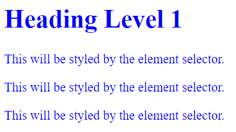

3. **Selector as a Class:** (most used one)
   - Targets all elements with the class `my-p-class`.

**CSS File:**


```python
<style>
.my-p-class {
    color: red;
    font-size: large;
}
</style>
```

**HTML File:**


```python
<p class="my-p-class">This will be styled by the class selector.</p>
```

 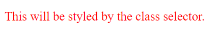

- **CSS Priority with Multiple Classes**

When an HTML element belongs to multiple classes, the **last class declared** will override any common properties shared with the earlier classes. This is because of the cascading nature of CSS, where the order of rules matters.

**CSS File:**


```python
<style>
.first-class {
  color: red;
  font-size: 16px;
}

.second-class {
  color: blue;
  font-size: 18px;
}
</style>
```

**HTML File:**


```python
<p class="first-class second-class">This text will be blue and 18px in size.</p>
```

 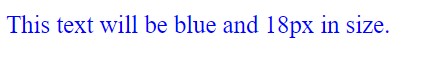

In this example, the paragraph belongs to both `first-class` and `second-class`. Since `second-class` is declared last, it will override the `color` and `font-size` properties from `first-class`. Therefore, the text will appear in blue with a font size of 18px.

4. **Selector as an ID:** (rarely used one)
   - Targets the specific element with the ID `my-p-id`.

**CSS File:**


```python
<style>
#my-p-id {
    color: red;
    font-size: large;
}
</style>
```

**HTML File:**


```python
<p id="my-p-id">This will be styled by the ID selector.</p>
```

 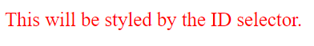

- The id attribute is meant to uniquely identify a single element on the page, so it cannot have multiple values like classes.

**CSS File:**


```python
<style>
    #first-id {
      color: red;
      font-size: 16px;
    }
    
    #second-id {
      color: blue;
      font-size: 18px;
    }
    </style>
```

**HTML File:**


```python
<p id="first-id second-id">This text won't be styled.</p>
```

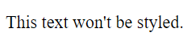

#### Worst Practice:
- It's not recommended to use the same ID for styling multiple elements. Instead, it's preferable to use classes for this purpose.

**CSS File:**


```python
<style>    
#element {
    color: rgb(196, 95, 12);
}
</style>
```

**HTML File:**


```python
<h1 id="element">header number 01</h1>
<p id="element">paragraph number 1</p>
<p id="element">paragraph number 2</p>
<p id="element">paragraph number 3</p>
```

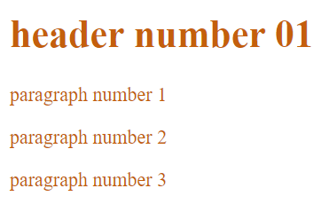

5. **Selector for Attribute Presence:**
   - Targets elements that have a specific attribute, regardless of its value.

   **CSS File:**


```python
<style>
[target] {
    color: red;
    font-weight: bold;
}
</style>
```

   **HTML File:**


```python
<a href="example.html" target="_blank">Link with target attribute</a>
<a href="example2.html">Link without target attribute</a>
```

 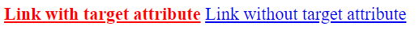

   This will apply the styles to any element that has a `target` attribute.

6. **Selector for Specific Attribute Value:**
   - Targets elements that have a specific attribute with a specific value.

   **CSS File:**


```python
<style>
[target="_blank"] {
    color: green;
    text-decoration: underline;
}
</style>
```

   **HTML File:**


```python
<a href="example.html" target="_blank">Link with target="_blank"</a>
<a href="example2.html" target="_top">Link with target="_top"</a>
```

 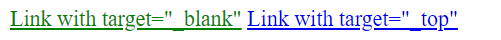

   This will apply the styles only to elements where `target="_blank"`.

7. **Selector for Partial Attribute Value (Contains Word):**
   - Targets elements where the attribute value contains a specific word.

   **CSS File:**


```python
<style>
[class~="highlight"] {
    background-color: yellow;
}
</style>
```

   **HTML File:**


```python
<p class="highlight important">This paragraph will be highlighted.</p>
<p class="important">This paragraph will not be highlighted.</p>
```

 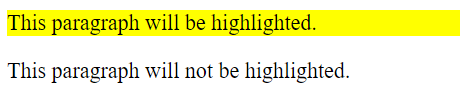

   This will apply the styles to elements where the `class` attribute contains the word `"highlight"`.

8. **Selector for Attribute Value Starting with a Specific String:**
   - Targets elements where the attribute value starts with a specific string.

   **CSS File:**


```python
<style>
[href^="https"] {
    color: green;
}
</style>
```

   **HTML File:**


```python
<a href="https://example.com">Secure Link</a>
<a href="http://example.com">Non-Secure Link</a>
```

 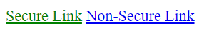

   This will apply the styles to links where the `href` attribute starts with `"https"`.


9. **Selector for Attribute Value Ending with a Specific String:**
   - Targets elements where the attribute value ends with a specific string.

   **CSS File:**


```python
<style>
[href$=".pdf"] {
    color: red;
}
</style>
```

   **HTML File:**


```python
<a href="document.pdf">PDF Document</a>
<a href="document.docx">Word Document</a>
```

 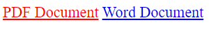

   This will apply the styles to links where the `href` attribute ends with `".pdf"`.


10. **Selector for Attribute Value Containing a Specific String:**
    - Targets elements where the attribute value contains a specific string anywhere.

   **CSS File:**


```python
<style>
[class*="nav"] {
    border: 1px solid black;
}
</style>
```

   **HTML File:**


```python
<div class="navbar">Navigation Bar</div>
<div class="sidebar-nav">Sidebar Navigation</div>
```

 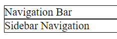

This will apply the styles to elements where the `class` attribute contains the string `"nav"` anywhere in its value.

# ///////////////////////////////////////////////////////

### CSS Combinators

CSS combinators allow you to define relationships between selectors, such as targeting descendants, direct children, adjacent siblings, and general siblings of an element. This gives you fine-grained control over how your styles are applied.

1. **Descendant Selector:**
   - The **descendant selector** targets elements that are nested inside another element. This is achieved using a space (` `) between two selectors.
   - **Syntax:** `A B` selects all elements `B` that are descendants of element `A`.

   **CSS File:**


```python
<style>
div p {
    background-color: orange;
}
</style>
```

**HTML File:**


```python
<div>
    <p>This paragraph is inside a div.</p>
    <span><p>This paragraph is also inside a div.</p></span>
</div>
<p>This paragraph is outside of the div.</p>
```

 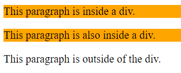

This CSS will apply the orange background to all `<p>` elements that are descendants of a `<div>`.

2. **Child Selector:**
   - The **child selector** targets only the direct children of a specific element, using the `>` symbol.
   - **Syntax:** `A > B` selects all elements `B` that are direct children of element `A`.

   **CSS File:**


```python
<style>
div > p {
    background-color: orange;
}
</style>
```

**HTML File:**


```python
<div>
    <p>This is a direct child of the div.</p>
    <span><p>This paragraph is nested and won't be styled.</p></span>
</div>
```

 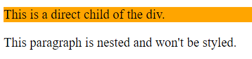

In this example, only the direct child `<p>` element inside the `<div>` will have the orange background.

3. **Adjacent Sibling Selector:**
   - The **adjacent sibling selector** selects an element that is immediately next to another element and shares the same parent. This is done using the `+` symbol.
   - **Syntax:** `A + B` selects the element `B` that comes immediately after the element `A`.

   **CSS File:**


```python
<style>
div + p {
    background-color: orange;
}
</style>
```

**HTML File:**


```python
<div></div>
   <p>This paragraph is directly after the div.</p>
   <p>This paragraph is not directly after the div.</p>
```

 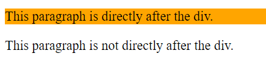

 Here, only the first paragraph directly following the `<div>` will be styled with an orange background.

4. **General Sibling Selector:**
   - The **general sibling selector** selects all elements that are siblings of a specified element, even if they are not immediately adjacent. This is done using the `~` symbol.
   - **Syntax:** `A ~ B` selects all elements `B` that follow element `A` and share the same parent.

   **CSS File:**


```python
<style>
div ~ p {
    background-color: orange;
}
</style>
```

**HTML File:**


```python
<div></div>
<p>This paragraph is a sibling of the div.</p>
<p>This paragraph is also a sibling of the div.</p>
```

 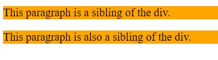

   This CSS will apply the orange background to all `<p>` elements that come after the `<div>`.

# ///////////////////////////////////////////////////////

### Pseudo-Classes in CSS
Pseudo-classes are used to define the state of an element, enabling you to apply styles based on certain conditions or user interactions, like hovering over an element, focusing on an input field, or identifying the first child of an element. Here's an overview of common pseudo-classes and how to use them.
#### Syntax:
```css
selector:pseudo-class {
  property: value;
}
```


1. **:active**
   - Targets an element that is currently being activated, such as a link during a click event.
   - Commonly used to style links when they are clicked.

   **CSS File:**


```python
<style>
a:active {
    color: red;
}
</style>
```

**HTML File:**


```python
<a href="#">Click me</a>
```

 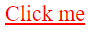

2. **:visited**
   - Styles links that have already been visited by the user.
   - Differentiates between visited and unvisited links.

   **CSS File:**


```python
<style>
a:visited {
    color: purple;
}
</style>
```

**HTML File:**


```python
<a href="#">Visited link example</a>
```

 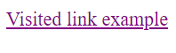

3. **:link**
   - Targets links that haven't been visited yet.
   - Used to style default link appearances.


   **CSS File:**


```python
<style>
a:link {
    color: green;
}
</style>
```

**HTML File:**


```python
<a href="#">Unvisited link example</a>
```

 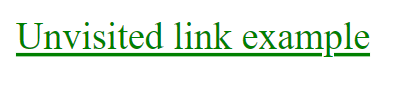

4. **:hover**
   - Applies styles when the user hovers over an element, usually for interactive effects.

   **CSS File:**


```python
<style>
div:hover {
    background-color: lightgray;
}
</style>
```

**HTML File:**


```python
<div>Hover over me</div>
```

 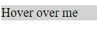

5. **:focus**
   - Targets an element that has focus, such as an input field when selected.

   **CSS File:**


```python
<style>
input:focus {
    outline: none;
    border-color: green;
}
</style>
```

**HTML File:**


```python
<input type="text" placeholder="Focus on me">

```

 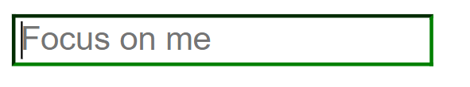

6. **:checked**
   - Applies styles to elements that are checked, such as checkboxes or radio buttons.

   **CSS File:**


```python
<style>
input:checked + label {
    background-color: yellow;
}
</style>
```

**HTML File:**


```python
<input type="checkbox" id="checkbox1">
<label for="checkbox1">Check this box</label>

<input type="checkbox" id="checkbox2" checked>
<label for="checkbox2">This box is already checked</label>
```

 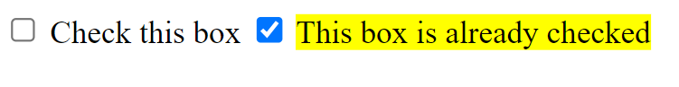

7. **:only-child**
   - Targets elements that are the only child of their parent.


```python
<style>
p:only-child {
    color: blue;
}
</style>
```

**HTML File:**


```python
<div>
    <p>This is the only child</p>
</div>
```

 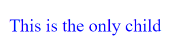

**Note:** If there are multiple children, the style will not be applied.

**HTML File:**


```python
<div>
    <p>This paragraph won't be styled because it has siblings.</p>
    <p>This paragraph won't be styled either.</p>
    <p>This paragraph won't be styled as well.</p>
</div>

<div>
    <p>This is the only child and will be styled blue.</p>
</div>
```

 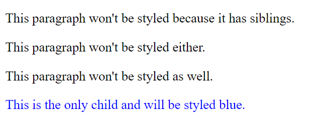

8. **:first-child**
   - Selects the first child element within its parent.

   **CSS File:**


```python
<style>
p:first-child {
    color: blue;
    background-color: yellow;
}
</style>
```

**HTML File:**


```python
<div>
    <p>First paragraph</p>
    <p>Second paragraph</p>
</div>
```

 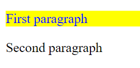

9. **:last-child**
   - Selects the last child element within its parent.

   **CSS File:**


```python
<style>
p:last-child {
    color: red;
}
</style>
```

**HTML File:**


```python
<div>
    <p>First paragraph</p>
    <p>Last paragraph</p>
</div>
```

 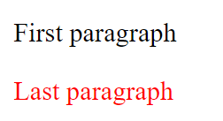

10. **:first-of-type**
    - Targets the first element of a specified type within its parent.

   **CSS File:**


```python
<style>
p:first-of-type {
    color: red;
}
</style>
```

**HTML File:**


```python
<div>
    <p>First paragraph</p>
    <span>Not a paragraph</span>
    <p>Second paragraph</p>
    <p>Third paragraph</p>
    <div>
        <p>First paragraph nested in another div</p>
        <p>Second paragraph nested in another div</p>
    </div>
</div>
<div>
    <p>First paragraph nested in ousider div</p>
    <p>Second paragraph nested in ousider div</p>
</div>
<p>First paragraph nested in body</p>
<p>Second paragraph nested in body</p>

```

 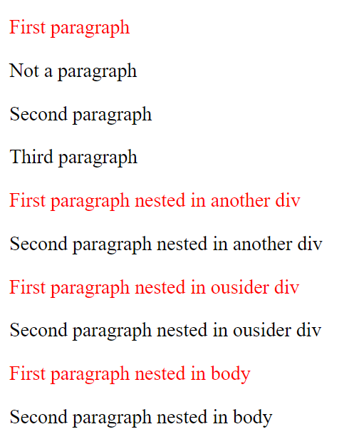

11. **:last-of-type**
    - Selects the last element of a specified type within its parent.

   **CSS File:**


```python
<style>
p:last-of-type {
    color: orange;
}
</style>
```

**HTML File:**


```python
<div>
    <p>First paragraph</p>
    <span>Not a paragraph</span>
    <p>Second paragraph</p>
    <p>Third paragraph</p>
    <div>
        <p>First paragraph nested in another div</p>
        <p>Second paragraph nested in another div</p>
    </div>
</div>
<div>
    <p>First paragraph nested in ousider div</p>
    <p>Second paragraph nested in ousider div</p>
</div>
<p>First paragraph nested in body</p>
<p>Second paragraph nested in body</p>
```

 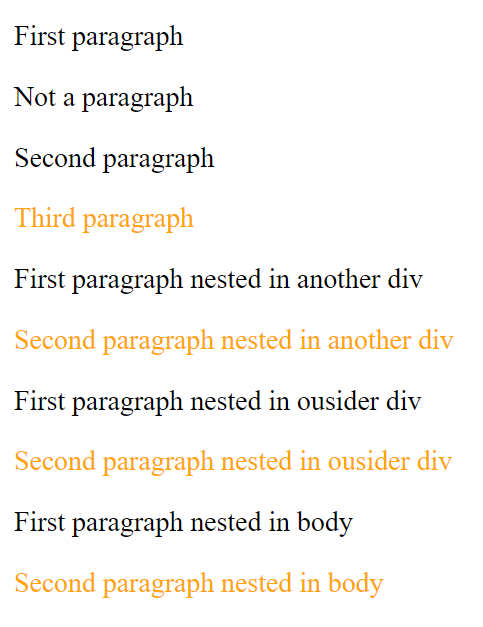

12. **:nth-child(n)**
    - Targets the nth child element within its parent.

   **CSS File:**


```python
<style>
p:nth-child(2) {
    color: red;
}
</style>
```

**HTML File:**


```python
<div>
    <span>This is not paragraph</span>
    <span>This is not paragraph</span>
    <p>First paragraph</p>
    <p>Second paragraph</p>
    <p>Third paragraph</p>
    <div>
        <p>First paragraph nested in another div</p>
        <p>Second paragraph nested in another div</p>
        <p>Third paragraph nested in another div</p> 
    </div>
    <span>
        <p>First paragraph nested in span</p>
        <p>Second paragraph nested in span</p>
        <p>Third paragraph nested in span</p> 
    </span>
</div>
<p>First paragraph nested in body</p>
<p>Second paragraph nested in body</p>
<p>Third paragraph nested in body</p>
<div>
    <p>First paragraph nested in ousider div</p>
    <p>Second paragraph nested in ousider div</p>
    <p>Third paragraph nested in ousider div</p>
</div>
```

 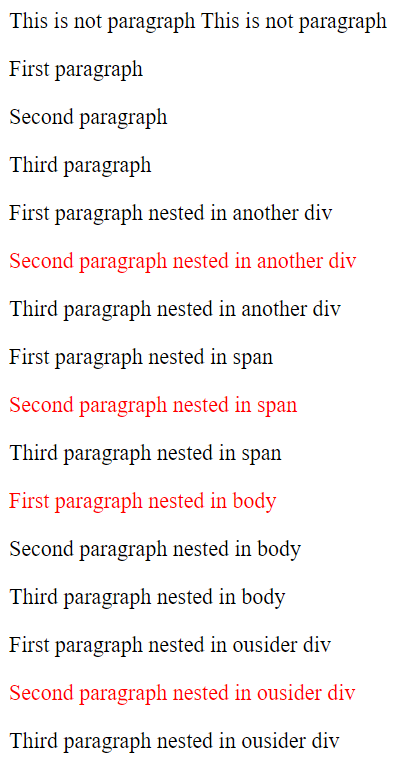

13. **:nth-of-type(n)**
    - Selects the nth child of a specified type within its parent.

   **CSS File:**


```python
<style>
p:nth-of-type(2) {
    color: red;
}
</style>
```

**HTML File:**


```python
<div>
    <span>This is not paragraph</span>
    <span>This is not paragraph</span>
    <p>First paragraph</p>
    <p>Second paragraph</p>
    <p>Third paragraph</p>
    <div>
        <p>First paragraph nested in another div</p>
        <p>Second paragraph nested in another div</p>
        <p>Third paragraph nested in another div</p> 
    </div>
    <span>
        <p>First paragraph nested in span</p>
        <p>Second paragraph nested in span</p>
        <p>Third paragraph nested in span</p> 
    </span>
</div>
<p>First paragraph nested in body</p>
<p>Second paragraph nested in body</p>
<p>Third paragraph nested in body</p>
<div>
    <p>First paragraph nested in ousider div</p>
    <p>Second paragraph nested in ousider div</p>
    <p>Third paragraph nested in ousider div</p>
</div>
```

 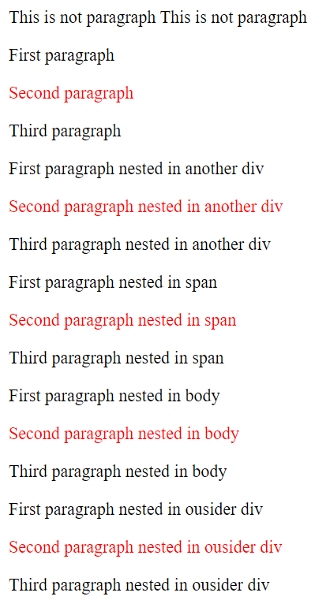

14. **:nth-last-child(n)**
    - Selects the nth child from the end of its parent.

   **CSS File:**


```python
<style>
p:nth-last-child(2) {
    color: red;
}
</style>
```

**HTML File:**


```python
<div>
    <span>This is not paragraph</span>
    <span>This is not paragraph</span>
    <p>First paragraph</p>
    <p>Second paragraph</p>
    <p>Third paragraph</p>
    <div>
        <p>First paragraph nested in another div</p>
        <p>Second paragraph nested in another div</p>
        <p>Third paragraph nested in another div</p> 
    </div>
    <span>
        <p>First paragraph nested in span</p>
        <p>Second paragraph nested in span</p>
        <p>Third paragraph nested in span</p> 
    </span>
</div>
<p>First paragraph nested in body</p>
<p>Second paragraph nested in body</p>
<p>Third paragraph nested in body</p>
<div>
    <p>First paragraph nested in ousider div</p>
    <p>Second paragraph nested in ousider div</p>
    <p>Third paragraph nested in ousider div</p>
</div>
```

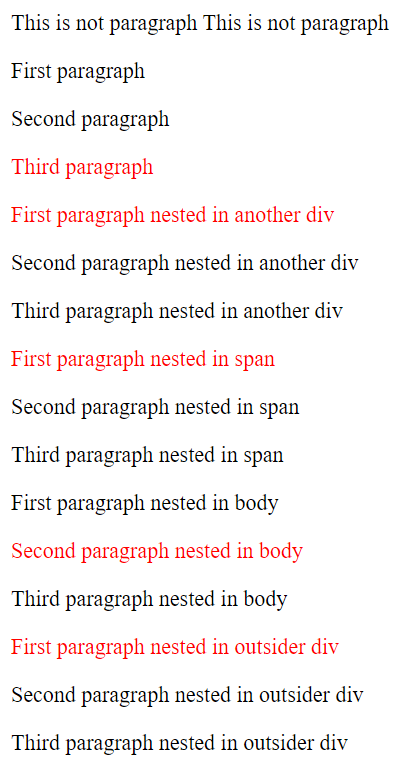

15. **:nth-last-of-type(n)**
    - Targets the nth child of a specified type from the end of its parent.

   **CSS File:**


```python
<style>
p:nth-last-of-type(3) {
    background-color: skyblue;
}
</style>
```

**HTML File:**


```python
<div>
    <span>This is not paragraph</span>
    <span>This is not paragraph</span>
    <p>First paragraph</p>
    <p>Second paragraph</p>
    <p>Third paragraph</p>
    <div>
        <p>First paragraph nested in another div</p>
        <p>Second paragraph nested in another div</p>
        <p>Third paragraph nested in another div</p> 
    </div>
    <span>
        <p>First paragraph nested in span</p>
        <p>Second paragraph nested in span</p>
        <p>Third paragraph nested in span</p> 
    </span>
</div>
<p>First paragraph nested in body</p>
<p>Second paragraph nested in body</p>
<p>Third paragraph nested in body</p>
<div>
    <p>First paragraph nested in ousider div</p>
    <p>Second paragraph nested in ousider div</p>
    <p>Third paragraph nested in ousider div</p>
</div>
```

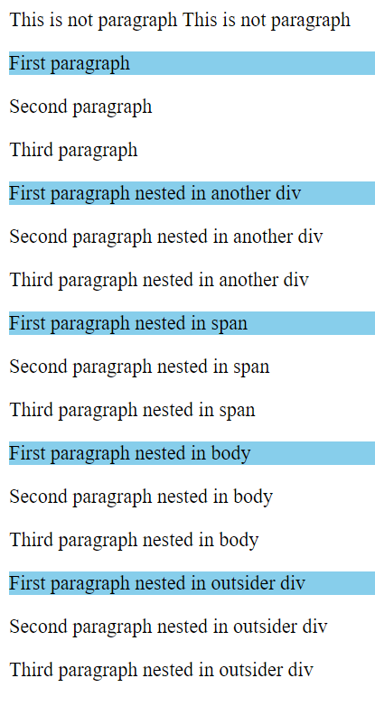

16. **:empty**
    - Selects elements that have no children (including text nodes).

   **CSS File:**


```python
<style>
    div:empty {
        border: 2px dashed red;
        height: 50px;
        width: 50px;
    }
</style>
```

**HTML File:**


```python
<div></div>
<div>Not Empty</div>
```

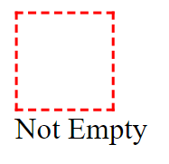

17. **:not(selector)**
    - Selects elements that do not match the specified selector.

   **CSS File:**


```python
<style>
p:not(.excluded) {
    background-color: rgb(20, 164, 248);
}
</style>
```

**HTML File:**


```python
<p class="excluded">This won't be styled.</p>
<p>This will be styled.</p>
<p>This will be styled.</p>
```

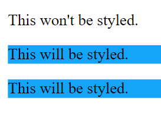

18. **:only-of-type**
   - Selects an element that is the only one of its specified type within its parent.
   - It's okay to encounter other sibling types, but they should not match the specified one.

   **CSS File:**


```python
<style>
p:only-of-type {
    background-color: rgb(220, 174, 81);
}
</style>
```

**HTML File:**


```python
<div>
    <p>This paragraph will be styled.</p>
</div>
<div>
    <p>This paragraph will be styled.</p>
    <span>This is a span, so the paragraph is the only one of its type.</span>
</div>
```

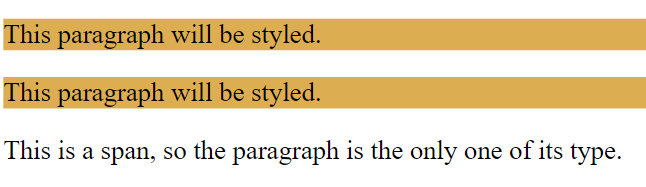

# ///////////////////////////////////////////////////////

### Pseudo-Elements in CSS

Pseudo-elements allow you to style specific parts of an element, such as the first letter, the first line of a paragraph, or content inserted before or after an element. These are especially useful for enhancing the appearance of text or adding decorative content.

#### Syntax:
```css
selector::pseudo-element {
  property: value;
}
```

1. **`::first-line`**
   - **Targets:** The first line of a block of text.
   - **Use Case:** Often used to style the first line of a paragraph differently from the rest.

   **CSS File:**


```python
<style>    
p::first-line {
    font-weight: bold;
    color: blue;
}
</style>
```

**HTML File:**


```python
<p>This is an example paragraph where only the first line is styled. <br>
    This is another line paragraph where will not be styled.
</p>
```

 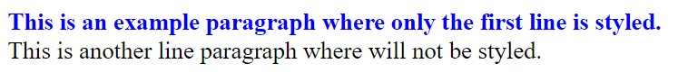

2. **`::first-letter`**
   - **Targets:** The first letter of a block of text.
   - **Use Case:** Commonly used for creating drop caps in paragraphs.

   **CSS File:**


```python
<style>    
p::first-letter {
    font-size: 2em;
    color: red;
}
</style>
```

**HTML File:**


```python
<p>This is an example where the first letter is styled larger and in red.</p>
```

 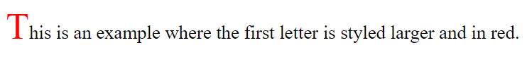

3. **`::selection`**
   - **Targets:** The part of an element that has been highlighted or selected by the user.
   - **Use Case:** Customizes the appearance of text when it is selected by the user (e.g., when the user drags their cursor to highlight text).

   **CSS File:**


```python
<style>    
::selection {
    background-color: black;
    color: yellow;
}
</style>
```

**HTML File:**


```python
<p>Select any part of this text to see the custom selection style.</p>
```

 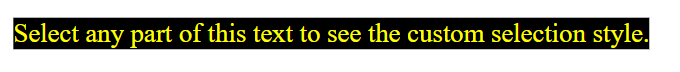

4. **`::after`**
   - **Targets:** Not an actual selection, but allows you to insert content after the last child of the selected element.
   - **Use Case:** Adds decorative elements or icons after content.

   **CSS File:**


```python
<style>    
h1::after {
    content: "after";
    margin-left: 50px;
}
</style>
```

**HTML File:**


```python
<h1>Welcome!</h1>
```

 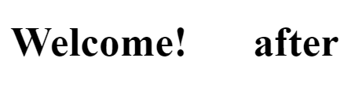

5. **`::before`**
   - **Targets:** Not an actual selection, but allows you to insert content before the first child of the selected element.
   - **Use Case:** Adds decorative elements or icons before content.

   **CSS File:**


```python
<style>    
h1::before {
    content: "before";
    margin-right: 50px;
}
</style>
```

**HTML File:**


```python
<h1>Hello!</h1>
```

 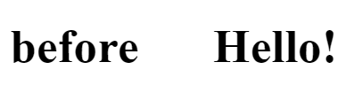

### CSS Specificity and Priority Rules

When multiple styles are applied to the same element, CSS uses a specificity hierarchy to determine which style takes precedence. The final style for an element is determined by combining unique properties and resolving conflicting properties based on their priority.

### Specificity Hierarchy (Descending Order of Priority)

1. **ID Selector**
   - **Highest priority.** Targets a specific element with an ID.
2. **Class or Attribute Selector**
   - **Intermediate priority.** Targets elements based on their class or attribute.
3. **Element Selector**
   - **Lower priority.** Targets elements by their type.
4. **Universal Selector**
   - **Lowest priority.** Targets all elements.
   
### Conflict Resolution in Styles

- **Combining Unique Properties:** Non-conflicting properties from all applicable selectors are combined.
- **Overriding Conflicting Properties:** The conflicting properties are overridden by the style with the highest specificity.

### Handling Styles of the Same Specificity

- **Last Defined Rule Wins:** If two styles have the same specificity, the style that is defined last in the CSS will be applied.


# ///////////////////////////////////////////////////////

### Valid Characters in CSS Selectors

1. **Alphanumeric Characters and Hyphens/Underscores**
   - CSS selectors and class names should primarily contain alphanumeric characters (letters and digits). Special characters like hyphens (`-`) and underscores (`_`) are also allowed.

   **CSS File:**


```python
<style>
.class-name {
/* valid */
}

.class_name {
/* valid */
}
</style>
```

2. **Class Names Cannot Start with Digits**
   - A class name or CSS selector cannot begin with a digit. If it does, it will be considered invalid.

   **CSS File:**


```python
<style>
/* Invalid */
.123name {
    /* invalid selector */
  }

  /* Valid */
  .name123 {
    /* valid selector */
  }
</style>
```

3. **Special Characters Must Be Escaped**
   - Class names and CSS selectors can include special characters such as `@`, `~`, `:`, etc. However, these characters must be escaped when used in CSS.

   **CSS File:**


```python
<style>
   /* Escaped special characters */
   .special\@char {
    /* valid selector */
  }

  .special\~char {
    /* valid selector */
  }
</style>
```

4. **Selectors Cannot Start with Special Characters**
   - CSS selectors cannot start with special characters like `@`, `#`, `&`, etc. The only exceptions are hyphens (`-`) and underscores (`_`), but even these have restrictions when combined with digits.

   **CSS File:**


```python
<style>
/* Invalid */
.@invalid {
    /* invalid selector */
}

/* Valid */
._-_valid {
    /* valid selector */
}
</style>
```

5. **Case Sensitivity in Selectors**
   - CSS class names and selectors are generally case-insensitive. This means `.TEST` and `.test` are considered the same. However, in some cases, such as in HTML/XML documents with specific settings, selectors might be case-sensitive.

   **CSS File:**


```python
<style>
    .TEST {
        color: red;
      }
   
      .test {
        color: blue;
      }
   
      /* Both .TEST and .test will be applied based on the document's case sensitivity settings. */
</style>
```

6. **No Spaces in Class Names**
   - Class names cannot contain spaces.

   **CSS File:**


```python
<style>
   /* Invalid */
   .my class {
    /* treated as two separate selectors: class tag inside .my */
  }

  /* Valid */
  .my-class {
    /* single valid class */
  }
</style>
```

   **CSS File:**


```python
<style>
    .my class {
      color: blue;
      font-size: 18px;
    }
</style>
```

**HTML File:**


```python
<div class="my">
    <class>This text will be styled.</class>
</div>
```

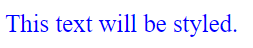

7. **Restrictions on Hyphens in Class Names**
   - A class name cannot consist of only a single hyphen (`-`). Additionally, a class name cannot start with a hyphen followed by digits.

   **CSS File:**


```python
<style>
/* Invalid */
.- {
    /* invalid selector */
  }

  .-123 {
    /* invalid selector */
  }

  /* Valid */
  ._ {
    /* valid selector */
  }
</style>
```

8. **No Leading or Trailing Special Characters**
   - CSS selectors should not begin or end with special characters.

   **CSS File:**


```python
<style>
/* Invalid */
.@classname {
/* invalid selector */
}

  /* Invalid */
.classname@ {
 /* valid if properly escaped */
}
</style>
```

# ///////////////////////////////////////////////////////

### CSS Naming and Formatting Best Practices

1. **Naming Conventions**
   - When naming a `class` or `ID`, ensure the name is descriptive of the element it represents. 
   - Avoid using capital letters or camelCase.
   - Refrain from using underscores to separate words unless following the BEM (Block Element Modifier) methodology.

   **CSS File:**


```python
<style>
/* Good */
.class-name {

}

/* Bad */
.className {

}

.ClassName {

}

.class_name {

}
</style>
```

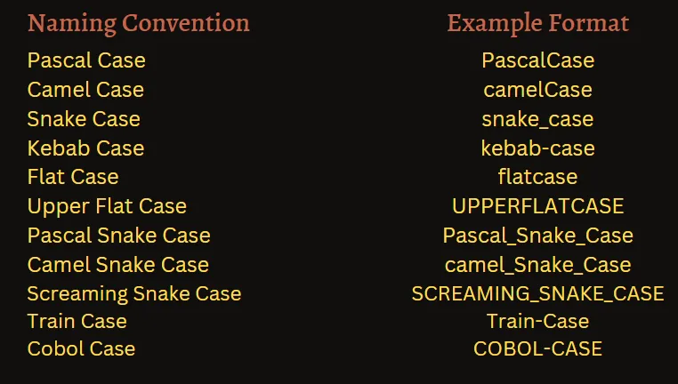

2. **Spacing Between Selectors**
   - Consistency in spacing between selectors is essential. 
   - Maintain a consistent style—either place a space between all selectors or none at all.

   - **No Spacing:**

   **CSS File:**


```python
<style>
.class-one {

}
.class-two {

}
.class-three {

}
</style>
```

   - **With Spacing:**

   **CSS File:**


```python
<style>
.class-one {

}

.class-two {

}

.class-three {

}
</style>
```

3. **Spacing After Class Names**
   - Always include a space after the class name and before the opening curly brace.
   - Avoid placing the curly brace immediately after the class name, except when minifying the code.

   **CSS File:**


```python
<style>
/* Good */
.class-one {

}

/* Bad */
.class-one{

}
</style>
```

4. **Spacing After Properties**
   - Place a space after the colon (`:`) in CSS properties for better readability.

   **CSS File:**


```python
<style>
/* Good */
.class-one {
font-weight: bold;
}

/* Bad */
.class-one {
font-weight:bold;
}
</style>
```

5. **Opening Brace Placement**
   - The opening brace should be on the same line as the selector, not on a new line.

   **CSS File:**


```python
<style>
/* Good */
.class-one {
font-weight: bold;
}

/* Bad */
.class-one
{
font-weight: bold;
}
</style>
```

6. **Grouping Related Properties**
   - Group related properties together for easier maintenance, such as font properties, position properties, etc.

   **CSS File:**


```python
<style>
/* Good */
.class-one {
    /* Font */
    font-family: Tahoma, Arial;
    font-weight: bold;
    font-size: 200px;

    /* Position */
    position: absolute;
    left: 0;
    top: 0;
    z-index: 2;

    /* Dimensions */
    width: 200px;
    height: 200px;

    /* Color */
    background-color: #333;
    color: #FFF;
  }

  /* Bad */
  .class-one {
    position: absolute;
    font-weight: bold;
    font-size: 200px;
    left: 0;
    width: 200px;
    top: 0;
    background-color: #333;
    z-index: 2;
    height: 200px;
    font-family: Tahoma, Arial;
    color: #FFF;
  }
</style>
```

7. **Grouping Selectors**
   - When grouping multiple selectors that share the same properties, place each selector on a new line.

   **CSS File:**


```python
<style>
/* Good */
.class-one .child span,
.class-two .child span,
.class-three .child span {
  font-weight: bold;
}

/* Bad */
.class-one .child span, .class-two .child span, .class-three .child span {
  font-weight: bold;
}
</style>
```

8. **Vendor Prefixes Order**
   - Maintain a consistent order when using vendor prefixes across your stylesheets.

   **CSS File:**


```python
<style>
/* Good */
.class-one {
    -webkit-transition: .3s;
       -moz-transition: .3s;
         -o-transition: .3s;
        -ms-transition: .3s;
            transition: .3s;

    -webkit-box-shadow: 0 0 100px #DDD;
       -moz-box-shadow: 0 0 100px #DDD;
         -o-box-shadow: 0 0 100px #DDD;
        -ms-box-shadow: 0 0 100px #DDD;
            box-shadow: 0 0 100px #DDD;
  }

  /* Bad */
  .class-one {
    -webkit-transition: .3s;
            transition: .3s;
         -o-transition: .3s;
        -ms-transition: .3s;
       -moz-transition: .3s;

            box-shadow: 0 0 100px #DDD;
       -moz-box-shadow: 0 0 100px #DDD;
         -o-box-shadow: 0 0 100px #DDD;
    -webkit-box-shadow: 0 0 100px #DDD;
        -ms-box-shadow: 0 0 100px #DDD;
  }
</style>
```

# ///////////////////////////////////////////////////////

### Background Properties in CSS

In CSS, the `background` property allows you to control the background color, image, and other related aspects of an HTML element. Below are detailed examples and explanations of various background properties, including different ways to define background colors and manage background images.

#### 1. **Background Color**
   The `background-color` property sets the background color of an element. You can define the color using various formats, such as color names, RGB values, hexadecimal codes, and HSL values.
   - **Color Name**: You can use predefined color names in CSS, such as `red`, `blue`, `green`, etc.

   **CSS File:**


```python
<style>
    div {
        background-color: red; /* Color Name */
      }
</style>
```

**HTML File:**


```python
<div>
    <p>
        This div has a red background color.
    </p>
</div>
```

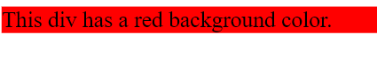

   - **RGB with Alpha (RGBA)**: You can define the background color using RGB values along with an alpha channel to control transparency.

   **CSS File:**


```python
<style>
    div {
        background-color: rgb(0, 0, 0); /* Black */
        background-color: rgba(0, 0, 0, 0.5); /* Black with 50% transparency */
      }
</style>
```

**HTML File:**


```python
<div>
    <p>
    This div has a black background color with 50% transparency.
    </p>
</div>
```

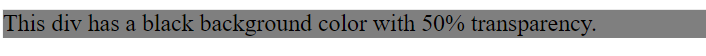

   - **Hexadecimal Code**: A common way to define colors in CSS is by using hexadecimal values.

   **CSS File:**


```python
<style>
    div {
        background-color: #FF0000; /* Red in Hex Code */
      }
</style>
```

**HTML File:**


```python
<div>
    <p>
    This div has a red background color using a hex code.
    </p>
</div>
```

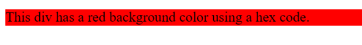

 - **HSL with Alpha (HSLA)**: Another way to define colors is using HSL (Hue, Saturation, Lightness) with optional alpha for transparency.

   **CSS File:**


```python
<style>
    div {
        background-color: hsla(0, 100%, 50%, 0.7); /* Red with 70% opacity */
      }
</style>
```

**HTML File:**


```python
<div>
    <p>
    This div has a red background color with 70% opacity using HSL.
    </p>
</div>
```

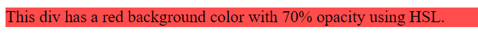

#### 2. **Background Image**
   The `background-image` property allows you to set an image as the background of an element. 

   - **Basic Usage**: Set a background image by specifying the URL of the image.


   **CSS File:**


```python
<style>
  div {
      background-image: url("../CSS_Cours_medias/CSS_Cours_images/45.png");
      color: white;
    }
</style>
```

**HTML File:**


```python
<div>
    <p>
    This div has a background image.
    </p>
    <p>
    This div has a background image.
    </p>
    <p>
    This div has a background image.
    </p>
    <p>
    This div has a background image.
    </p>
    <p>
    This div has a background image.
    </p>
    <p>
    This div has a background image.
    </p>
    <p>
    This div has a background image.
    </p>
    <p>
    This div has a background image.
    </p>
    <p>
    This div has a background image.
    </p>
    <p>
    This div has a background image.
    </p>
    <p>
    This div has a background image.
    </p>
</div>
```

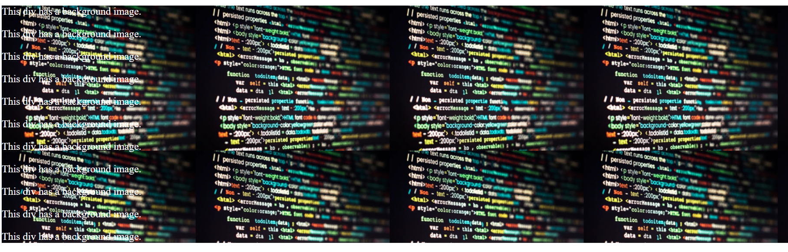

#### 3. **Background Repeat**
   The `background-repeat` property controls how the background image is repeated within the element.

   - **No Repeat**: The image will not be repeated, and it will only appear once.

   **CSS File:**


```python
<style>
    div {
      background-image: url("../CSS_Cours_medias/CSS_Cours_images/45.png");
        background-repeat: no-repeat;
        color: white;
        background-color: skyblue;
      }
      
</style>
```

**HTML File:**


```python
<div>
    <p>
      No repeat for the background image.
    </p>
    <p>
      No repeat for the background image.
    </p>
    <p>
      No repeat for the background image.
    </p>
    <p>
      No repeat for the background image.
    </p>
    <p>
      No repeat for the background image.
    </p>
    <p>
      No repeat for the background image.
    </p>
    <p>
      No repeat for the background image.
    </p>
    <p>
      No repeat for the background image.
    </p>
    <p>
      No repeat for the background image.
    </p>
    <p>
      No repeat for the background image.
    </p>
    <p>
      No repeat for the background image.
    </p>
</div>
```

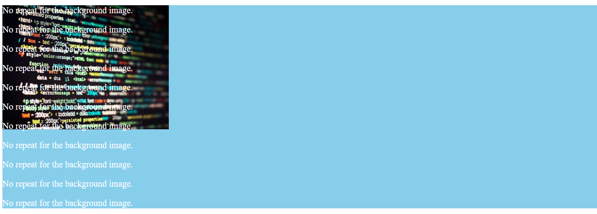

   - **Repeat Horizontally or Vertically**: You can choose to repeat the background image only along the horizontal or vertical axis.

   **CSS File:**


```python
<style>
    div {
      background-image: url("../CSS_Cours_medias/CSS_Cours_images/45.png");
      background-repeat: repeat-x; /* Repeat horizontally */
        color: white;
        background-color: skyblue;
      }   
</style>
```

**HTML File:**


```python
<div>
    <p>
    Horizontal repeat for the background image.
    </p>
    <p>
    Horizontal repeat for the background image.
    </p>
    <p>
    Horizontal repeat for the background image.
    </p>
    <p>
    Horizontal repeat for the background image.
    </p>
    <p>
    Horizontal repeat for the background image.
    </p>
    <p>
    Horizontal repeat for the background image.
    </p>
    <p>
    Horizontal repeat for the background image.
    </p>
    <p>
    Horizontal repeat for the background image.
    </p>
    <p>
    Horizontal repeat for the background image.
    </p>
    <p>
    Horizontal repeat for the background image.
    </p>
    <p>
    Horizontal repeat for the background image.
    </p>
    <p>
    Horizontal repeat for the background image.
    </p>
</div>
```

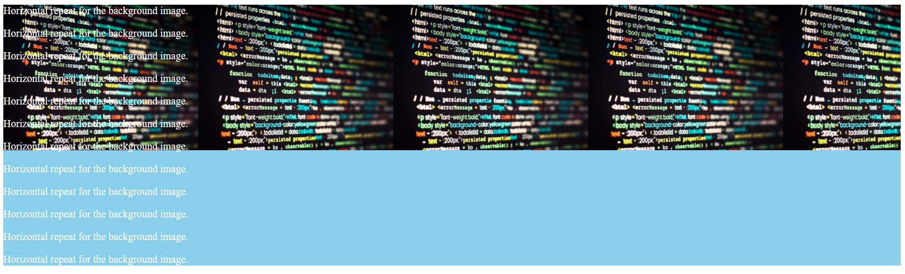

   **CSS File:**


```python
<style>
  div {
    background-image: url("../CSS_Cours_medias/CSS_Cours_images/45.png");
    background-repeat: repeat-y; /* Repeat vertically */
    color: white;
    background-color: skyblue;
    }   
</style>
```

**HTML File:**


```python
<div>
    <p>
    Vertical repeat for the background image.
    </p>
    <p>
    Vertical repeat for the background image.
    </p>
    <p>
    Vertical repeat for the background image.
    </p>
    <p>
    Vertical repeat for the background image.
    </p>
    <p>
    Vertical repeat for the background image.
    </p>
    <p>
    Vertical repeat for the background image.
    </p>
    <p>
    Vertical repeat for the background image.
    </p>
    <p>
    Vertical repeat for the background image.
    </p>
    <p>
    Vertical repeat for the background image.
    </p>
    <p>
    Vertical repeat for the background image.
    </p>
    <p>
    Vertical repeat for the background image.
    </p>
    <p>
    Vertical repeat for the background image.
    </p>
</div>
```


   - **Repeat Both Directions**: This is the default behavior where the image repeats both horizontally and vertically.

   **CSS File:**


```python
<style>
    div {
      background-image: url("../CSS_Cours_medias/CSS_Cours_images/45.png");
      background-repeat: repeat; /* Repeat both horizontally and vertically */
      color: white;
      }
</style>
```

**HTML File:**


```python
<div>
    <p>
      The background image repeats both horizontally and vertically.
    </p>
    <p>
      The background image repeats both horizontally and vertically.
    </p>
    <p>
      The background image repeats both horizontally and vertically.
    </p>
    <p>
      The background image repeats both horizontally and vertically.
    </p>
    <p>
      The background image repeats both horizontally and vertically.
    </p>
    <p>
      The background image repeats both horizontally and vertically.
    </p>
    <p>
      The background image repeats both horizontally and vertically.
    </p>
    <p>
      The background image repeats both horizontally and vertically.
    </p>
    <p>
      The background image repeats both horizontally and vertically.
    </p>
</div>
```


#### 4. **Background Position**
   The `background-position` property defines the starting position of the background image within the element.

   - **Top-Left Corner**: This is the default position.

   **CSS File:**


```python
<style>
  div {
    background-image: url("../CSS_Cours_medias/CSS_Cours_images/45.png");
    background-position: top left; 
    background-repeat: no-repeat;
    background-color: brown;
    color: white;
    }
</style>
```

**HTML File:**


```python
<div>
    <p>
    Background image positioned at the top-left corner.
    </p>
    <p>
    Background image positioned at the top-left corner.
    </p>
    <p>
    Background image positioned at the top-left corner.
    </p>
    <p>
    Background image positioned at the top-left corner.
    </p>
    <p>
    Background image positioned at the top-left corner.
    </p>
    <p>
    Background image positioned at the top-left corner.
    </p>
    <p>
    Background image positioned at the top-left corner.
    </p>
    <p>
    Background image positioned at the top-left corner.
    </p>
    <p>
    Background image positioned at the top-left corner.
    </p>
    <p>
    Background image positioned at the top-left corner.
    </p>
    <p>
    Background image positioned at the top-left corner.
    </p>
    <p>
    Background image positioned at the top-left corner.
    </p>
    <p>
    Background image positioned at the top-left corner.
    </p>
    <p>
    Background image positioned at the top-left corner.
    </p>
    <p>
    Background image positioned at the top-left corner.
    </p>
    <p>
    Background image positioned at the top-left corner.
    </p>
    <p>
    Background image positioned at the top-left corner.
    </p>
</div>   
```


In addition to `top left`, here are the eight different background positions:

- **Top center**: (or simply `top`)`background-position: top center;`
- **Top right**: `background-position: top right;`
- **Center left**: (or simply `left`)`background-position: center left;`
- **Center center** (or simply `center`): `background-position: center center;`
- **Center right**: (or simply `right`)`background-position: center right;`
- **Bottom left**: `background-position: bottom left;`
- **Bottom center**: (or simply `bottom`)`background-position: bottom center;`
- **Bottom right**: `background-position: bottom right;`

   - **Custom Position**: You can specify custom positions using length values, percentages.

   **CSS File:**


```python
<style>
    div {
        background-image: url("../CSS_Cours_medias/CSS_Cours_images/45.png");
        background-position: 50% 50%; /* Centered */
        background-position: 100px 200px; /* 100px from the left, 200px from the top */
        background-repeat: no-repeat;
        background-color: brown;
        color: white;
      }
</style>
```

**HTML File:**


```python
<div>
    <p>
    Background image positioned 100px from the left and 200px from the top.
    </p> 
    <p>
    Background image positioned 100px from the left and 200px from the top.
    </p> 
    <p>
    Background image positioned 100px from the left and 200px from the top.
    </p> 
    <p>
    Background image positioned 100px from the left and 200px from the top.
    </p> 
    <p>
    Background image positioned 100px from the left and 200px from the top.
    </p> 
    <p>
    Background image positioned 100px from the left and 200px from the top.
    </p> 
    <p>
    Background image positioned 100px from the left and 200px from the top.
    </p> 
    <p>
    Background image positioned 100px from the left and 200px from the top.
    </p> 
    <p>
    Background image positioned 100px from the left and 200px from the top.
    </p> 
    <p>
    Background image positioned 100px from the left and 200px from the top.
    </p> 
    <p>
    Background image positioned 100px from the left and 200px from the top.
    </p> 
    <p>
    Background image positioned 100px from the left and 200px from the top.
    </p> 
    <p>
    Background image positioned 100px from the left and 200px from the top.
    </p> 
    <p>
    Background image positioned 100px from the left and 200px from the top.
    </p> 
    <p>
    Background image positioned 100px from the left and 200px from the top.
    </p> 
    <p>
    Background image positioned 100px from the left and 200px from the top.
    </p> 
</div>
```


#### 5. **Background Size**
   The `background-size` property specifies the size of the background image.
   
- **Cover**: Scales the image to cover the entire element, ensuring the image fills the space completely, even if parts of it are cropped.

   **CSS File:**


```python
<style>
    div {
      background-image: url("../CSS_Cours_medias/CSS_Cours_images/45.png");
        background-size: cover;
        background-repeat: no-repeat;
        background-color: brown;
        color: white;
      }
</style>
```

**HTML File:**


```python
<div>
    <p>
    Background image scaled to cover the entire div.
    </p>
    <p>
    Background image scaled to cover the entire div.
    </p>
    <p>
    Background image scaled to cover the entire div.
    </p>
    <p>
    Background image scaled to cover the entire div.
    </p>
    <p>
    Background image scaled to cover the entire div.
    </p>
    <p>
    Background image scaled to cover the entire div.
    </p>
    <p>
    Background image scaled to cover the entire div.
    </p>
    <p>
    Background image scaled to cover the entire div.
    </p>
    <p>
    Background image scaled to cover the entire div.
    </p>
    <p>
    Background image scaled to cover the entire div.
    </p>
    <p>
    Background image scaled to cover the entire div.
    </p>
    <p>
    Background image scaled to cover the entire div.
    </p>
    <p>
    Background image scaled to cover the entire div.
    </p>
    <p>
    Background image scaled to cover the entire div.
    </p>
    <p>
    Background image scaled to cover the entire div.
    </p>
    <p>
    Background image scaled to cover the entire div.
    </p>
    <p>
    Background image scaled to cover the entire div.
    </p>
</div>
```

 <video src="../CSS_Cours_medias/CSS_Cours_videos/1.mp4" controls width="600"></video>

   - **Contain**: Scales the image to be contained within the element without being cut off.

   **CSS File:**


```python
<style>
    div {
      background-image: url("../CSS_Cours_medias/CSS_Cours_images/45.png");
        background-size: contain;
        background-repeat: no-repeat;
        background-color: brown;
        color: white;
      }
</style>
```

**HTML File:**


```python
<div>
    <p>
    Background image scaled to fit within the div.
    </p>
    <p>
    Background image scaled to fit within the div.
    </p>
    <p>
    Background image scaled to fit within the div.
    </p>
    <p>
    Background image scaled to fit within the div.
    </p>
    <p>
    Background image scaled to fit within the div.
    </p>
    <p>
    Background image scaled to fit within the div.
    </p>
    <p>
    Background image scaled to fit within the div.
    </p>
    <p>
    Background image scaled to fit within the div.
    </p>
    <p>
    Background image scaled to fit within the div.
    </p>
    <p>
    Background image scaled to fit within the div.
    </p>
    <p>
    Background image scaled to fit within the div.
    </p>
    <p>
    Background image scaled to fit within the div.
    </p>
</div>
```

<video src="../CSS_Cours_medias/CSS_Cours_videos/2.mp4" controls width="600"></video>

   - **Custom Size**: You can define specific dimensions for the background image.

   **CSS File:**


```python
<style>
    div {
      background-image: url("../CSS_Cours_medias/CSS_Cours_images/45.png");
        background-size: 100% 100%; /* 100% width and 100% height */
        background-size: 100px 200px; /* 100px width and 200px height */
        background-repeat: no-repeat;
        background-color: brown;
        color: white;
      }
</style>
```

**HTML File:**


```python
<div>
    <p>
    Background image with custom size (100px width, 200px height).
    </p>
    <p>
    Background image with custom size (100px width, 200px height).
    </p>
    <p>
    Background image with custom size (100px width, 200px height).
    </p>
    <p>
    Background image with custom size (100px width, 200px height).
    </p>
    <p>
    Background image with custom size (100px width, 200px height).
    </p>
    <p>
    Background image with custom size (100px width, 200px height).
    </p>
    <p>
    Background image with custom size (100px width, 200px height).
    </p>
    <p>
    Background image with custom size (100px width, 200px height).
    </p>
    <p>
    Background image with custom size (100px width, 200px height).
    </p>
    <p>
    Background image with custom size (100px width, 200px height).
    </p>
    <p>
    Background image with custom size (100px width, 200px height).
    </p>
    <p>
    Background image with custom size (100px width, 200px height).
    </p>
    <p>
    Background image with custom size (100px width, 200px height).
    </p>
    <p>
    Background image with custom size (100px width, 200px height).
    </p>
    <p>
    Background image with custom size (100px width, 200px height).
    </p>
    <p>
    Background image with custom size (100px width, 200px height).
    </p>
    <p>
    Background image with custom size (100px width, 200px height).
    </p> 
</div>
```


#### 6. **Background Attachment**
   The `background-attachment` property controls whether the background image scrolls with the page or remains fixed.

   - **Scroll**: The background image scrolls with the page content (default behavior).

   **CSS File:**


```python
<style>
    div {
      background-image: url("../CSS_Cours_medias/CSS_Cours_images/45.png");
        background-attachment: scroll;
        background-repeat: no-repeat;
        background-color: brown;
        color: white;
      }
</style>
```

**HTML File:**


```python
<div>
    <p>
    Background image scrolls with the page.
    </p>
    <p>
    Background image scrolls with the page.
    </p>
    <p>
    Background image scrolls with the page.
    </p>
    <p>
    Background image scrolls with the page.
    </p>
    <p>
    Background image scrolls with the page.
    </p>
    <p>
    Background image scrolls with the page.
    </p>
    <p>
    Background image scrolls with the page.
    </p>
    <p>
    Background image scrolls with the page.
    </p>
    <p>
    Background image scrolls with the page.
    </p>
    <p>
    Background image scrolls with the page.
    </p>
    <p>
    Background image scrolls with the page.
    </p>
    <p>
    Background image scrolls with the page.
    </p>
    <p>
    Background image scrolls with the page.
    </p>
    <p>
    Background image scrolls with the page.
    </p>
    <p>
    Background image scrolls with the page.
    </p>
    <p>
    Background image scrolls with the page.
    </p>
    <p>
    Background image scrolls with the page.
    </p>
    <p>
    Background image scrolls with the page.
    </p>
    <p>
    Background image scrolls with the page.
    </p>
    <p>
    Background image scrolls with the page.
    </p>
    <p>
    Background image scrolls with the page.
    </p>
    <p>
    Background image scrolls with the page.
    </p>
    <p>
    Background image scrolls with the page.
    </p>
    <p>
    Background image scrolls with the page.
    </p>
    <p>
    Background image scrolls with the page.
    </p>
    <p>
    Background image scrolls with the page.
    </p>
    <p>
    Background image scrolls with the page.
    </p>
    <p>
    Background image scrolls with the page.
    </p>
    <p>
    Background image scrolls with the page.
    </p>
    <p>
    Background image scrolls with the page.
    </p>
    <p>
    Background image scrolls with the page.
    </p>
    <p>
    Background image scrolls with the page.
    </p>
    <p>
    Background image scrolls with the page.
    </p>
    <p>
    Background image scrolls with the page.
    </p>
    <p>
    Background image scrolls with the page.
    </p>
    <p>
    Background image scrolls with the page.
    </p>
</div>
```

<video src="../CSS_Cours_medias/CSS_Cours_videos/3.mp4" controls width="600"></video>

  - **Fixed**: The background image remains fixed in place even when the page is scrolled.

   **CSS File:**


```python
<style>
    div {
      background-image: url("../CSS_Cours_medias/CSS_Cours_images/45.png");
        background-attachment: fixed;
        background-repeat: no-repeat;
        background-color: brown;
        color: white;
      }
</style>
```

**HTML File:**


```python
<div>
    <p>
    Background image remains fixed when scrolling.
    </p>
    <p>
    Background image remains fixed when scrolling.
    </p>
    <p>
    Background image remains fixed when scrolling.
    </p>
    <p>
    Background image remains fixed when scrolling.
    </p>
    <p>
    Background image remains fixed when scrolling.
    </p>
    <p>
    Background image remains fixed when scrolling.
    </p>
    <p>
    Background image remains fixed when scrolling.
    </p>
    <p>
    Background image remains fixed when scrolling.
    </p>
    <p>
    Background image remains fixed when scrolling.
    </p>
    <p>
    Background image remains fixed when scrolling.
    </p>
    <p>
    Background image remains fixed when scrolling.
    </p>
    <p>
    Background image remains fixed when scrolling.
    </p>
    <p>
    Background image remains fixed when scrolling.
    </p>
    <p>
    Background image remains fixed when scrolling.
    </p>
    <p>
    Background image remains fixed when scrolling.
    </p>
    <p>
    Background image remains fixed when scrolling.
    </p>
    <p>
    Background image remains fixed when scrolling.
    </p>
    <p>
    Background image remains fixed when scrolling.
    </p>
    <p>
    Background image remains fixed when scrolling.
    </p>
    <p>
    Background image remains fixed when scrolling.
    </p>
    <p>
    Background image remains fixed when scrolling.
    </p>
    <p>
    Background image remains fixed when scrolling.
    </p>
    <p>
    Background image remains fixed when scrolling.
    </p>
    <p>
    Background image remains fixed when scrolling.
    </p>
    <p>
    Background image remains fixed when scrolling.
    </p>
    <p>
    Background image remains fixed when scrolling.
    </p>
    <p>
    Background image remains fixed when scrolling.
    </p>
    <p>
    Background image remains fixed when scrolling.
    </p>
    <p>
    Background image remains fixed when scrolling.
    </p>
    <p>
    Background image remains fixed when scrolling.
    </p>
    <p>
    Background image remains fixed when scrolling.
    </p>
    <p>
    Background image remains fixed when scrolling.
    </p>
    <p>
    Background image remains fixed when scrolling.
    </p>
</div>
```

<video src="../CSS_Cours_medias/CSS_Cours_videos/4.mp4" controls width="600"></video>

   - **Local**: The background image scrolls with the content inside the element. The same as Scroll

   **CSS File:**


```python
<style>
    div {
      background-image: url("../CSS_Cours_medias/CSS_Cours_images/45.png");
        background-attachment: local;
        background-repeat: no-repeat;
        background-color: brown;
        color: white;
      }
</style>
```

### Background shorthand

**background:**
   - background-image 
   - background-position-x
   - background-position-y
   - background-size
   - background-repeat
   - background-attachment
   - background-origin
   - background-clip


# ///////////////////////////////////////////////////////

### Padding in CSS

**Padding** is the space between the content of an element and its border. It creates an inner margin, pushing the content away from the border, thereby giving it some breathing room.

### Syntax

```css
padding: <top> <right> <bottom> <left>;
```

You can specify padding in various ways:

1. **All Sides Equally**: 

   **CSS File:**


```python
<style>
   div {
   padding: 20px;
   background-color: #DDD;
   }
</style>
```

**HTML File:**


```python
<div>
    <h2>H2 Title</h2>
    <p>This Is Paragraph</p>
</div>
```


   This sets a padding of 20px on all four sides (top, right, bottom, left).

2. **Vertical | Horizontal**:  

   **CSS File:**


```python
<style>
    div {
        padding: 20px 10px;
        background-color: #DDD;
    }
 </style>
```

**HTML File:**


```python
<div>
    <h2>H2 Title</h2>
    <p>This Is Paragraph</p>
</div>
```


   This sets a padding of 20px on the top and bottom, and 10px on the left and right.

3. **Top | Horizontal | Bottom**:  

   **CSS File:**


```python
<style>
    div {
        padding: 20px 10px 15px;
        background-color: #DDD;
    }
 </style>
```

**HTML File:**


```python
<div>
    <h2>H2 Title</h2>
    <p>This Is Paragraph</p>
</div>
```


   This sets a padding of 20px on the top, 10px on the left and right, and 15px on the bottom.


4. **Top | Right | Bottom | Left**:  

   **CSS File:**


```python
<style>
    div {
        padding: 20px 10px 15px 5px;
        background-color: #DDD;
    }
 </style>
```

**HTML File:**


```python
<div>
    <h2>H2 Title</h2>
    <p>This Is Paragraph</p>
</div>
```


   This sets a padding of 20px on the top, 10px on the right, 15px on the bottom, and 5px on the left.

### Shorthand vs. Longhand

- **Shorthand**:
  ```css
  padding: 20px 10px 15px 5px;
  ```
- **Longhand**:
  ```css
  padding-top: 20px;
  padding-right: 10px;
  padding-bottom: 15px;
  padding-left: 5px;
  ```

### Padding with Different Units

Padding can be set using various units, such as:

- **Pixels (px)**: `padding: 10px;`
- **Percentages (%)**: `padding: 5%;` (relative to the width of the containing element)
- **Em units (em)**: `padding: 1em;` (relative to the font size of the element)
- **Rem units (rem)**: `padding: 1rem;` (relative to the font size of the root element)

### Padding and Box Model

Padding is part of the **CSS box model**. It affects the size of the element by adding space inside the element’s border. For example, if an element has a width of 200px and padding of 20px, the total width including padding will be 240px (200px width + 20px left padding + 20px right padding).

### Negative Padding

Negative values are **not allowed** for padding. Padding must always be a non-negative value.

# ///////////////////////////////////////////////////////

### Margin in CSS

**Margin** is the space outside an element's border, creating space between the element and its surrounding elements. It is an essential part of the **CSS box model** and helps control the layout by defining how much space should be around elements.

### Syntax

```css
margin: <top> <right> <bottom> <left>;
```

You can specify margins in several ways: the same as padding

#### Margin with Different Units
the same as padding

### Margin and Box Model

Margin is part of the **CSS box model** but unlike padding, margin is **outside** the border of the element. Margins create space between elements and can collapse under certain conditions (called **margin collapsing**).

### Margin Collapsing

Margin collapsing occurs when vertical margins of adjacent elements (top and bottom) combine into a single margin that equals the largest of the two. This happens in several situations, including:

- Between a block element and its first/last child element.
- Between adjacent block elements.


   **CSS File:**


```python
<style>
    div {
        width: 200px;
        margin: 20px 10px 15px 5px;
        border: 2px solid #000;
        background-color: #f0f0f0;
      }
</style>
```

**HTML File:**


```python
<div>
    <h2>H2 Title</h2>
    <p>This Is Paragraph</p>
</div>
<div>
    <h2>H2 Title</h2>
    <p>This Is Paragraph</p>
</div>
```


In this example:

- The content area is 200px wide.
- The margin adds space outside the element: 20px on top, 10px on the right, 15px on the bottom, and 5px on the left.

### Shorthand vs. Longhand

- **Shorthand**:
  ```css
  margin: 20px 10px 15px 5px;
  ```
- **Longhand**:
  ```css
  margin-top: 20px;
  margin-right: 10px;
  margin-bottom: 15px;
  margin-left: 5px;
  ```

Shorthand is more concise, but longhand provides more control when you need to set different margins on each side.

### Negative Margins

Unlike padding, margins can have **negative values**. Negative margins pull the element closer to its neighboring elements, potentially overlapping them.


   **CSS File:**


```python
<style>
    div {
        margin-top: -10px;
        margin-right: -5px;
        margin-bottom: -15px;
        margin-left: -20px;
        width: 200px;
        border: 2px solid #000;
        background-color: #f0f0f0;
      }
</style>
```

**HTML File:**


```python
<div>
    <h2>H2 Title</h2>
    <p>This Is Paragraph</p>
</div>
```


### margin: auto

Using `margin: auto` is commonly used to center block elements horizontally within a container.

   **CSS File:**


```python
<style>
  div {
    width: 600px;
    height: 500px;
    background-color: rgb(119, 14, 217);
  }
  .div {
      width: 200px;
      height: 100px;
      color: white;
      background-color: #8d0303;
      margin: auto;
    }
</style>

```

**HTML File:**


```python
<div>
    <div class="div">
      <h2>H2 Title</h2>
      <p>This Is Paragraph</p>
    </div>
</div>
```


### **DIV Child**


### **DIV Parent**


In this case, the element will be horizontally centered within its containing element because the left and right margins are automatically adjusted as it has the to total width of the parent element while this is not applied for height.

### Zeroing Out Margins

You can remove margins entirely by setting them to `0`:

```css
margin: 0;
```

This is often used as a reset or normalization step in CSS to ensure consistency across browsers.


# ///////////////////////////////////////////////////////

### Border in CSS

The **border** property in CSS is used to define the space between an element's padding and its surrounding margin. It creates a visual boundary around an element and can be customized in terms of width, style, and color. The border is part of the **CSS box model**, along with padding, margin, and content.

### Syntax

The `border` shorthand property allows you to set the width, style, and color of an element's border in a single declaration:

```css
border: <border-width> <border-style> <border-color>;
```

### Components of the Border

1. **`border-width`**: Specifies the thickness of the border.
   - **Values**: 
     - Can be specified in units like `px`, `em`, or `rem`.
     - Keywords: `thin`, `medium`, `thick`.
   - Example: `border-width: 2px;`

2. **`border-style`**: Specifies the style of the border.
   - **Values**:
     - `none`: No border (default).
     - `solid`: A solid line.
     - `dashed`: A dashed line.
     - `dotted`: A dotted line.
     - `double`: Two solid lines.
     - `groove`: A 3D grooved border.
     - `ridge`: A 3D ridged border.
     - `inset`: A 3D inset border.
     - `outset`: A 3D outset border.
   - Example: `border-style: solid;`

3. **`border-color`**: Specifies the color of the border.
   - **Values**:
     - Color names (e.g., `red`, `blue`).
     - Hex codes (e.g., `#ff0000`).
     - RGB/RGBA values (e.g., `rgb(255, 0, 0)`).
     - HSL/HSLA values (e.g., `hsl(0, 100%, 50%)`).
   - Example: `border-color: #ff0000;`


### Individual Side Borders

You can also set borders for individual sides of an element:

- **`border-top`**: `border-top: 2px solid red;`
- **`border-right`**: `border-right: 2px solid green;`
- **`border-bottom`**: `border-bottom: 2px solid blue;`
- **`border-left`**: `border-left: 2px solid yellow;`


### Border Radius

The `border-radius` property allows you to create rounded corners for an element's border. You can specify a single value for all corners or individual values for each corner:

- **All Corners**: `border-radius: 10px;`
- **Individual Corners**: 
  - `border-top-left-radius: 10px;`
  - `border-top-right-radius: 20px;`
  - `border-bottom-right-radius: 30px;`
  - `border-bottom-left-radius: 40px;`

You can also specify two values to define an elliptical border-radius:

```css
border-radius: 10px 20px; /* Horizontal and vertical radius */
```

### Border Color

You can set different colors for each side of the border:

```css
border-top-color: red;
border-right-color: green;
border-bottom-color: blue;
border-left-color: yellow;
```
the same thing for width and style

### Border and Box Model

The border is part of the CSS box model and affects the total size of an element. For example, if an element has a width of 200px and a border of 10px, the total width will be 220px (200px + 10px left border + 10px right border).

### Shorthand vs. Longhand

- **Shorthand**:
  ```css
  border: 2px solid red;
  border: 2px 5px 10px 5px solid red; /* this shorthand is invalid*/

  ```
- **Longhand**:
  ```css
  border-width: 2px;
  border-style: solid;
  border-color: red;
  ```

The shorthand is more concise, but longhand allows for more detailed control when you need to define specific properties for each side of the border.

### No Border

If you want an element to have no border at all, you can set the border to `none`:

```css
border: none;
```

This will remove the border from all sides of the element.

   **CSS File:**


```python
<style>
    div {
        width: 200px;
        height: 200px;
        border-width: 2px 3px 4px 5px;
        border-style: solid dotted dashed double;
        border-color: red blue green yellow;
        border-radius: 10px 20px 30px;
    }
</style>
```

**HTML File:**


```python
<div></div>
```


# ///////////////////////////////////////////////////////

### Outline in CSS

The **outline** property in CSS is used to draw a line outside the border edge of an element. It is similar to the border property but differs in several key ways:

- **Does not affect layout**: Unlike borders, outlines do not take up space or affect the element's box model. They are drawn outside the element's border and do not change the size or position of the element.
- **Not part of the box model**: Since outlines do not affect the box model, they do not contribute to the element's width, height, or any box model calculations.

### Syntax

The `outline` shorthand property allows you to set the width, style, and color of an outline in a single declaration:

```css
outline: <outline-width> <outline-style> <outline-color>;
```


### Components of the Outline
the same as the borded

### Outline Offset

The `outline-offset` property allows you to add space between the outline and the element's border:

```css
outline-offset: <length>;
```

   **CSS File:**


```python
<style>
    .example {
        margin: 50px;
        width: 200px;
        height: 100px;
        padding: 20px;
        border: 2px solid black;
        outline: 3px dashed red;
        outline-offset: 5px;
        background-color: #f0f0f0;
      }
</style>
```

**HTML File:**


```python
<div class="example">
    Content
</div>
```


### Differences Between Border and Outline

- **Impact on Layout**: Borders affect the size of the element and are part of the box model, while outlines do not.
- **Shape**: Borders follow the shape of the element (including `border-radius`), while outlines can appear around the entire shape, including the rounded corners or even different shapes if the `outline-offset` is used.

# ///////////////////////////////////////////////////////

### Display Types in CSS

CSS provides different ways to control how elements are displayed on a webpage. The main types are **block**, **inline**, and **inline-block**. 

#### 1. **Block-Level Elements**
- Each `<div>` element takes the full available width of its parent container.
- There’s a line break before and after each `<div>`, stacking them vertically.
- The `padding`, `margin`, `width`, and `height` are all respected.

   **CSS File:**


```python
<style>
    .block {
        background-color: lightblue;
        padding: 10px;
        margin-bottom: 10px;
        width: 30%; 
        height: 50px;
    }    
</style>
```

**HTML File:**


```python
<div class="block">Div => Block</div>
<div class="block">Div => Block</div>
<div class="block">Div => Block</div>
```


#### 2. **Inline Elements**
- Each `<span>` element only takes up as much width as its content requires.
- The elements are placed side by side without line breaks.
- `Width` and `height` properties are ignored, but horizontal `padding` and `margin` are respected.

   **CSS File:**


```python
<style>
    .inline {
        background-color: lightgreen;
        padding: 20px; 
        margin:  50px; 
        width: 100px; 
        height: 50px;
    }
    .block {
      background-color: lightblue;
      width: 30%; 
    }      
</style>
```

**HTML File:**


```python
<span class="inline">Span => Inline</span>
<span class="inline">Span => Inline</span>
<span class="inline">Span => Inline</span>
<div class="block">Div => Block</div>
```


#### 3. **Inline-Block Elements**
- Each `<span>` element is placed side by side with others on the same line.
- Unlike inline elements, `inline-block` elements respect the `width`, `height`, `padding`, and `margin` properties.
- If the container's width is insufficient to hold all `inline-block` elements side by side, a line break will occur, moving the remaining elements to the next line.

   **CSS File:**


```python
<style>
    .inline-block {
        display: inline-block;
        background-color: lightcoral;
        padding: 10px;
        margin: 50px;
        width: 200px;
        height: 50px;
    }    
</style>
```

**HTML File:**


```python
<span class="inline-block">Span => Inline-Block</span>
<span class="inline-block">Span => Inline-Block</span>
<span class="inline-block">Span => Inline-Block</span>
<span class="inline-block">Span => Inline-Block</span>
<span class="inline-block">Span => Inline-Block</span>
```


# ///////////////////////////////////////////////////////

### Understanding `display: none` and `visibility: hidden` in CSS

Both `display: none` and `visibility: hidden` are used in CSS to hide elements on a webpage, but they behave differently in terms of how they affect the layout and visibility of those elements.


#### 1. **`display: none`**

The `display: none` property completely removes the element from the document flow. This means that the element will not take up any space on the page as if it doesn’t exist.

   **CSS File:**


```python
<style>
    .hidden {
        display: none;
    }
    div {
        background-color: #eee;
        padding: 10px;
    }
</style>
```

**HTML File:**


```python
<div class="hidden">This div is hidden.</div>
<div>This div is visible.</div>
```


- The first `<div>` with the class `.hidden` is not rendered at all. It does not occupy any space, and the second `<div>` is displayed as if the first one was never there.

#### 2. **`visibility: hidden`**

The `visibility: hidden` property hides the element from view but still keeps it in the document flow. The element remains in its original position, taking up space on the page, but it is not visible to the user.

   **CSS File:**


```python
<style>
    .invisible {
        visibility: hidden;
    }
    div {
        background-color: #eee;
        padding: 10px;
    } 
</style>
```

**HTML File:**


```python
<div class="invisible">This div is invisible.</div>
<div>This div is visible.</div>
```


- The first `<div>` with the class `.invisible` is hidden from view, but it still occupies space on the page.
- The second `<div>` remains in its original position, as the hidden element still holds its place in the layout.

### When to Use

- **`display: none`**: Use this when you need to remove an element entirely from the layout, such as hiding a modal, dropdown menu, or any element that should not take up space when hidden.
  
- **`visibility: hidden`**: Use this when you want to hide an element but maintain its space in the layout, such as temporarily hiding a tooltip or keeping the layout consistent while making an element invisible.

# ///////////////////////////////////////////////////////

### Dimensions in CSS

CSS provides properties to control the dimensions of elements, including `width`, `min-width`, `max-width`, `height`, `min-height`, `max-height`, and `fit-content`. These properties work together to define and manage the size of elements, making them responsive and adaptable to different content and screen sizes. 

#### 1. **`width`**

The `width` property defines the horizontal size of an element’s content box. It excludes padding, borders, and margins.

   **CSS File:**


```python
<style>
    .width-example {
        width: 300px;
        background-color: lightblue;
    }
</style>
```

**HTML File:**


```python
<div class="width-example">This box has a fixed width of 300px.</div>
```


- The `<div>` element will have a fixed width of `300px`.
- If the content exceeds this width, it may overflow unless controlled by properties like `overflow`.

#### 2. **`min-width`**

The `min-width` property sets the minimum width that an element can shrink to. The element’s width will not go below this value, regardless of the content or screen size.

   **CSS File:**


```python
<style>
    .min-width-example {
        min-width: 200px;
        background-color: lightgreen;
        display: inline-block;
    }
</style>
```

**HTML File:**


```python
<div class="min-width-example">This box has a minimum width of 200px.</div>
```

<video src="../CSS_Cours_medias/CSS_Cours_videos/5.mp4" controls width="600"></video>

- The `<div>` element will have a minimum width of `200px`.
- Even if the content or container size would make the element smaller, it won’t go below `200px`.

#### 3. **`max-width`**

The `max-width` property sets the maximum width an element can grow to. The element’s width will not exceed this value, even if the content or screen size would allow it.

   **CSS File:**


```python
<style>
    .max-width-example {
        max-width: 400px;
        background-color: lightcoral;
    }
</style>
```

**HTML File:**


```python
<div class="max-width-example">This box has a maximum width of 400px.</div>
```

<video src="../CSS_Cours_medias/CSS_Cours_videos/6.mp4" controls width="600"></video>

- The `<div>` element will have a maximum width of `400px`.
- Even if the content or screen size allows for a wider element, it will not grow beyond `400px`.

#### 4. **`height`**

The `height` property defines the vertical size of an element’s content box, excluding padding, borders, and margins.

   **CSS File:**


```python
<style>
    .height-example {
        height: 150px;
        background-color: goldenrod;
    }
</style>
```

**HTML File:**


```python
<div class="height-example">This box has a fixed height of 150px.</div>
```


- The `<div>` element will have a fixed height of `150px`.
- If the content inside the element exceeds this height, it may overflow unless managed by properties like `overflow`.

#### 5. **`min-height`**

The `min-height` property sets the minimum height an element can shrink to. The element’s height will not go below this value.

   **CSS File:**


```python
<style>
    .min-height-example {
        min-height: 100px;
        background-color: lightpink;
    }
</style>
```

**HTML File:**


```python
<div class="box min-height-example">This box has a minimum height of 100px.</div>
```

- The `<div>` element will have a minimum height of `100px`.
- Even if the content or container size would make the element shorter, it won’t go below `100px`.

<video src="../CSS_Cours_medias/CSS_Cours_videos/7.mp4" controls width="600"></video>

#### 6. **`max-height`**

The `max-height` property sets the maximum height an element can grow to. The element’s height will not exceed this value, even if the content or screen size would allow it.

   **CSS File:**


```python
<style>
    .max-height-example {
        max-height: 200px;
        background-color: lightgray;
    }
</style>
```

**HTML File:**


```python
<div class="max-height-example">This box has a maximum height of 200px.</div>
```

<video src="../CSS_Cours_medias/CSS_Cours_videos/8.mp4" controls width="600"></video>

- The `<div>` element will have a maximum height of `200px`.
- Even if the content or screen size allows for a taller element, it will not grow beyond `200px`.


#### 7. **`fit-content`**

The `fit-content` value for the `width` or `height` property makes the element’s size adjust to fit its content, but within the limits of any `min-width`, `max-width`, `min-height`, or `max-height` properties.


   **CSS File:**


```python
<style>
    .fit-content-example {
        width: fit-content;
        background-color: rgb(14, 110, 110);
    }
</style>
```

**HTML File:**


```python
<div class="fit-content-example">This box adjusts its width to fit the content.</div>
```

<video src="../CSS_Cours_medias/CSS_Cours_videos/9.mp4" controls width="600"></video>

- The `<div>` element will adjust its width to fit the content inside it.
- The width will not exceed the `max-width` or go below the `min-width` if those properties are set.
- The `fit-content` value allows the element to grow or shrink based on its content, making it a flexible option for responsive design.

# ///////////////////////////////////////////////////////

### Overflow in CSS

The `overflow` property in CSS controls how content is handled when it exceeds the size of its container. This property is particularly useful when dealing with fixed dimensions or dynamic content that may not fit neatly within its parent element.

#### 1. **`overflow: visible`**

When `overflow` is set to `visible` (default vlue), content that overflows the container will be rendered outside the container's boundaries.

   **CSS File:**


```python
<style>
    .overflow-visible {
        width: 150px;
        height: 50px;
        overflow: visible;
        background-color: lightblue;
    }
</style>
```

**HTML File:**


```python
<div class="overflow-visible">Thiscontentwilloverflowandbevisibleoutsidethe box.Thiscontentwilloverflowandbevisibleoutsidethebox.This content will overflow and be visible outside the box.This content will overflow and be visible outside the box.</div>
```


- The content inside the `<div>` will be displayed even if it exceeds the defined width and height of `150px` by `50px`.
- The excess content will be visible outside the container.

#### 2. **`overflow: hidden`**

When `overflow` is set to `hidden`, content that exceeds the container's size will be clipped, and the overflow content will not be visible.


   **CSS File:**


```python
<style>
    .overflow-hidden {
        width: 150px;
        height: 50px;
        overflow: hidden;
        background-color: lightgreen;
    }
</style>
```

**HTML File:**


```python
<div class="overflow-hidden">Thiscontentisclippedandwon'tbevisibleoutsidethebox.hiscontentisclippedandwon'tbevisibleoutsidethebox.his content is clipped and won't be visible outside the box.his content is clipped and won't be visible outside the box.his content is clipped and won't be visible outside the box.</div>
```


- The content inside the `<div>` will be clipped to fit within the `150px` by `50px` box.
- Any content that exceeds these dimensions will not be visible.

#### 3. **`overflow: scroll`**

When `overflow` is set to `scroll`, the container will display scroll bars to allow the user to view the overflowed content.

   **CSS File:**


```python
<style>
    .overflow-scroll {
        width: 150px;
        height: 50px;
        overflow: scroll;
        background-color: lightcoral;
    }
</style>
```

**HTML File:**


```python
<div class="overflow-scroll">Thiscontentoverflows,andyoucanscrolltoseeit.Thiscontentoverflows,andyoucanscrolltoseeit.This content overflows, and you can scroll to see it.This content overflows, and you can scroll to see it.This content overflows, and you can scroll to see it.</div>
```

<video src="../CSS_Cours_medias/CSS_Cours_videos/10.mp4" controls width="600"></video>

- Scroll bars will appear inside the `<div>` whether the content exceeds the container’s dimensions of `150px` by `50px` or not.
- The user can scroll horizontally and/or vertically to view the hidden content.

#### 4. **`overflow: auto`**

When `overflow` is set to `auto`, the browser will automatically provide scroll bars only when the content overflows the container. If there is no overflow, no scroll bars will be shown.

   **CSS File:**


```python
<style>
    .overflow-auto {
        width: 150px;
        height: 50px;
        overflow: auto;
        background-color: gold;
    }
</style>
```

**HTML File:**


```python
<div class="overflow-auto">Thiscontentmightneedscrollingdependingonthecontentsize.Thiscontentmightneedscrollingdependingonthecontentsize.This content might need scrolling depending on the content size.This content might need scrolling depending on the content size.</div>
<br><br>
<div class="overflow-auto">This content might need scrolling depending on the content size.</div>
<br><br>
<div class="overflow-auto">This content might need scrolling</div>
```

<video src="../CSS_Cours_medias/CSS_Cours_videos/11.mp4" controls width="600"></video>

- The browser will display scroll bars only if the content exceeds the `150px` by `50px` container.
- If the content fits within the container, no scroll bars will appear.

#### 5. **`overflow-x` and `overflow-y`**

- **`overflow-x`** controls the horizontal overflow.
- **`overflow-y`** controls the vertical overflow.

   **CSS File:**


```python
<style>
    .overflow-x-hidden {
        width: 150px;
        height: 50px;
        overflow-x: hidden;
        overflow-y: visible;
        background-color: lightpink;
    }
    
    .overflow-y-hidden {
        width: 150px;
        height: 50px;
        overflow-y: hidden;
        overflow-x: visible;
        background-color: lightgray;
    }
</style>
```

**HTML File:**


```python
<div class="overflow-x-hidden">ThiscontentoverflowsverticallybutishiddenThiscontentoverflowsverticallybutishidden.This content overflows vertically but is hidden.This content overflows vertically but is hidden.This content overflows vertically but is hidden.This content overflows vertically but is hidden.</div>
<br><br>
<div class="overflow-y-hidden">ThiscontentoverflowsverticallybutishiddenThiscontentoverflowsverticallybutishidden.This content overflows vertically but is hidden.This content overflows vertically but is hidden.This content overflows vertically but is hidden.This content overflows vertically but is hidden.</div>
```

<video src="../CSS_Cours_medias/CSS_Cours_videos/12.mp4" controls width="600"></video>

- **`.overflow-x-hidden`**: The content will be clipped horizontally if it exceeds `150px` in width, but it can overflow vertically.
- **`.overflow-y-hidden`**: The content will be clipped vertically if it exceeds `50px` in height, but it can overflow horizontally.

# ///////////////////////////////////////////////////////

### Text Properties in CSS

CSS provides a range of properties to style and manipulate text. This guide covers various text-related properties, including `text-shadow`, `text-alignment`, `direction`, `text-decoration`, `text-transform`, `text-spacing`, `letter-spacing`, `word-spacing`, `line-height`, `text-indent`, `word-wrap`, `white-space`, and `text-overflow`.....etc

#### 1. **Text-Shadow**

The `text-shadow` property adds shadows to text, creating a layered effect that can enhance readability or add a visual appeal.

##### **Syntax:**

```css
text-shadow: [horizontal-offset] [vertical-offset] [blur-radius] [color];
```

   **CSS File:**


```python
<style>
    .text-shadow-example {
        text-shadow: 2px 2px 5px rgba(0, 0, 0, 0.5);
        font-size: 20px;
    }
</style>
```

**HTML File:**


```python
<p class="text-shadow-example">This is a text with a shadow effect.</p>
```


**Best Practice:** 
Avoid excessive blur-radius and offset values, as they can make the text hard to read.

#### 2. **Text-Alignment and Direction**

The `text-align` property specifies the horizontal alignment of text within its container, while the `direction` property defines the text direction for right-to-left (RTL) or left-to-right (LTR) languages.

##### **Text-Alignment Syntax:**

```css
text-align: left | right | center | justify;
```

##### **Direction Syntax:**

```css
direction: ltr | rtl;
```

   **CSS File:**


```python
<style>
    .text-align-example {
        text-align: center;
    }
    
    .text-direction-example {
        direction: rtl;
        text-align: right;
    }
</style>
```

**HTML File:**


```python
<p class="text-align-example">This text is centered.</p>
<p class="text-direction-example">This text is in RTL direction.</p>
```


```python
<style>
    .text-align-example {
        text-align: justify;
    }
</style>
```


```python
<div style="width: 500px;">
    <p class="text-align-example">This text is centered.This text is centered.This text is centered.This text is centered.This text is centered.This text is centered.This text is centered.This text is centered.This text is centered.This text is centered.This text is centered.This text is centered.This text is centered.This text is centered.This text is centered.This text is centered.This text is centered.This text is centered.</p>
  </div>
```

**Before appling justify**


**after appling justify**


##### **Use Case:**

- **Text-Align:** Use `justify` for newspaper-style text alignment or `center` for headlines.
- **Direction:** Apply `direction: rtl` for languages like Arabic or Hebrew.

#### 3. **Vertical Alignment of Inline Elements**

The `vertical-align` property is used to align inline elements (like images or text within a line) relative to the baseline of the text or to the line box.

##### **Syntax:**

```css
vertical-align: baseline | top | middle | bottom | text-top | text-bottom | sub | super;
```
- **`baseline`**: Aligns the element with the baseline of the parent element. This is the default value.
- **`top`**: Aligns the top of the element with the top of the tallest element on the line.
- **`middle`**: Aligns the middle of the element with the middle of the line box.
- **`bottom`**: Aligns the bottom of the element with the lowest point of the line.
- **`text-top`**: Aligns the top of the element with the top of the parent’s font.
- **`text-bottom`**: Aligns the bottom of the element with the bottom of the parent’s font.
- **`sub`**: Aligns the element as subscript text.
- **`super`**: Aligns the element as superscript text.

   **CSS File:**


```python
<style>
    .align-middle {
        vertical-align: middle;
    }
</style>
```

**HTML File:**


```python
<p>
    
    This is an example of vertically aligned text and image.
</p>
```


##### **Use Case:**

- **Images and Text:** Align images with the text baseline or vertically center them within a line of text.

##### **Best Practice:**

- Use `vertical-align: middle;` for inline elements like icons or images to align them with the surrounding text, ensuring consistent visual alignment.


#### 4. **Text-Decoration and Transform**

The `text-decoration` property adds decorative features like underlines, overlines, or strike-throughs, while the `text-transform` property changes the capitalization of text.

##### **Text-Decoration Syntax:**

```css
text-decoration: none | underline | overline | line-through | blink;
```

##### **Text-Transform Syntax:**

```css
text-transform: capitalize | uppercase | lowercase | none;
```

   **CSS File:**


```python
<style>
    .text-decoration-example {
        text-decoration: underline;
    }
    
    .text-transform-example {
        text-transform: uppercase;
    }
</style>
```

**HTML File:**


```python
<p class="text-decoration-example">This text is underlined.</p>
<p class="text-transform-example">this text is in uppercase.</p>
```


##### **Use Case:**

- **Text-Decoration:** 
1. Use `line-through` for indicating deleted or out-of-stock items. 
2. Use `none` to remove underline from links. 
- **Text-Transform:** Use `uppercase` for section headers or buttons to grab attention.

##### **Best Practice:**

- Avoid using `blink` as it is deprecated and not supported in most browsers.
- Use `text-transform` sparingly to maintain readability.

### 5. **Text-Spacing Properties in CSS**

Text-spacing properties control the spacing around and within text elements.

#### **5.1. Letter-Spacing**

The `letter-spacing` property controls the space between individual characters in a text element.

##### **Syntax:**

```css
letter-spacing: normal | [length];
```

- **`normal`**: Default spacing between characters.
- **`length`**: Specifies the space between characters. It can be a positive or negative value, typically in units like `px`, `em`, or `%`.

   **CSS File:**


```python
<style>
    .letter-spacing-example {
        letter-spacing: 2px;
    }
</style>
```

**HTML File:**


```python
<p class="letter-spacing-example">This text has increased letter spacing.</p>
```


In this example, each character in the paragraph will have 2px of additional space between them.

#### **5.2. Word-Spacing**

The `word-spacing` property adjusts the space between words in a text element.

##### **Syntax:**

```css
word-spacing: normal | [length];
```

- **`normal`**: Default space between words.
- **`length`**: Specifies the additional space between words, which can be positive or negative.

   **CSS File:**


```python
<style>
    .word-spacing-example {
        word-spacing: 5px;
    }
</style>
```

**HTML File:**


```python
<p class="word-spacing-example">This text has increased word spacing.</p>
```


In this example, there will be an additional 5px of space between each word.

#### **5.3. Line-Height**

The `line-height` property sets the amount of space above and below inline elements, effectively controlling the distance between lines of text.

##### **Syntax:**

```css
line-height: normal | [number] | [length] | [percentage];
```

- **`normal`**: A reasonable default height based on the font size.
- **`number`**: Multiplier of the font size (e.g., `1.5`).
- **`length`**: Fixed line height using units like `px`, `em`.
- **`percentage`**: Percentage of the font size (e.g., `150%`).

   **CSS File:**


```python
<style>
    .line-height-example {
        line-height: 1.6;
        width: 400px;
    }
</style>
```

**HTML File:**


```python
<p class="line-height-example">This text has increased line height for better readability.This text has increased line height for better readability.This text has increased line height for better readability.This text has increased line height for better readability.This text has increased line height for better readability.This text has increased line height for better readability.</p>
```


Setting `line-height: 1.6;` means that the line height will be 1.6 times the font size.

#### **5.4. Text-Indent**

The `text-indent` property controls the indentation of the first line of a text block. (it is not considered as margin)

##### **Syntax:**

```css
text-indent: [length] | [percentage];
```

- **`length`**: Specifies the indentation in units like `px`, `em`.
- **`percentage`**: Percentage of the containing block's width.

   **CSS File:**


```python
<style>
    .text-indent-example {
        text-indent: 30px;
    }
</style>
```

**HTML File:**


```python
<p class="text-indent-example">The first line of this text is indented.</p>
```


In this example, the first line of the paragraph is indented by 30px.

#### **5.5. Word-Wrap or Word-break**

The `word-wrap` or `word-break` property allows long words to break and wrap onto the next line, ensuring that the text doesn't overflow its container.

##### **Syntax:**

```css
word-wrap: normal | break-word;
```
```css
word-break: normal | break-all;
```

- **`normal`**: Default behavior, words will not break.
- **`break-word`**: Breaks long words and wraps them onto the next line when it reach to the element's edge.

   **CSS File:**


```python
<style>
    .word-wrap-example {
        width: 200px;
        word-wrap: break-word;
        border: 1px solid #ccc;
    }    
</style>
```

**HTML File:**


```python
<div class="word-wrap-example">
    ThisIsAReallyLongWordThatWouldNormallyOverflowItsContainer.
</div>  
```


With `word-wrap: break-word;`, the long word in the example will break and wrap onto the next line, preventing overflow and maintaining layout integrity.

#### **5.6. White-Space**

The `white-space` property controls how white space inside an element is handled, including spaces, tabs, and line breaks.

##### **Syntax:**

```css
white-space: normal | nowrap | pre | pre-wrap | pre-line;
```

- **`normal`**: Default, collapses white spaces and wraps text.
- **`nowrap`**: Collapses white space but does not wrap text.
- **`pre`**: Preserves white space, does not wrap text (like `<pre>` tag).
- **`pre-wrap`**: Preserves white space and wraps text.
- **`pre-line`**: Collapses white space, but preserves line breaks.


   **CSS File:**


```python
<style>
    .white-space-example {
        white-space: pre-wrap;
        border: 1px solid #ccc;
        width: 300px;
    }
</style>
```

**HTML File:**


```python
<div class="white-space-example">
    This is some text with   irregular
    spacing  and line breaks.
</div>
```


With `white-space: pre-wrap;`, the text will preserve both the spaces and line breaks as written in the HTML, making it useful for maintaining formatting in code blocks or poetry.

#### 6. **Text-Overflow**

The `text-overflow` property determines how overflowed content that is not displayed is signaled to the user. This property is often used in conjunction with `white-space: nowrap` and `overflow: hidden`.

##### **Syntax:**

```css
text-overflow: clip | ellipsis | [string];
```

   **CSS File:**


```python
<style>
    .text-overflow-example {
        width: 150px;
        white-space: nowrap;
        overflow: hidden;
        text-overflow: ellipsis;
        border: 1px solid #ccc;
    }
</style>
```

**HTML File:**


```python
<div class="text-overflow-example">This is an example of text overflow handling.</div>
```


##### **Use Case:**

- **Ellipsis:** Use `text-overflow: ellipsis;` to indicate that text is truncated, such as in tables or card layouts where space is limited.

##### **Best Practice:**

- Always combine `text-overflow` with `overflow: hidden` and `white-space: nowrap` to ensure consistent behavior across browsers.
- Use `ellipsis` to provide a visual cue to users that content has been truncated.


# ///////////////////////////////////////////////////////

### Inheritance in CSS: 

#### 1. What is Inheritance? 
Inheritance in CSS means that some CSS properties applied to a parent element are automatically passed down (or "inherited") to its child elements. This behavior is intended to maintain consistency in styling and reduce redundancy in the CSS code.

   **CSS File:**


```python
<style>
    .parent {
        color: blue;
        font-family: Arial, sans-serif;
    }
</style>
```

**HTML File:**


```python
<div class="parent">
    Parent Text
    <p class="child">Child Text</p>
</div>
```


In this example, the `color` and `font-family` properties set for the `.parent` element are inherited by the `.child` element, so the text in both elements will appear in blue and use the Arial font.

#### **2. Inherited vs. Non-Inherited Properties**

Not all CSS properties are inherited. Only specific properties that deal with text formatting and layout are typically inherited, while others, such as box model properties, are not.

##### **Commonly Inherited Properties:**

- **Text-related properties:**
  - `color`
  - `background`
  - `font-family`
  - `font-size`
  - `font-style`
  - `font-variant`
  - `font-weight`
  - `line-height`
  - `text-align`
  - `text-indent`
  - `text-transform`
  - `visibility`
  - `white-space`
  - `word-spacing`

##### **Non-Inherited Properties:**

- **Box model properties:**
  - `margin`
  - `padding`
  - `border`
  - `width`
  - `height`
  - `position`
  - `display`

   **CSS File:**


```python
<style>
    .parent {
        color: red; /* Inherited */
        margin: 20px; /* Not inherited */
    }    
</style>
```

**HTML File:**


```python
<div class="parent">
    Parent Text
    <span class="child">Child Text</span>
    <span class="child">Child Text</span>
</div> 
```


**parent container**


**Child container**


In this case, the child elements will inherit the `color: red;` property, but not the `margin: 20px;`.

#### **3. Controlling Inheritance**

You can control inheritance using specific keywords: `inherit`, `initial`, `unset`, and `revert`.

##### **1. `inherit`**

Forces a property to inherit its value from its parent, even if it's normally not inherited.

   **CSS File:**


```python
<style>
    .parent {
        color: red;
        margin: 20px;
    }
    .child {
        color: inherit; /* Will take the parent's color */
        margin: inherit; /* Even though margin is not inherited by default */
    }
</style>
```

**HTML File:**


```python
<div class="parent">
    Parent Text
    <span class="child">Child Text</span>
    <span class="child">Child Text</span>
</div> 
```


**parent container**


**Child container**


##### **2. `initial`**

Resets a property to its default value as defined by the browser.

   **CSS File:**


```python
<style>
    .parent {
        color: red;
        margin: 20px;
    }
    .child {
        color: initial; /* Resets to the browser's default color */
    }
</style>
```

**HTML File:**


```python
<div class="parent">
    Parent Text
    <span class="child">Child Text</span>
    <span class="child">Child Text</span>
</div> 
```


##### **3. `unset`**

Resets the property to its inherited value if it is inheritable, or to its initial value if it is not.

   **CSS File:**


```python
<style>
    .parent {
        color: red;
        margin: 20px;
    }
    .child {
        color: unset; /* Acts as 'inherit' for color */
        margin: unset; /* Acts as 'initial' for margin */
    }    
</style>
```

**HTML File:**


```python
<div class="parent">
    Parent Text
    <span class="child">Child Text</span>
    <span class="child">Child Text</span>
</div> 
```


##### **4. `revert`**

Resets the property to the value it would have had according to the user-agent stylesheet or any user-defined style, discarding any other styles applied.

   **CSS File:**


```python
<style>
    .parent {
        color: red;
        margin: 20px;
    }
    .child {
        color: revert; /* Reverts to the browser's default or user-defined stylesheet */
    }
</style>
```

**HTML File:**


```python
<div class="parent">
    Parent Text
    <span class="child">Child Text</span>
    <span class="child">Child Text</span>
</div> 
```


#### **4. Best Practices for Using Inheritance**

1. **Use Inheritance for Consistency:** Use inheritance to maintain consistent styling across similar elements, such as text color or font families, ensuring a uniform design.
  
2. **Avoid Overuse of Inheritance:** Be cautious with deep nested elements, as unintended inheritance can lead to complex debugging.

3. **Override When Necessary:** Use class selectors or inline styles to override inherited properties when specific customization is needed.

4. **Understand the Cascade:** Familiarize yourself with the cascade rules to predict how inheritance will interact with other CSS rules.

# ///////////////////////////////////////////////////////

### Typography: Font familly in CSS

Using custom fonts on a webpage enhances design and branding. In CSS, there are several methods to define and use fonts, including specifying font families with fallbacks, integrating Google Fonts, and using custom fonts hosted on your server with `@font-face`.

#### **1. Font Family and Fallbacks**

The `font-family` property in CSS defines the typeface to be used for text. To ensure text is displayed correctly even if the primary font isn't available, you can specify multiple font families, with the browser using the first available one.

##### **Syntax:**

```css
font-family: "Primary Font", "Fallback Font", generic-family;
```

- **Primary Font:** The desired font, usually a custom or specific web font.
- **Fallback Font:** Alternative fonts that are similar in style.
- **Generic Family:** A broad category like `serif`, `sans-serif`, or `monospace`.

   **CSS File:**


```python
<style>
    .custom-font {
        font-family: "Arial", "Helvetica", sans-serif;
    }
</style>
```

**HTML File:**


```python
<p class="custom-font">This is some text with a custom font family.</p>
```


In this example, the browser will first try to use Arial. If Arial isn't available, it will fall back to Helvetica, and if neither is available, it will use any available sans-serif font.

#### **2. Using Google Fonts**

Google Fonts is a free library of web fonts that can be easily integrated into a webpage.

##### **Steps to Use Google Fonts:**

1. **Select the Font:**
   - Go to [Google Fonts](https://fonts.google.com/).
   - Select the desired font(s).

2. **Embed the Font:**
   - Google Fonts provides a link to include in the HTML `<head>` section.

3. **Apply the Font:**
   - Use the `font-family` property in your CSS to apply the font.


   **CSS File:**


```python
<style>
    .google-font {
          font-family: "Merienda", cursive , sans-serif;
        }
</style>
```

**HTML File:**


```python
<head>
    <link rel="preconnect" href="https://fonts.googleapis.com">
    <link rel="preconnect" href="https://fonts.gstatic.com" crossorigin>
    <link href="https://fonts.googleapis.com/css2?family=Merienda:wght@300&display=swap" rel="stylesheet">
</head>
<body>
    <p class="google-font">This text uses the Merienda font from Google Fonts.</p>
</body>
```


This example loads the "Merienda" font from Google Fonts. The `font-family` property then applies this font to the text. The browser will use the Merienda font if available, with `cursive` as a fallback and `sans-serif` as a Generic Family.

#### **3. Using Custom Fonts with `@font-face`**

The `@font-face` rule in CSS allows you to use custom fonts hosted on your own server. This is useful when you want to use a unique font that isn't available in Google Fonts or other web font services.

##### **Steps to Use `@font-face`:**

1. **Upload the Font Files to Your Server:**
   - Ensure you have the font files in various formats (e.g., `.woff`, `.woff2`, `.ttf`, `.eot`).

2. **Define the Font Using `@font-face`:**
   - Specify the font's name and the paths to the font files.

3. **Apply the Font with `font-family`:**
   - Use the `font-family` property to apply the custom font to elements.

##### **Example Font Files:**
- `myCustomFont.woff2`
- `myCustomFont.woff`
- `myCustomFont.ttf`

   **CSS File:**


```python
<style>
    @font-face {
        font-family: 'Orbitron';
        src: url('../CSS_Cours_medias/CSS_Cours_fonts/Orbitron/Orbitron-VariableFont_wght.ttf') format('ttf'),
             url('../CSS_Cours_medias/CSS_Cours_fonts/Orbitron/Orbitron-VariableFont_wght.woff2') format('woff2'),
             url('../CSS_Cours_medias/CSS_Cours_fonts/Orbitron/Orbitron-VariableFont_wght.woff') format('woff');
        font-weight: normal;
        font-style: normal;
    }
    
    .custom-font {
        font-family: 'Orbitron', sans-serif;
    }
</style>
```

**HTML File:**


```python
<p class="custom-font">This text uses a custom font hosted on the server.</p>
```


In this example:
- The `@font-face` rule defines the custom font called "Orbitron" and provides paths to different font file formats.
- The `font-family` property is then used to apply "MyCustomFont" to the text, with `sans-serif` as a fallback.

By including multiple font formats (`woff2`, `woff`, `truetype`), you ensure compatibility across different browsers.

# ///////////////////////////////////////////////////////

### Typography: Font Size and CSS Units in Detail


#### **1. CSS Units for Font Size**

In CSS, font size can be specified using different units, each with its own behavior and use case. Here’s an overview of the most common units:

##### **a. `px` (Pixels)**

- **Definition:** A fixed unit representing the number of pixels on the screen.
- **Use Case:** Ideal for precise control over font size, but not responsive. Useful for designing pixel-perfect layouts.

##### **b. `em` (Relative to Parent Font Size)**

- **Definition:** A relative unit that scales based on the font size of the parent element. `1em` equals the font size of the parent element.
- **Use Case:** Useful for scaling elements relative to their container's font size.
- **Important Note:** The statement "1em = 16px" is not universally true; it depends on the parent's font size.

   **CSS File:**


```python
<style>
    div {
        font-size: 40px;
    }
    
    span {
        font-size: 2em; /* 80px if the parent is 40px */
    }
</style>
```

**HTML File:**


```python
<div>
    <p>
        This is paragraph to <span>Test the em Unit</span>
    </p>
</div>
```


##### **c. `rem` (Root Em)**

- **Definition:** A relative unit based on the font size of the root element (`<html>`), not the parent element.
- **Use Case:** More predictable than `em` because it always relates to the root font size, often used for consistent sizing across different elements.

   **CSS File:**


```python
<style>
    html {
        font-size: 40px; /* 16px is the default value */
    }
    
    span {
        font-size: 1.5rem; /* 60px */
    }
</style>
```

**HTML File:**


```python
<div>
    <p>
        This is paragraph to <span>Test the rem Unit</span>
    </p>
</div>
```


##### **d. Percentage (`%`)**

- **Definition:** A percentage-based unit that sets the font size relative to the parent element’s font size.
- **Use Case:** Often used for creating fluid layouts where font sizes adjust based on the parent's size.

   **CSS File:**


```python
<style>
    body {
        font-size: 40px;
    }
    
    span {
        font-size: 150%; /* 60px */
    }
</style>
```

**HTML File:**


```python
<div>
    <p>
        This is paragraph to <span>Test Percentage</span>
    </p>
</div>
```


##### **e. `vw` (Viewport Width)**

- **Definition:** A relative unit that is a percentage of the viewport's width. `1vw` equals 1% of the viewport width.
- **Use Case:** Useful for responsive typography that scales with the browser window size.

   **CSS File:**


```python
<style>
    span {
        font-size: 5vw; /* Will scale based on the width of the viewport */
    }
</style>
```

**HTML File:**


```python
<div>
    <p>
        This is paragraph to <span>Test viewport width</span>
    </p>
</div>
```

<video src="../CSS_Cours_medias/CSS_Cours_videos/13.mp4" controls width="600"></video>

##### **f. `vh` (Viewport Height)**

- **Definition:** A relative unit that is a percentage of the viewport's height. `1vh` equals 1% of the viewport height.
- **Use Case:** Similar to `vw`, but scales based on the viewport height.

   **CSS File:**


```python
<style>
    span {
        font-size: 10vh; /* Will scale based on the height of the viewport */
    }
</style>
```

**HTML File:**


```python
<div>
    <p>
        This is paragraph to <span>Test viewport height</span>
    </p>
</div>
```

<video src="../CSS_Cours_medias/CSS_Cours_videos/14.mp4" controls width="600"></video>

##### **g. `vmin` (Viewport Minimum)**

- **Definition:** A relative unit that equals 1% of the viewport's smaller dimension (either width or height).
- **Use Case:** Useful for responsive typography that adapts to both landscape and portrait orientations.

   **CSS File:**


```python
<style>
    span {
        font-size: 5vmin; /* Will scale based on the smaller of viewport width or height */
    }
</style>
```

**HTML File:**


```python
<div>
    <p>
        This is paragraph to <span>Test viewport min</span>
    </p>
</div>
```

<video src="../CSS_Cours_medias/CSS_Cours_videos/15.mp4" controls width="600"></video>


**Note:** The default font size for web browsers is typically `16px`accordding to W3C standard. This default value can be modified using CSS.


# ///////////////////////////////////////////////////////

### Font Style, Font Variant, and Font Weight in CSS

#### **1. Font Style**

The `font-style` property defines whether a font should be styled as normal, italic, or oblique. This property is often used to emphasize or differentiate text.

##### **Syntax:**

```css
font-style: normal | italic | oblique | initial | inherit;
```

- **normal:** The default font style (not italicized).
- **italic:** Renders the text in an italic style.
- **oblique:** Similar to italic, but the text is slanted instead of having a true italic style.

   **CSS File:**


```python
<style>
    p.normal {
        font-style: normal;
    }
    
    p.italic {
        font-style: italic;
    }
    
    p.oblique {
        font-style: oblique;
    }    
</style>
```

**HTML File:**


```python
<p class="normal">This is normal text.</p>
<p class="italic">This text is italic.</p>
<p class="oblique">This text is oblique.</p>
```


**Use Case:** Italics are commonly used for emphasis, citations, or foreign words.


#### **2. Font Variant**

The `font-variant` property controls the use of small-caps or other alternative text styles available within the font. This is useful for achieving a more refined typographic effect.

##### **Syntax:**

```css
font-variant: normal | small-caps | initial | inherit;
```

- **normal:** Default variant, where text is displayed in its regular form.
- **small-caps:** Transforms lowercase text to uppercase but with smaller, capital letter glyphs.

   **CSS File:**


```python
<style>
    p.normal {
        font-variant: normal;
    }
    
    p.small-caps {
        font-variant: small-caps;
    }
</style>
```

**HTML File:**


```python
<p class="normal">This is normal text.</p>
<p class="small-caps">This text is small-caps.</p>
```


**Use Case:** Small-caps are often used for headings, acronyms, or to add a distinctive style to text without fully capitalizing it.(not really used)

#### **3. Font Weight**

The `font-weight` property defines the thickness (or boldness) of the font. It allows you to emphasize text by making it bolder or lighter.

##### **Syntax:**

```css
font-weight: normal | bold | bolder | lighter | 100 | 200 | 300 | 400 | 500 | 600 | 700 | 800 | 900 | initial | inherit;
```

- **normal (400):** The default font weight.
- **bold (700):** A heavier font weight.
- **bolder:** A font weight that is bolder than the inherited weight.
- **lighter:** A font weight that is lighter than the inherited weight.
- **100 to 900:** Numeric values representing the weight, where 100 is the lightest and 900 is the heaviest.

   **CSS File:**


```python
<style>
    p.normal {
        font-weight: normal;
    }
    
    p.bold {
        font-weight: bold;
    }
    
    p.lighter {
        font-weight: lighter;
    }
    
    p.custom {
        font-weight: 600; /* Semi-bold */
    }
</style>
```

**HTML File:**


```python
<p class="normal">This is normal text.</p>
<p class="bold">This text is bold.</p>
<p class="lighter">This text is lighter than normal.</p>
<p class="custom">This text has a custom weight of 600 (semi-bold).</p>
```


**Use Case:** Bold text is typically used to draw attention to important information, such as headings, key points, or action items.

# ///////////////////////////////////////////////////////

### Mouse Cursor in CSS

The `cursor` property in CSS allows you to change the appearance of the mouse pointer when it hovers over an element. This can be useful for indicating interactive elements, improving user experience, or adding a custom style to your web page.

#### **1. Cursor Property**

The `cursor` property can be used to define different types of cursors based on the context. CSS provides several predefined cursor types, as well as the ability to use custom cursor images.

##### **Syntax:**

```css
cursor: value;
```

##### **Predefined Cursor Values:**

- **default:** The default arrow pointer.
- **pointer:** A hand icon, typically used to indicate a clickable link.
- **text:** A text cursor, usually displayed over text elements.
- **move:** Indicates that an element is movable.
- **not-allowed:** A circle with a line through it, indicating an action is not allowed.
- **crosshair:** A crosshair or plus sign.
- **wait:** An hourglass or spinning circle, indicating a process is in progress.
- **help:** A question mark or balloon, indicating help or information is available.
- **grab:** An open hand, indicating an element can be grabbed and dragged.
- **grabbing:** A closed hand, indicating an element is currently being dragged.
- **resize:** Arrows indicating that an element can be resized (e.g., `n-resize`, `e-resize`, `nw-resize`).

   **CSS File:**


```python
<style>
/* Default pointer cursor */
a {
    cursor: pointer;
}

/* Text cursor for text areas */
textarea {
    cursor: text;
}

/* Move cursor for draggable elements */
.draggable {
    cursor: move;
}
</style>
```

**HTML File:**


```python
<a href="#" class="pointer">This link uses a pointer cursor.</a>
<textarea class="text-cursor">Hover over me for a text cursor.</textarea>
<div class="draggable">This element can be dragged.</div>
```

<video src="../CSS_Cours_medias/CSS_Cours_videos/16.mp4" controls width="600"></video>

#### **2. Custom Cursors**

Custom cursors allow you to use your own images for the mouse pointer. This can be done by specifying the path to the image file in the `cursor` property.

##### **Syntax for Custom Cursors:**

```css
cursor: url('path/to/cursor.png'), fallback;
```

- **URL:** The path to the custom cursor image (can be `.png`, `.gif`, `.cur` formats).
- **Fallback:** A standard cursor type as a fallback in case the image fails to load. Generally, the fallback value sets to `auto`.

   **CSS File:**


```python
<style>
    .custom-cursor {
        cursor: url('../CSS_Cours_medias/CSS_Cours_cursors/Purple Glowing Cursor.cur'), pointer;
    }
</style>
```

**HTML File:**


```python
<div class="custom-cursor">
    Hover over me to see a custom cursor.
</div>
```

<video src="../CSS_Cours_medias/CSS_Cours_videos/17.mp4" controls width="600"></video>

##### **Best Practices:**

- **Image Size:** Custom cursor images should be small (typically 32x32 pixels or less) to ensure they render correctly and don't obscure too much of the screen.
- **Formats:** Use `.png` or `.cur` formats for best compatibility.
- **Fallback:** Always provide a fallback cursor to ensure usability if the custom image fails to load.

# ///////////////////////////////////////////////////////

### Understanding `float` and `clear` in CSS

#### 1. **Float Property**
The `float` property in CSS is used to position an element to the left or right of its container, allowing text and inline elements to wrap around it. It's commonly used for creating layouts, especially in the era before Flexbox and Grid became popular.

**Note:** When using `float`, avoid setting margins to `auto` as it will be ignored, since the element is "floating" and removed from the normal layout flow. Use specific values for margins instead.

**Syntax:**
```css
element {
  float: left | right | none | inherit;
}
```

**Values:**
- **`left`**: The element floats to the left of its container.
- **`right`**: The element floats to the right of its container.
- **`none`**: Default value. The element does not float, and it is displayed in the normal flow.
- **`inherit`**: The element inherits the `float` value from its parent.

   **CSS File:**


```python
<style>
    .box {
      width: 150px;
      height: 150px;
      background-color: #f0a;
      margin: 10px;
    }
    .left-box {
      float: left;
    }
    .right-box {
      float: right;
    }
  </style>
```

**HTML File:**


```python
<div class="box left-box">Left Float</div>
<div class="box right-box">Right Float</div>
<p>This paragraph will wrap around the floated boxes.</p>
```


   **CSS File:**


```python
<style>
    .a {
        background-color: red;
        text-align: center;
        padding: 10px;
        border-radius: 50px;
       
        float: left;
        width: 25%;
      }
      .b {
        background-color: black;
        color: white;
        text-align: center;
        padding: 10px;

        float: left;
        width: 25%;
      }
</style>
```

**HTML File:**


```python
<div class="a">Product One</div>
<div class="b">Product Two</div>
```

<video src="../CSS_Cours_medias/CSS_Cours_videos/18
.mp4" controls allowfullscreen></video>

   **CSS File:**


```python
<style>
    .parent {
        background-color: red;
        padding: 10px;
      }
      .parent div {
        border-radius: 50px;
        padding-top: 10px;
        padding-bottom: 10px;
        text-align: center;
        background-color: #eee;
        width: 25%;
        float: left;
      }
      .clear {
        clear: left;
        font-weight: bold;
        color: white;
        background-color: black;

      }
</style>
```

**HTML File:**


```python
<div class="parent">
    <div>Product One</div>
    <div>Product Two</div>
    <div>Product Three</div>
    <div>Product Four</div>
    <p class="clear"></p>
</div>
<p>This Is P For Testing Float</p>
```

<video src="../CSS_Cours_medias/CSS_Cours_videos/19
.mp4" controls allowfullscreen></video>

**Use Cases:**
- **Image and Text Wrapping**: Float an image to the left or right, allowing text to wrap around it.
- **Layout Creation**: Before Flexbox and Grid, floats were widely used to create multi-column layouts.

**Tricks:**
- **Clearing Floats**: Use the `clear` property to avoid elements overlapping with floated elements.
- **Clearing with `clearfix`**: A common technique to clear floats within a container without using additional markup.
- **Note:** this solution is semilar to the one mentioned above.


```python
<style>
    .parent {
        background-color: red;
        padding: 10px;
      }
      .parent div {
        border-radius: 50px;
        padding-top: 10px;
        padding-bottom: 10px;
        text-align: center;
        background-color: #eee;
        width: 25%;
        float: left;
      }
      .clearfix::after {
        content: "";
        display: table;
        clear: both;
      }
</style>
```


```python
<div class="parent clearfix">
    <div>Product One</div>
    <div>Product Two</div>
    <div>Product Three</div>
    <div>Product Four</div>
</div>
<p>This Is P For Testing Float</p>
```

<video src="../CSS_Cours_medias/CSS_Cours_videos/20
.mp4" controls allowfullscreen></video>

- **Avoiding Float Issues**: Use `overflow: auto;` or `overflow: hidden;` on the parent container to clear floats without using additional markup.

<video src="../CSS_Cours_medias/CSS_Cours_videos/21
.mp4" controls allowfullscreen></video>

#### 2. **Clear Property**
The `clear` property is used to control the behavior of elements that follow floated elements. It ensures that elements don't wrap around floated elements and instead start below them.

**Syntax:**
```css
element {
  clear: left | right | both | none | inherit;
}
```

**Values:**
- **`left`**: The element moves below any floated elements on the left.
- **`right`**: The element moves below any floated elements on the right.
- **`both`**: The element moves below any floated elements on either side.
- **`none`**: Default value. The element does not move, and it can wrap around floated elements.
- **`inherit`**: The element inherits the `clear` value from its parent.

   **CSS File:**


```python
<style>
    .box {
      width: 150px;
      height: 150px;
      background-color: #aaf;
      margin: 10px;
      float: left;
    }
    .clear-both {
      clear: both;
      background-color: #faa;
    }
</style>
```

**HTML File:**


```python
<div class="box">Box 1</div>
<div class="box">Box 2</div>
<div class="clear-both">This element is cleared and appears below the floated elements.</div>
```


**Use Cases:**
- **Clearing Floats**: After floating elements, use `clear` to ensure subsequent content starts below the floated elements.
- **Resetting Floats**: Useful when you need to reset the layout and prevent overlap or wrapping around floats.

**Tricks:**
- **Clearfix Hack**: Use the `clearfix` technique on parent containers to automatically clear floats within it.
- **Clear Helper Classes**: Create utility classes like `.clear-left`, `.clear-right`, or `.clear-both` to quickly apply clearing where needed.

```css
.clear-left { clear: left; }
.clear-right { clear: right; }
.clear-both { clear: both; }
```

**Note:** it is not recommanded to use **Helper Classes** in companies project since you are not allowed to have changes on HTML template. 

# ///////////////////////////////////////////////////////

### **The `calc()` function in CSS**

it is a powerful tool that allows you to perform calculations to determine CSS property values directly within your stylesheets. This function can be used wherever lengths, percentages, or numerical values are accepted. It’s especially useful for responsive design, where you may need to combine different units or adjust sizes dynamically.

### **Syntax**
```css
property: calc(expression);
```

### **Key Points**
- **Operators**: `+`, `-`, `*`, and `/` are supported within `calc()`. However, multiplication (`*`) and division (`/`) must be used carefully because only one of the values in the expression can be a unit-based value.
- **Spaces**: Ensure that you include spaces around operators (e.g., `calc(100% - 50px)`), otherwise, it might not be parsed correctly.
- **Mixing Units**: You can mix different units (e.g., percentages, pixels, em, rem) in a single expression.

   **CSS File:**


```python
<style>
    body {
        margin: 0;
      }
      div {
        padding-top: 10px;
        padding-bottom: 10px;
        text-align: center;
        background-color: #eee;
        float: left;
        width: calc((100% - 60px) / 5);
        margin-left: 10px;
      }
      /*
        Content Width Is: 100%
        6 Spaces  10px * 6 => 60px From Content Width
        100% - 60px Available Space
        5 Elements The Width Is: (100% - 60px) / 5
      */
</style>
```

**HTML File:**


```python
<div>Product One</div>
<div>Product Two</div>
<div>Product Three</div>
<div>Product Four</div>
<div>Product Five</div>
```


# ///////////////////////////////////////////////////////

### **`Opacity` in CSS**

The `opacity` property in CSS controls the transparency level of an element. It ranges from `0` to `1`, where `0` is fully transparent, and `1` is fully opaque.

### **Syntax**
```css
selector {
  opacity: value;
}
```
- **Value**: A number between `0` (completely transparent) and `1` (completely opaque).

### **Behavior**

- **Inherited by Children**: When you apply `opacity` to a parent element, the transparency level is inherited by all child elements. This means that any text, images, or other content inside the element will also be affected by the transparency level.
  
- **Layered Effects**: Elements with `opacity` less than `1` are layered on top of the background and any other elements beneath them, creating a visual stacking effect.

   **CSS File:**


```python
<style>
    .one {
      background-color: red;
      opacity: 0.1;
      padding: 20px;
      margin-bottom: 10px;
    }

    .two {
      background-color: rgb(255 0 0 / 0.1);
      padding: 20px;
    }
</style>
```

**HTML File:**


```python
<div class="one">This text is semi-transparent due to opacity.</div>
<div class="two">This text is not affected by the background transparency.</div>
```


### **Use Cases**

- **Overlay Effects**: Use `opacity` to create overlay effects where you want an element to appear semi-transparent over other content.
- **Hover Effects**: It’s common to change the `opacity` on hover to give visual feedback to users.
  
  ```css
  .hover-effect:hover {
      opacity: 0.7;
  }
  ```

### **Best Practices**

- **Avoid Overusing**: Overusing `opacity` can make your text or important UI elements hard to read or interact with.
- **Consider Accessibility**: Be mindful that low-opacity text can be difficult for users with visual impairments to read.

# ///////////////////////////////////////////////////////

## CSS `position` Property

### Description
The `position` property in CSS specifies how an element is positioned in the document. The `position` property can be set to several values, each of which determines how the element is placed on the page.

**Note:** Margins can be used to position elements, but they may push other content on the page.Therefore, using position is more practical in complicated placement.

### Syntax
```css
element {
    position: value;
}
```

**Note:** Elements with a `position` value other than `static` have a higher stacking order (z-index) by default.

### Possible Values
1. **`static`**
   - **Default value**: The element is positioned according to the normal flow of the document. (direction can't move element)

   **CSS File:**


```python
<style>
    .static-position {
        width: 300px;
        padding: 10px;
        background-color: cadetblue;
        color: white;
        position: static;
        left: 100px;
    }
</style>
```

**HTML File:**


```python
<div class="static-position">
    This paragraph test static position
</div>
```


2. **`relative`**
   - **Description**: The element is positioned relative to its normal position. The properties `top`, `right`, `bottom`, and `left` will adjust the element from its original position.

   **CSS File:**


```python
<style>
    .relative-position {
        background-color: rgb(134, 237, 66);
        width: 300px;
        padding: 10px;
        font-weight: bold;
        
        position: relative;
        top: 20px;
        left: 15px;
    }
</style>
```

**HTML File:**


```python
<div class="relative-position">
    This paragraph test relative position
</div>
```


3. **`absolute`**
   - **Description**: The element is positioned relative to its closest positioned ancestor (anything with a position other than `static`). If there is no such ancestor, it uses the document body, and it moves with page scrolling.

**Note:** 
- You need to set element's width and height when ``position`` take the value of ``absolute`` or ``fixed`` since 100% width will shrink to ``fit content width``.
- ``Absolute`` and ``fixed postion`` will prevent ``magin collapsing``.
- An element with `absolute` positioning is removed from the normal layout, allowing following elements to occupy its space even if they are setted to ``absolute`` too.

   **CSS File:**


```python
<style>
    .parent {
        background-color: blueviolet;
        width: 500px;
        height: 300px;
        position: relative;
    }
    .absolute-position {
        background-color: gold;
        font-weight: bold;
        padding: 10px;
        position: absolute;
        top: 50px;
        left: 100px;
    }
</style>
```

**HTML File:**


```python
<div class="parent">
    <div class="absolute-position">
        This paragraph test absolute position
    </div>
</div>
```


4. **`fixed`**
   - **Description**: The element is positioned relative to the browser window, and it does not move when the page is scrolled.

   **CSS File:**


```python
<style>
    body {
        height: 5000px;
    }
    .fixed-position {
        background-color: rgb(90, 252, 255);
        font-weight: bold;
        padding: 10px;
        
        position: fixed;
        bottom: 100px;
        right: 100px;
    }
</style>
```

**HTML File:**


```python
<div class="fixed-position">
    This paragraph test fixed position
</div>
```

<video src="../CSS_Cours_medias/CSS_Cours_videos/22
.mp4" controls allowfullscreen></video>

5. **`sticky`**
   - **Description**: The element is positioned based on the user's scroll position. It toggles between `relative` and `fixed`, depending on the scroll position.

   **CSS File:**


```python
<style>
    body {
        height: 5000px;
    }
    .sticky-position {
        background-color: blueviolet;
        color: yellow;
        font-weight: bold;
        font-size: 20px;
        font-family: orbitron;
        padding: 20px;
        position: sticky;
        top: 50px;
    }
</style>
```

**HTML File:**


```python
<p>Lorem ipsum dolor sit, amet consectetur adipisicing elit. Dolorem iusto amet sit non! Alias porro exercitationem autem reiciendis illum ea soluta rerum illo et? Earum explicabo repellat excepturi reprehenderit et.</p>
<p>Lorem ipsum dolor sit, amet consectetur adipisicing elit. Dolorem iusto amet sit non! Alias porro exercitationem autem reiciendis illum ea soluta rerum illo et? Earum explicabo repellat excepturi reprehenderit et.</p>
<p>Lorem ipsum dolor sit, amet consectetur adipisicing elit. Dolorem iusto amet sit non! Alias porro exercitationem autem reiciendis illum ea soluta rerum illo et? Earum explicabo repellat excepturi reprehenderit et.</p>
<p>Lorem ipsum dolor sit, amet consectetur adipisicing elit. Dolorem iusto amet sit non! Alias porro exercitationem autem reiciendis illum ea soluta rerum illo et? Earum explicabo repellat excepturi reprehenderit et.</p>
<p>Lorem ipsum dolor sit, amet consectetur adipisicing elit. Dolorem iusto amet sit non! Alias porro exercitationem autem reiciendis illum ea soluta rerum illo et? Earum explicabo repellat excepturi reprehenderit et.</p>
<p>Lorem ipsum dolor sit, amet consectetur adipisicing elit. Dolorem iusto amet sit non! Alias porro exercitationem autem reiciendis illum ea soluta rerum illo et? Earum explicabo repellat excepturi reprehenderit et.</p>
<p>Lorem ipsum dolor sit, amet consectetur adipisicing elit. Dolorem iusto amet sit non! Alias porro exercitationem autem reiciendis illum ea soluta rerum illo et? Earum explicabo repellat excepturi reprehenderit et.</p>
<p>Lorem ipsum dolor sit, amet consectetur adipisicing elit. Dolorem iusto amet sit non! Alias porro exercitationem autem reiciendis illum ea soluta rerum illo et? Earum explicabo repellat excepturi reprehenderit et.</p>
<p>Lorem ipsum dolor sit, amet consectetur adipisicing elit. Dolorem iusto amet sit non! Alias porro exercitationem autem reiciendis illum ea soluta rerum illo et? Earum explicabo repellat excepturi reprehenderit et.</p>
<div class="sticky-position">
    This paragraph test sticky position
</div>
<p>Lorem ipsum dolor sit, amet consectetur adipisicing elit. Dolorem iusto amet sit non! Alias porro exercitationem autem reiciendis illum ea soluta rerum illo et? Earum explicabo repellat excepturi reprehenderit et.</p>
<p>Lorem ipsum dolor sit, amet consectetur adipisicing elit. Dolorem iusto amet sit non! Alias porro exercitationem autem reiciendis illum ea soluta rerum illo et? Earum explicabo repellat excepturi reprehenderit et.</p>
<p>Lorem ipsum dolor sit, amet consectetur adipisicing elit. Dolorem iusto amet sit non! Alias porro exercitationem autem reiciendis illum ea soluta rerum illo et? Earum explicabo repellat excepturi reprehenderit et.</p>
<p>Lorem ipsum dolor sit, amet consectetur adipisicing elit. Dolorem iusto amet sit non! Alias porro exercitationem autem reiciendis illum ea soluta rerum illo et? Earum explicabo repellat excepturi reprehenderit et.</p>
<p>Lorem ipsum dolor sit, amet consectetur adipisicing elit. Dolorem iusto amet sit non! Alias porro exercitationem autem reiciendis illum ea soluta rerum illo et? Earum explicabo repellat excepturi reprehenderit et.</p>
<p>Lorem ipsum dolor sit, amet consectetur adipisicing elit. Dolorem iusto amet sit non! Alias porro exercitationem autem reiciendis illum ea soluta rerum illo et? Earum explicabo repellat excepturi reprehenderit et.</p>
<p>Lorem ipsum dolor sit, amet consectetur adipisicing elit. Dolorem iusto amet sit non! Alias porro exercitationem autem reiciendis illum ea soluta rerum illo et? Earum explicabo repellat excepturi reprehenderit et.</p>
<p>Lorem ipsum dolor sit, amet consectetur adipisicing elit. Dolorem iusto amet sit non! Alias porro exercitationem autem reiciendis illum ea soluta rerum illo et? Earum explicabo repellat excepturi reprehenderit et.</p>
<p>Lorem ipsum dolor sit, amet consectetur adipisicing elit. Dolorem iusto amet sit non! Alias porro exercitationem autem reiciendis illum ea soluta rerum illo et? Earum explicabo repellat excepturi reprehenderit et.</p>
```

<video src="../CSS_Cours_medias/CSS_Cours_videos/23
.mp4" controls allowfullscreen></video>

### Use Cases

1. **`static`**:
   - Best for standard flow layout where no specific positioning is required.
  
2. **`relative`**:
   - Useful for slight adjustments to elements without affecting the surrounding elements' layout.
  
3. **`absolute`**:
   - Perfect for pop-ups, dropdowns, and floating elements that need to be placed in a specific location on the page.
  
4. **`fixed`**:
   - Ideal for fixed headers, footers, or sidebars that should remain visible as the user scrolls the page.
  
5. **`sticky`**:
   - Great for creating sticky headers or elements that need to stick to the top as the user scrolls down.

# ///////////////////////////////////////////////////////

## CSS `z-index` Property

### Description
The `z-index` property in CSS controls the vertical stacking order of elements that overlap each other. Elements with a higher `z-index` are displayed in front of those with a lower `z-index`. This property only works on elements that have a `position` value other than `static` (i.e., `relative`, `absolute`, `fixed`, or `sticky`).

### Syntax
```css
element {
    z-index: value;
}
```

### Possible Values
1. **`auto` or `0`**
   - **Description**: The element's stack level is the same as its sibling's stack level. This is the default value.

   **CSS File:**


```python
<style>
    div {
        width: 300px;
        font-weight: bold;
        font-size: 20px;
        font-family: orbitron;
        padding: 20px;
        position: relative;
        z-index: auto;
    }
    .auto-z-index01 {
        background-color: blueviolet;
        color: yellow;
        top: 50px;
    }
    .auto-z-index02 {
        background-color: yellow;
        color: blueviolet;
        bottom: 50px;
    }
</style>
```

**HTML File:**


```python
<div class="auto-z-index01">
    This paragraph 01 test auto-z-index
</div>
<div class="auto-z-index02">
    This paragraph 02 test auto-z-index
</div>
```


2. **`integer`**
   - **Description**: Defines the stack level of the element. Higher numbers stack the element above others with lower numbers. It can be positive, zero, or negative.

   **CSS File:**


```python
<style>
    div {
        font-family: orbitron;
        font-size: 20px;
        font-weight: bold;
        width: 260px;
        height: 60px;
        padding: 20px;
        position: absolute;
    }
    .higher-z-index {
        background-color: rgb(16, 159, 151);
        color: rgb(245, 255, 106);
        z-index: 10;
    }

    .lower-z-index {
        background-color: rgb(244, 112, 247);
        color: rgb(212, 88, 11);
        top: 20px;
        left: 20px;
        z-index: 5;
    }

    .negative-z-index {
        background-color: rgb(73, 44, 166);
        color: rgb(228, 225, 229);
        top: 40px;
        left: 40px;
        z-index: -1;
    }
</style>
```

**HTML File:**


```python
<div class="higher-z-index">
    This paragraph 01 test higher-z-index
</div>
<div class="lower-z-index">
    This paragraph 02 test lower-z-index
</div>
<div class="negative-z-index">
    This paragraph 03 test negative-z-index
</div>
```


### How `z-index` Works
- The `z-index` only applies to elements with a positioned value (`relative`, `absolute`, `fixed`, `sticky`).
- The stacking order of elements with the same `z-index` value is determined by their order in the HTML (elements that appear later in the HTML are stacked on top).
- A higher `z-index` value means the element is closer to the viewer, while a lower or negative `z-index` means it's further away.

### Use Cases

1. **Overlapping Elements**:
   - If you have multiple elements that overlap, you can use `z-index` to control which one appears on top.
  
2. **Popup Windows or Modals**:
   - When you create a modal or popup, you'll often set a high `z-index` to ensure it's displayed above all other content.

3. **Fixed Elements**:
   - Fixed headers or footers often need a `z-index` to ensure they are displayed above other scrolling content.

# ///////////////////////////////////////////////////////

## Styling Lists in CSS

### Overview
HTML lists are elements commonly used for creating navigations, item lists, menus, and more. These lists can be styled and customized in various ways to suit different design needs.

### Styling Lists with CSS

#### Basic Styling

1. **Removing Default Styling**
   - By default, browsers add padding and list markers (bullets or numbers) to lists. These can be removed or customized.

   **CSS File:**


```python
<style>
    ul {
        list-style: none; /* Removes bullets or numbers */
        padding: 0; /* Removes default padding */
        margin: 0; /* Removes default margin */
    }
</style>
```

**HTML File:**


```python
<ul>
    <li>element one</li>
    <li>element two</li>
    <li>
        element three
        <ul>
            <li>sub-element one</li>
            <li>sub-element two</li>
            <li>sub-element three</li>
        </ul>
    </li>
</ul>
```

**before styling the lists**


**after styling the lists**


2. **Custom List Markers**
   - You can change the list marker style using the `list-style-type` property.

   **CSS File:**


```python
<style>
    ul {
        list-style-type: square; /* Changes bullets to squares */
    }

    ol {
        list-style-type: upper-roman; /* Changes numbers to Roman numerals */
    }
</style>
```

**HTML File:**


```python
<ul>
    <li>element one of ul</li>
    <li>element two of ul</li>
    <li>element three of ul</li>
</ul>
<ol>
    <li>element one of ol</li>
    <li>element two of ol</li>
    <li>element three of ol</li>
</ol>
```


3. **Customizing List Marker Images**
   - You can use custom images as list markers with the `list-style-image` property.

   **CSS File:**


```python
<style>
    ul {
        list-style-image: url('../CSS_Cours_medias/CSS_Cours_images/112.png'); /* Custom image for bullets */
    }
</style>
```

**HTML File:**


```python
<ul>
    <li>element one of ul</li>
    <li>element two of ul</li>
    <li>element three of ul</li>
</ul>
```


4. **Customizing Number Appearance**
   - The appearance of numbers in ordered lists can be customized, such as changing the font size, color, or even adding a background.

   **CSS File:**


```python
<style>
    ol.custom-numbering {
        margin-left: 100px;
        counter-reset: section; /* Reset counter */
    }

    ol.custom-numbering li {
        counter-increment: section; /* Increment counter */
        position: relative;
    }

    ol.custom-numbering li::before {
        content: "-" counter(section) "-";
        position: absolute;
        left: -50px;
        font-family: orbitron;
        font-weight: bold;
        color: #333;
    }
</style>
```

**HTML File:**


```python
<ol class="custom-numbering">
    <li>element one of ol</li>
    <li>element two of ol</li>
    <li>element three of ol</li>
</ol>
```


5. **Change belonging of markers**

The `list-style-position` property in CSS controls the positioning of the list markers (bullets or numbers) in a list.
##### Values:

 **`inside`**:
   - The list marker is placed inside the list item's content area.
   - The marker is positioned relative to the text and does not affect the list item's padding.
   - This often causes the marker to overlap the list item's text if the list item's padding is not sufficient.

 **`outside`**:
   - The list marker is placed outside the list item's content area.
   - The marker is positioned outside the padding and text, which ensures that the text does not overlap with the marker.
   - This is the default value for most lists.

   **CSS File:**


```python
<style>
    ul.inside {
        list-style-position: inside;
    }

    ul.outside {
        list-style-position: outside;
    }
</style>
```

**HTML File:**


```python
<ul class="inside">
    <li>Item 1</li>
    <li>Item 2</li>
    <li>Item 3</li>
</ul>

<ul class="outside">
    <li>Item A</li>
    <li>Item B</li>
    <li>Item C</li>
</ul>
```

**outside**


**inside**


### Shorthand of `list-style` property

The `list-style` shorthand property in CSS sets the marker type, position, and image for list items in one line, e.g., `list-style: square inside url('image.png');`.

### Use Cases for Lists

   - Lists are often used to create navigation bars.
   - Breadcrumbs navigation can also be created using ordered lists.
   - Lists are great for organizing content, such as feature lists, steps in a process, or frequently asked questions.
   - Ordered lists can be used for step-by-step instructions

# ///////////////////////////////////////////////////////

### Tables in CSS

### 1. **`border-spacing`**
The `border-spacing` property controls the space between the borders of adjacent cells. It only works if the `border-collapse` property is set to `separate` (the default).

**Syntax:**
```css
border-spacing: length;
```

   **CSS File:**


```python
<style>
    table {
        border: 1px solid #351111;
        width: 50%;
        border-spacing: 20px; /* Adds 20px spacing between cells */
    }
    table td {
        padding: 30px;
        border: 1px solid #351111;
    }   
</style>
```

**HTML File:**


```python
<table>
    <thead>
      <tr>
        <td>Name</td>
        <td>Age</td>
      </tr>
    </thead>
    <tbody>
      <tr>
        <td>John</td>
        <td>30</td>
      </tr>
      <tr>
        <td>Jane</td>
        <td>25</td>
      </tr>
    </tbody>
  </table>
  
```


### 2. **`border-collapse`**
The `border-collapse` property determines whether the table borders are separated or collapsed into a single border between adjacent cells.

**Syntax:**
```css
border-collapse: collapse | separate;
```

- `collapse`: Borders of adjacent cells are merged.
- `separate`: Each cell maintains its own border, and `border-spacing` is applied.

   **CSS File:**


```python
<style>
    table {
        border-collapse: collapse;
        border: 10px solid #3e1616;
    }
    table td {
        border: 5px solid #77ab10;
        padding: 10px;
    }
      
</style>
```

**HTML File:**


```python
<table>
    <thead>
      <tr>
        <td>Name</td>
        <td>Age</td>
      </tr>
    </thead>
    <tbody>
      <tr>
        <td>John</td>
        <td>30</td>
      </tr>
      <tr>
        <td>Jane</td>
        <td>25</td>
      </tr>
    </tbody>
  </table>  
```

**Border-collapse: collapse**


**Border-collapse: separate**


### 3. **`table-layout`**
The `table-layout` property defines how table columns are laid out, either by the content of the cells or a fixed size.

**Syntax:**
```css
table-layout: auto | fixed;
```

- `auto`: The column width adjusts to the content.
- `fixed`: Column width is determined by the width of the table and any explicit `width` set on columns.

   **CSS File:**


```python
<style>
    table {
        table-layout: fixed;
        width: 100%; /* Table width is distributed evenly */
        border: 1px solid #CCC;
      }
      table td {
        padding: 10px;
        border: 1px solid #CCC;
      }      
</style>
```

**HTML File:**


```python
<table>
    <thead>
      <tr>
        <td>Name</td>
        <td>Age</td>
      </tr>
    </thead>
    <tbody>
      <tr>
        <td>John</td>
        <td>30</td>
      </tr>
      <tr>
        <td>Jane</td>
        <td>25</td>
      </tr>
    </tbody>
  </table>  
```


### 4. **`display: table`**
The `display: table` property is used to make an element behave like a table. This is often used in non-semantic elements (like `div`) to create table-like layouts without actual `table`, `tr`, `td` tags.

**Syntax:**
```css
display: table;
```

   **CSS File:**


```python
<style>
    .table {
        display: table;
        border: 1px solid #CCC;
      }
      .row {
        display: table-row;
      }
      .cell {
        display: table-cell;
        padding: 10px;
        border: 1px solid #CCC;
      }      
</style>
```

**HTML File:**


```python
<div class="table">
    <div class="row">
      <div class="cell">Name</div>
      <div class="cell">Age</div>
    </div>
    <div class="row">
      <div class="cell">John</div>
      <div class="cell">30</div>
    </div>
</div>
```


### 5. **`caption-side`**
The `caption-side` property specifies the placement of a table's caption.

**Syntax:**
```css
caption-side: top | bottom;
```

- `top`: Places the caption above the table.
- `bottom`: Places the caption below the table.

   **CSS File:**


```python
<style>
    table {
      width: 25%;
      border: 1px solid #CCC;
      }
      caption {
        caption-side: bottom;
        font-weight: bold;
      }      
</style>
```

**HTML File:**


```python
<table>
    <caption>Student Info</caption>
    <thead>
      <tr>
        <td>Name</td>
        <td>Age</td>
      </tr>
    </thead>
    <tbody>
      <tr>
        <td>John</td>
        <td>30</td>
      </tr>
    </tbody>
  </table>  
```


# ///////////////////////////////////////////////////////

### Some uses of pseudo elements (before and after) and content

   **CSS File:**


```python
<style>
    .parent {
        margin-bottom: 20px;
        overflow: hidden;
      }
      .one {
        background-color: #eee;
        padding: 10px;
        width: 600px;
        float: left;
        position: relative;
      }
      .one::after {
        content: "";
        position: absolute;
        width: 5px;
        height: 100%;
        right: -10px;
        top: 0;
        background-color: #009688;
      }
      .one::before {
        content: "";
        /*
        any thing inside content property is considered
        as an inline element (display: inline). Therefore
        it is possible to convert it ot block element 
        when needed
        */
        position: absolute;
        top: 50%;
        left: -20px;
        /*width: 0;
        height: 0;*/ 
        /* 
        width is setted to fit content. Therefore ,
        there is no need to declare width and height
        */
        margin-top: -10px;
        border-style: solid;
        border-width: 10px;
        border-color: transparent #009688 transparent transparent;
      }
      .user {
        background-color: #eee;
        width: 50px;
        margin-right: 20px;
        padding: 10px;
        height: 55.5px;
        float: left;
        font-size: 50px;
        text-align: center;
      }
</style>
```

**HTML File:**


```python
<div class="parent">
  <div class="user">O</div>
  <div class="one">
    Lorem ipsum dolor sit amet consectetur adipisicing elit. Laborum labore culpa dolores, autem voluptatum atque,
    in dolore asperiores facilis libero dolorum magni iure doloribus quae pariatur! Similique ipsum nobis quos.
  </div>
</div>

<div class="parent">
  <div class="user">A</div>
  <div class="one">
    Lorem ipsum dolor sit amet consectetur adipisicing elit. Laborum labore culpa dolores, autem voluptatum atque,
    in dolore asperiores facilis libero dolorum magni iure doloribus quae pariatur! Similique ipsum nobis quos.
  </div>
</div>
  
<div class="parent">
  <div class="user">E</div>
  <div class="one">
    Lorem ipsum dolor sit amet consectetur adipisicing elit. Laborum labore culpa dolores, autem voluptatum atque,
    in dolore asperiores facilis libero dolorum magni iure doloribus quae pariatur! Similique ipsum nobis quos.
  </div>
</div>
```


   **CSS File:**


```python
<style>
    .parent {
        margin-bottom: 20px;
        overflow: hidden;
        counter-increment: members-counter;
    }

    .one {
        background-color: #eee;
        padding: 10px;
        width: 600px;
        float: left;
        position: relative;
    }

    .one::before {
        content: attr(data-text);
        display: none;
    }

    .one:hover:before {
        display: block;
    }

    .one::after {
        content: counter(members-counter);
        position: absolute;
        background-color: red;
        color: white;
        width: 20px;
        height: 20px;
        text-align: center;
        font-weight: bold;
        right: -10px;
        top: 50%;
        margin-top: -10px;
    }

    .user {
        background-color: #eee;
        width: 50px;
        margin-right: 20px;
        padding: 10px;
        height: 55.5px;
        float: left;
        font-size: 50px;
        text-align: center;
    }

    ul {
        list-style: none;
    }

    ul li {
        position: relative;
        padding: 10px;
        margin-bottom: 5px;
    }
    
    ul li::before {
        content: "";
        position: absolute;
        left: -20px;
        top: 50%;
        margin-top: -10px;
        border-width: 10px;
        border-style: solid;
        border-color: transparent #009688 transparent transparent;
    }
</style>
```

**HTML File:**


```python
<div class="parent">
    <div class="user">O</div>
    <div class="one" data-text="Something">
      Lorem ipsum dolor sit amet consectetur adipisicing elit. Laborum labore culpa dolores, autem voluptatum atque,
      in dolore asperiores facilis libero dolorum magni iure doloribus quae pariatur! Similique ipsum nobis quos.
    </div>
</div>

<div class="parent">
    <div class="user">A</div>
    <div class="one">
      Lorem ipsum dolor sit amet consectetur adipisicing elit. Laborum labore culpa dolores, autem voluptatum atque,
      in dolore asperiores facilis libero dolorum magni iure doloribus quae pariatur! Similique ipsum nobis quos.
    </div>
</div>

<div class="parent">
    <div class="user">E</div>
    <div class="one">
      Lorem ipsum dolor sit amet consectetur adipisicing elit. Laborum labore culpa dolores, autem voluptatum atque,
      in dolore asperiores facilis libero dolorum magni iure doloribus quae pariatur! Similique ipsum nobis quos.
    </div>
</div>

  <ul>
    <li>One</li>
    <li>One</li>
    <li>One</li>
    <li>One</li>
    <li>One</li>
  </ul>
```


# ///////////////////////////////////////////////////////

### Vendor Prefixes in CSS

#### How Vendor Prefixes Work

1. **New CSS Feature Appears**:
   - When a new CSS feature is proposed, it's usually not immediately supported by all browsers. It starts as an experimental feature that developers can test.

2. **Browsers Test the Feature**:
   - Browsers implement the new feature in a specific version to allow testing and feedback from developers. During this stage, the feature is not yet fully stable or standardized.

3. **Browsers Add Prefixes**:
   - To enable developers to start using the new feature, browser vendors add a prefix to the CSS property. This prefix makes it clear that the feature is still in the experimental phase and might change in the future.

4. **Full Support in Browsers**:
   - Once the feature is stable and standardized, browsers remove the need for the prefix. The property can then be used without any prefix.

#### Common Vendor Prefixes

- **`-webkit-`**: Used by Chrome, Safari, and newer versions of Opera.
- **`-moz-`**: Used by Firefox.
- **`-ms-`**: Used by Internet Explorer (IE) and Edge.
- **`-o-`**: Used by older versions of Opera.

   **CSS File:**


```python
<style>
    .class {
        -webkit-border-radius: 10px; /* Chrome, Safari, newer Opera */
        -moz-border-radius: 10px;    /* Firefox */
        -ms-border-radius: 10px;     /* Internet Explorer, Edge */
        -o-border-radius: 10px;      /* Older versions of Opera */
        border-radius: 10px;         /* Standard syntax */
      }      
</style>
```

In this example, the `border-radius` property is supported by modern browsers, so it’s safe to use the unprefixed version. However, to ensure compatibility with older versions, vendor prefixes are also included.

### Understanding the Use of Vendor Prefixes

1. **Most Users Use Modern Browsers**:
   - Today, most users are on modern browsers that support the latest CSS features without the need for prefixes. This reduces the necessity of including every vendor prefix for properties that are now standard.

2. **VS Code Addon for Prefixes**:
   - If you're using Visual Studio Code (VS Code) as your editor, there are extensions available that automatically add the necessary vendor prefixes to your CSS code. This can save time and ensure that your styles work across different browsers.

3. **Task Runners**:
   - Tools like Gulp, Grunt, or Webpack can automate the process of adding vendor prefixes. They often use libraries like Autoprefixer, which analyzes your CSS and adds only the necessary prefixes based on the browsers you want to support.

4. **Use the "Can I Use" Website**:
   - Before using a new CSS feature, you can check its browser support status on the ["Can I use"](https://caniuse.com/) website. This tool provides detailed information about which browsers and versions support a particular CSS property, helping you decide whether to include vendor prefixes or use a fallback solution.

# ///////////////////////////////////////////////////////

### `border-radius` in CSS

The `border-radius` property in CSS is used to create rounded corners on elements, such as `div` boxes, images, buttons, etc. This property allows you to define the radius of an element's corners, making the corners appear rounded instead of sharp.

#### Border-radius Usage

The `border-radius` property can be applied to all four corners of an element simultaneously or individually for each corner.

   **CSS File:**


```python
<style>
    div {
        width: 150px;
        height: 150px;
        background-color: red;
        margin: 20px auto;
        border-radius: 10px 20px 30px 40px; 
        /* top-left: 10px, top-right: 20px, bottom-right: 30px, bottom-left: 40px */
      }      
</style>
```

**HTML File:**


```python
<div></div>
```


In this example:
- The top-left corner has a radius of `10px`.
- The top-right corner has a radius of `20px`.
- The bottom-right corner has a radius of `30px`.
- The bottom-left corner has a radius of `40px`.

#### Elliptical Border Radius

You can also create an elliptical border radius by specifying two values separated by a slash (`/`). The first value applies to the horizontal radius, and the second value applies to the vertical radius.

   **CSS File:**


```python
<style>
    div {
        width: 150px;
        height: 150px;
        background-color: red;
        margin: 20px auto;
        border-radius: 109px 17px / 47px 65px;
        /* 
        top-left: 109px 47px, 
        top-right: 17px 65px, 
        bottom-right: 17px 65px, 
        bottom-left: 109px 47px 
        */
      }      
</style>
```

**HTML File:**


```python
<div></div>
```


In this example:
- The top-left and bottom-left corners have a horizontal radius of `109px` and a vertical radius of `47px`.
- The top-right and bottom-right corners have a horizontal radius of `17px` and a vertical radius of `65px`.

# ///////////////////////////////////////////////////////

### `box-shadow` in CSS

#### Syntax

```css
box-shadow: h-offset v-offset blur spread color inset;
```

- **h-offset**: The horizontal offset of the shadow. A positive value moves the shadow to the right, and a negative value moves it to the left.

- **v-offset**: The vertical offset of the shadow. A positive value moves the shadow down, and a negative value moves it up.

- **blur** (optional): The amount of blur applied to the shadow. The higher the number, the more blurred the shadow will appear. If omitted, the default is `0`, which means a sharp shadow.

- **spread** (optional): This value determines how much the shadow expands or contracts. A positive value will make the shadow larger, and a negative value will make it smaller. If omitted, the default is `0`.

- **color**: The color of the shadow. You can use any valid CSS color value.

- **inset** (optional): This keyword changes the shadow from an outer shadow (default) to an inner shadow.

   **CSS File:**


```python
<style>
    div {
        padding: 20px;
        background-color: #eee;
        margin: 20px auto;
        width: 300px;
        box-shadow: 0 4px 8px rgba(0, 0, 0, 0.5);
      }      
</style>
```

**HTML File:**


```python
<div></div>
```


In this example:
- The shadow is offset by `4px` to the right and `8px` down.
- The shadow has a blur radius, creating a soft shadow effect.
- The color of the shadow is black with 50% opacity.

You can create multiple shadows on the same element by separating each shadow with a comma.

   **CSS File:**


```python
<style>
    div {
        padding: 20px;
        background-color: #eee;
        margin: 20px auto;
        width: 300px;
        box-shadow:
          0 0 10px 0 #F10000,  /* Red shadow */
          0 0 10px 0 #000,      /* Black shadow */
          0 0 10px 0 #080,      /* Green shadow */
          0 0 10px 0 #00f,      /* Blue shadow */
          0 0 10px 0 yellow;    /* Yellow shadow */
      }      
</style>
```

**HTML File:**


```python
<div></div>
```


# ///////////////////////////////////////////////////////

### `box-sizing` in CSS

#### Description:
The `box-sizing` defines how the total width and height of an element are calculated.

#### Syntax:
```css
box-sizing: content-box | border-box | inherit;
```

- **`content-box`** (default): Width and height only include the content area. Padding and border are added outside the content size.
- **`border-box`**: Width and height include the content, padding, and border. This is often used to avoid unexpected element overflow.
- **`inherit`**: Inherits the `box-sizing` value from the parent element.

   **CSS File:**


```python
<style>
    * {
        -webkit-box-sizing: border-box;
        -moz-box-sizing: border-box;
        box-sizing: border-box;
      }
      .parent {
        width: 600px;
        overflow: hidden;
        margin: 20px auto;
        padding: 20px;
        background-color: #ddd;
        box-sizing: unset;
      }
      .one {
        background-color: #eee;
        width: 300px;
        height: 40px;
        float: left;
        padding: 10px;
        border: 10px solid red;
      }
</style>
```

**HTML File:**


```python
<div class="parent">
    <div class="one">One</div>
    <div class="one">One</div>
</div>
```


#### Best Practice:
It is common to set all elements to use `box-sizing: border-box;` to avoid layout issues, especially with padding and borders affecting size calculations.

```css
* {
  box-sizing: border-box;
}
```

# ///////////////////////////////////////////////////////

### `transition` in CSS

#### Description:
The `transition` allows you to create smooth changes between two or more states of an element. These changes can occur when a user interacts with an element (hover, focus, active, etc.) or when the page state changes.

#### 1. `transition-duration`
- **Description**: Specifies the time it takes for the transition to complete.
- **Syntax**: 
  ```css
  transition-duration: time;
  ```
  Where `time` can be in seconds (`s`) or milliseconds (`ms`).
- **Default**: `0s` (no transition).

#### 2. `transition-delay`
- **Description**: Defines how long to wait before the transition starts after a change occurs.
- **Syntax**: 
  ```css
  transition-delay: time;
  ```
  Like `transition-duration`, the `time` can be in seconds (`s`) or milliseconds (`ms`).
- **Default**: `0s` (no delay).

#### 3. `transition-property`
- **Description**: Specifies the name of the CSS property to which the transition is applied. You can also use the keyword `all` to apply the transition to all changeable properties.
- **Syntax**:
  ```css
  transition-property: property;
  ```
  Where `property` is the CSS property name (e.g., `width`, `color`).
- **Default**: `all` (applies to all properties that change).

#### 4. `transition-timing-function`
- **Description**: Defines the speed curve of the transition over its duration. It allows you to control how the transition progresses over time.
- **Syntax**:
  ```css
  transition-timing-function: function;
  ```
  Common timing functions:
  - `linear`: Constant speed from start to end.
  - `ease`: Slow start, then fast, then slow (default).
  - `ease-in`: Slow start, then fast.
  - `ease-out`: Fast start, then slow.
  - `ease-in-out`: Slow start, fast middle, slow end.
  - `cubic-bezier(x1, y1, x2, y2)`: Custom curve using bezier coordinates.

    - `x1`, `x2`: Horizontal (time) coordinates. Must be between `0` and `1`.
    - `y1`, `y2`: Vertical (progress) coordinates. These can be any value, allowing for acceleration and deceleration beyond the normal range of `0` to `1`.
    - You can use online tools like [Cubic Bezier Generator](https://cubic-bezier.com/) to visualize and fine-tune your custom timing functions.

### Shorthand: `transition`

```css
transition: [property] [duration] [timing-function] [delay];
```

   **CSS File:**


```python
<style>
    .box {
      width: 100px;
      height: 100px;
      background-color: lightblue;
      transition: width 2s ease-in-out 0.5s, background-color 1s;
    }

    .box:hover {
      width: 200px;
      background-color: lightcoral;
    }
  </style>
```

**HTML File:**


```python
<div class="box"></div>
```

<video src="../CSS_Cours_medias/CSS_Cours_videos/24
.mp4" controls allowfullscreen></video>

# ///////////////////////////////////////////////////////

### `!important` Declaration in CSS

#### Description:
The `!important` declaration in CSS is used to give a property the highest specificity, overriding all other styles (including inline styles) that apply to the element, regardless of the specificity or source of the other styles.

When you add `!important` to a CSS property, it forces that property to be applied, even if other conflicting rules have higher specificity or come later in the cascade.

#### Syntax:
```css
property: value !important;
```

   **CSS File:**


```python
<style>
/* This will override the all rules */
p {
    color: red !important;
}

/* Regular style */
p {
    color: blue;
} 
</style>
```

**HTML File:**


```python
<p style="color: greenyellow;">This paragraph will be red</p>
```


### Use Cases of `!important`

- **Override Third-Party CSS Libraries**:
   When using external libraries like Bootstrap or Material UI, their CSS may conflict with your custom styles. In such cases, you can use `!important` to ensure your custom styles override the library's styles.

- **Specificity Battles in Complex Projects**:
   In large projects with multiple style sheets and deeply nested elements, `!important` can be useful to resolve specificity issues without having to increase the complexity of selectors.

- **Quick Debugging and Temporary Fixes**:
   Sometimes, during development or debugging, you may need to quickly force a style to apply without refactoring the entire CSS. In such cases, using `!important` can provide a quick fix, though it is generally better to avoid using it long-term.

### Drawbacks of `!important`

- **Harder to Maintain**:
   Once you start using `!important`, it can lead to a situation where future styles also need `!important` to override previous ones, creating a cascade of important rules that are difficult to manage.

# ///////////////////////////////////////////////////////

### The Margin Collapse in CSS

**Margin collapsing** is a behavior in CSS where adjacent vertical margins (top and bottom) of block-level elements collapse into a single margin, rather than adding together. This behavior only affects vertical margins, not horizontal ones.

#### 1. Only Vertical Margins Collapse

- **Description**: Margin collapse occurs only for **vertical margins** (`margin-top` and `margin-bottom`). Horizontal margins (`margin-left` and `margin-right`) do not collapse.

#### 2. Bigger Margin Wins

- **Description**: When two vertical margins collide (e.g., `margin-bottom` of one element and `margin-top` of the next), the larger of the two margins will be applied, and the smaller one will be ignored.

   **CSS File:**


```python
<style>
    .box1 {
      margin-bottom: 40px;
      background-color: lightblue;
    }
    .box2 {
      margin-top: 20px;
      background-color: lightcoral;
    }
</style>
```

**HTML File:**


```python
<div class="box1">Box 1</div>
<div class="box2">Box 2</div>
```


Since `box1` has a `margin-bottom` of `40px` and `box2` has a `margin-top` of `20px`, the space between them will be **40px** (the larger margin). The smaller margin is effectively "ignored."

#### 3. Margin Collapsing With Elements Without Anything Between

- **Description**: When there is no content or padding between two block-level elements, their vertical margins will collapse into a single margin.

   **CSS File:**


```python
<style>
  .first {
    margin-bottom: 30px;
    background-color: lightgreen;
  }
  .second {
    margin-top: 20px;
    background-color: rgb(209, 209, 18);
  }
</style>   
```

**HTML File:**


```python
<div class="first">first</div>
<div class="middle-block-element" style="padding: 0.1px;"></div>
<!-- you need to add some padding to prevent collapsing -->
<div class="second">second</div>
```


### 4. Nesting Does Not Prevent Collapse

- **Description**: Even if an element is nested inside another element, their margins can still collapse. This means the `margin-top` of a child element can collapse with the `margin-top` of its parent, if there is no border, padding, or content between them.

   **CSS File:**


```python
<style>
    .child {
      margin-bottom: 40px;
      background-color: lightblue;
    }
    .neighbor {
      margin-top: 20px;
      background-color: lightcoral;
    }
</style>
```

**HTML File:**


```python
<div class="parent">
    <div class="child">Child inside Parent</div>
</div>
<div class="neighbor">neighbor element</div>
```


### How to Prevent Margin Collapse

To prevent margin collapse in situations where it's undesirable, you can use the following techniques:

1. **Add Padding**:
   Adding padding between elements will prevent the margins from collapsing. By introducing padding, you create space inside the box, which separates the margins.

   **CSS File:**


```python
<style>
    .parent {
        width: 200px;
        margin-top: 20px;
        padding: 10px; /*Prevents margin collapse*/
        background-color: rgb(21, 125, 159);
    }
   
    .child {
        width: 100px;
        margin-top: 130px;
        background-color: lightcoral;
    }   
</style> 
```

**HTML File:**


```python
<div id="div" class="parent">
    <div id="div" class="child">child</div>
</div>
```


2. **Add Border**:
   Even a transparent border between elements can stop margins from collapsing, as borders act as separators.

   **CSS File:**


```python
<style>
    .parent {
        margin-top: 20px;
        border-top: 1px solid transparent; /* Prevents margin collapse */
        background-color: lightgreen;
    }
   
    .child {
        margin-top: 30px;
        background-color: rgb(200, 200, 27);
    }
</style>
```

**HTML File:**


```python
<div id="div" class="parent">
    <div id="div" class="child">child</div>
</div>
```


3. **Add Overflow**:
   Setting `overflow: hidden`, or any value other than `visible`, on the parent will also prevent margin collapse. This creates a new block formatting context, isolating the margins.

   **CSS File:**


```python
<style>
    .parent {
        margin-bottom: 20px;
        overflow: hidden; /* Prevents margin collapse */
        background-color: lightblue;
    }
   
    .child {
        margin-bottom: 30px;
        background-color: lightcoral;
    }   
</style>
```

**HTML File:**


```python
<div id="div" class="parent">
    <div id="div" class="child">child</div>
</div>
```


# ///////////////////////////////////////////////////////

### CSS Variables

1. **Global Variables**:
   - Defined in the `:root` selector, making them accessible throughout the entire document.

   **CSS File:**


```python
<style>
  :root {
   --main-color: #3498db;
  }
  body {
    background-color: var(--main-color);
    color: white;
  }
</style>
```

**HTML File:**


```python
<p>This body uses the globally defined main color.</p>
```


2. **Local Variables**:
   - Defined inside a specific selector, making them accessible only within that element and its children.

   **CSS File:**


```python
<style>
  .card {
   --card-padding: 20px;
   padding: var(--card-padding);
   background-color: black;
   color: white;
  }

  .another-card {
    padding: 10px; /* No access to --card-padding */
    background-color: black;
    color: white;
  }
</style>
```

**HTML File:**


```python
<div class="card">This card has local padding.</div>
<div class="another-card">This card uses default padding.</div>
```


# ///////////////////////////////////////////////////////

### CSS Flexbox

Flexbox is a powerful layout model in CSS, designed to make creating flexible and responsive layouts simpler. It allows items within a container to automatically adjust and distribute space based on available space and other factors. Flexbox works on the principle of two elements: the **container (parent)** and the **flex items (children)**.

### **For the Parent (Flex Container)**

#### 1. `display: flex`
- **Purpose**: This property enables the Flexbox layout model on the container.

   **CSS File:**


```python
<style>
    .container {
        background-color: #eee;
        width: 600px;
        padding: 20px;
        margin: 20px auto;
        display: flex;
    }
    .container div {
        background-color: #f00;
        color: white;
        text-align: center;
        padding: 20px;
    }
</style>
```

**HTML File:**


```python
<div class="container">
    <div>Item 1</div>
    <div>Item 2</div>
    <div>Item 3</div>
</div>
```


#### 2. `flex-direction: row`
- **Purpose**: Specifies the direction of the flex items. The default is `row`, which means items are placed horizontally.
- **Possible Values**:
  - `row` (default): Horizontal layout (left to right).
  - `row-reverse`: Horizontal layout (right to left).
  - `column`: Vertical layout (top to bottom).
  - `column-reverse`: Vertical layout (bottom to top).

   **CSS File:**


```python
<style>
  .container {
      background-color: #eee;
      width: 600px;
      padding: 20px;
      margin: 20px auto;
      display: flex;
      flex-direction: row;
  }
  .container div {
      background-color: #f00;
      color: white;
      text-align: center;
      padding: 20px;
  }
</style>
```

**HTML File:**


```python
<div class="container">
    <div>Item 1</div>
    <div>Item 2</div>
    <div>Item 3</div>
</div>
```

**flex-direction: row;**


**flex-direction: row-reverse;**


**flex-direction: column;**


**flex-direction: column-reverse;**


#### 3. `flex-wrap: nowrap`
- **Purpose**: Controls whether the flex items are forced onto one line (`nowrap`, default) or wrapped onto multiple lines if necessary.
- **Possible Values**:
  - `nowrap` (default): Items will not wrap to the next line (override the width of items).
  - `wrap`: Items will wrap to the next line when necessary.
  - `wrap-reverse`: Items will wrap to the next line, but in reverse order.

   **CSS File:**


```python
<style>
    .container {
        background-color: #eee;
        width: 600px;
        padding: 20px;
        margin: 20px auto;
        display: flex;
        flex-wrap: nowrap;
    }
    .container div {
        background-color: #f00;
        color: white;
        text-align: center;
        padding: 20px;
        width: calc(100%/3);
    }
  </style>
```

**HTML File:**


```python
<div class="container">
    <div>Item 1</div>
    <div>Item 2</div>
    <div>Item 3</div>
</div>
```

**flex-wrap: nowrap;**


**flex-wrap: wrap;**


**flex-wrap: wrap-reverse;**


#### 4. `flex-flow`
- **Purpose**: A shorthand property for setting both `flex-direction` and `flex-wrap` in one line.

   **CSS File:**


```python
<style>
    .container {
        background-color: #eee;
        width: 600px;
        padding: 20px;
        margin: 20px auto;
        display: flex;
        flex-flow: wrap-reverse column;
    }
    .container div {
        background-color: #f00;
        color: white;
        text-align: center;
        padding: 20px;
        width: calc(100%/3);
    }
  </style>
```

**HTML File:**


```python
<div class="container">
    <div>Item 1</div>
    <div>Item 2</div>
    <div>Item 3</div>
</div>
```


#### 5. `justify-content: flex-start`
- **Purpose**: Defines the alignment of flex items along the main axis (the axis defined by `flex-direction`). The default is `flex-start`.
- **Possible Values**:
  - `flex-start` (default): Items align to the start.
  - `flex-end`: Items align to the end.
  - `center`: Items align in the center.
  - `space-between`: Items are evenly distributed, with space between them.
  - `space-around`: Items are evenly distributed with space around them.
  - `space-evenly`: Items are evenly distributed with space between them.

   **CSS File:**


```python
<style>
    .container {
        background-color: #eee;
        width: 600px;
        padding: 20px;
        margin: 20px auto;
        display: flex;
        flex-wrap: wrap;
        justify-content: space-evenly;
    }
    .container div {
        box-sizing: border-box;
        background-color: #f00;
        color: white;
        text-align: center;
        padding: 20px;
        width: calc(90%/4);
    }
  </style>
```


```python
<div class="container">
    <div>Item 1</div>
    <div>Item 2</div>
    <div>Item 3</div>
    <div>Item 4</div>
</div>
```

**justify-content: flex-start;**


**justify-content: flex-end;**


**justify-content: center;**


**justify-content: space-between;**


**justify-content: space-around;**


**justify-content: space-evenly;**


#### 6. `align-items: stretch`
- **Purpose**: Aligns flex items along the cross axis (perpendicular to the main axis). The default is `stretch`.
- **Possible Values**:
  - `stretch` (default): Items stretch to fill the container's height.
  - `flex-start`: Items align at the start.
  - `flex-end`: Items align at the end.
  - `center`: Items align in the center.
  - `baseline`: Items align along their baselines.

   **CSS File:**


```python
<style>
    .container {
        background-color: #eee;
        width: 600px;
        padding: 20px;
        margin: 20px auto;
        display: flex;
        align-items: stretch;
    }
    .container div {
        background-color: #f00;
        color: white;
        text-align: center;
        padding: 20px;
        width: calc(100%/3);
    }
  </style>
```

**HTML File:**


```python
<div class="container">
    <div style="height: 50px;">Item 1</div>
    <div style="height: 100px;">Item 2</div>
    <div>Item 3</div>
</div>
```

**align-items: stretch;**


**align-items: center;**

you can get the same result using:
- **float: left** 
- **vertical-align: middle;**


   **CSS File:**


```python
<style>
.center {
  background-color: blue;
  color: white;
  width: 300px;
  height: 200px;
  display: flex;
  justify-content: center;
  align-items: center;
}
</style>
```

**HTML File:**


```python
<div class="center">Center</div>
```

you can get the same result using: 

- **line-height: 200px;**
- **text-align: center;**


#### 7. `align-content: stretch`
- **Purpose**: Aligns flex lines within the flex container when there is extra space along the cross axis (works when there are multiple lines due to wrapping).
- **Possible Values**:
  - `stretch` (default): Lines stretch to fill the remaining space.
  - `flex-start`, `flex-end`, `center`, `space-between`, `space-around`: Align lines as needed.

   **CSS File:**


```python
<style>
    .container {
        background-color: #eee;
        width: 600px;
        height: 300px;
        padding: 20px;
        margin: 20px auto;
        display: flex;
        flex-wrap: wrap;
        /* align-items: flex-start; */
        align-content: flex-start;
    }
    .container div {
        background-color: #f00;
        color: white;
        text-align: center;
        padding: 20px;
        width: calc(100%/4);
    }
  </style>
```

**HTML File:**


```python
<div class="container">
    <div>Item 1</div>
    <div>Item 2</div>
    <div>Item 3</div>
    <div>Item 4</div>
</div>
```

**align-content: flex-start;**


**align-items: flex-start;**


### **For the Children (Flex Items)**

#### 1. `flex-grow: 0`
- **Purpose**: Defines the ability of a flex item to grow if needed. The default value is `0`, which means the item will not grow beyond its default size.

**Note:** When you set the `flex-grow` property on a single element among others, increasing its value doesn’t make it grow indefinitely — it simply allows that element to take up the **remaining available space** in the container. However, when the `flex-grow` property is applied to **all elements**, increasing their values affects **how the extra space is distributed proportionally** among them.


   **CSS File:**


```python
<style>
    .flex {
      background-color: #eee;
      width: 600px;
      padding: 20px;
      margin: 20px auto;
      display: flex;
    }
    .flex div {
      background-color: #f00;
      color: white;
      text-align: center;
      margin-right: 5px;
      flex-grow: 1;
    }
    </style>
```

**HTML File:**


```python
<div class="flex">
    <div>1</div>
    <div>2</div>
    <div style="flex-grow: 3;">3</div>
    <div>4</div>
    <div>5</div>
    <div>6</div>
</div>
```


#### 2. `flex-shrink: 1`
- **Purpose**: Defines the ability of a flex item to shrink if needed. The default value is `1`.

**Note:**
* The `flex-shrink` property only takes effect when the total size of the flex items **exceeds 100%** of the container’s width.
* The `flex-shrink` value behaves similarly to the `z-index` in the sense that increasing its number doesn’t directly cause more shrinking; instead, it defines a **relative priority** — determining how much an item will shrink **in proportion** to others when space is limited.


   **CSS File:**


```python
<style>
.flex {
  background-color: #eee;
  width: 500px;
  padding: 20px;
  margin: 20px auto;
  display: flex;
}
.flex div {
  background-color: #f00;
  color: white;
  width: 80px;
  text-align: center;
  padding: 20px;
  margin-right: 5px;
  flex-shrink: 1;
}
</style>
```

**HTML File:**


```python
<div class="flex">
    <div>1</div>
    <div>2</div>
    <div style="flex-shrink: 3;">3</div>
    <div>4</div>
    <div>5</div>
    <div>6</div>
</div>
```


#### 3. `order: 0`
- **Purpose**: Controls the order in which the flex items appear. The default is `0`. Lower values appear first.

   **CSS File:**


```python
<style>
    .flex {
      background-color: #eee;
      width: 600px;
      padding: 20px;
      margin: 20px auto;
      display: flex;
    }
    .flex div {
      background-color: #f00;
      color: white;
      width: 80px;
      text-align: center;
      padding: 20px;
      margin-right: 5px;
    }
    </style>
```

**HTML File:**


```python
<div class="flex">
    <div style="order: 3;">1</div>
    <div>2</div>
    <div style="order: 2;">3</div>
    <div>4</div>
    <div>5</div>
    <div>6</div>
  </div>
```


#### 4. `flex-basis: auto`
- **Purpose**: Defines the initial size of a flex item before any `flex-grow` or `flex-shrink` takes effect. The default is `auto`, which means the size is based on the content.

   **CSS File:**


```python
<style>
    .flex {
      background-color: #eee;
      width: 600px;
      padding: 20px;
      margin: 20px auto;
      display: flex;
      flex-direction: column;
    }
    .flex div {
      background-color: #f00;
      color: white;
      width: 80px;
      text-align: center;
      padding: 20px;
      margin-right: 5px;
    }
</style>
```

**HTML File:**


```python
<div class="flex">
    <div>1</div>
    <div>2</div>
    <div style="flex-basis: 200px;">3</div>
    <div>4</div>
    <div>5</div>
    <div>6</div>
</div>
```

**flex-direction: row;**


**flex-direction: column;**


#### 5. `flex: [flex-grow] [flex-shrink] [flex-basis]`
- **Purpose**: A shorthand property for setting `flex-grow`, `flex-shrink`, and `flex-basis` in one line.

#### 6. `align-self: auto`
- **Purpose**: Allows the item to override the `align-items` property for individual alignment along the cross axis.
- **Possible Values**:
  - `auto` (default): Inherits from `align-items`.
  - `flex-start`, `flex-end`, `center`, `stretch`, `baseline`: Same as `align-items`.

# ///////////////////////////////////////////////////////

### CSS Filters

CSS `filter` property is used to apply graphical effects, such as blurring, sharpening, or color shifting, to elements like images, backgrounds, or entire containers. Filters can enhance the visual appearance or create interesting effects.

### Syntax:
```css
filter: none | blur() | brightness() | contrast() | drop-shadow() | grayscale() | hue-rotate() | invert() | opacity() | saturate() | sepia();
```

You can apply multiple filters at once by separating them with spaces.


### Common Filter Functions:

1. **`blur()`**
   - Applies a Gaussian blur to the element.
   - **Syntax:** `blur(radius)`
   - **Example:**
     ```css
     filter: blur(5px);
     ```

2. **`brightness()`**
   - Adjusts the brightness of the element. Values > 1 increase brightness, and values < 1 decrease it.
   - **Syntax:** `brightness(percentage)`
   - **Example:**
     ```css
     filter: brightness(150%);
     ```


3. **`contrast()`**
   - Changes the contrast. A value of 100% means no change; higher values increase contrast, and lower values reduce it.
   - **Syntax:** `contrast(percentage)`
   - **Example:**
     ```css
     filter: contrast(200%);
     ```

4. **`drop-shadow()`**
   - Adds a shadow to the element.
   - **Syntax:** `drop-shadow(offset-x offset-y blur-radius color)`
   - **Example:**
     ```css
     filter: drop-shadow(5px 5px 10px rgba(0, 0, 0, 0.5));
     ```

5. **`grayscale()`**
   - Converts the element to grayscale. A value of 100% makes it completely grayscale.
   - **Syntax:** `grayscale(percentage)`
   - **Example:**
     ```css
     filter: grayscale(100%);
     ```

6. **`hue-rotate()`**
   - Rotates the hue of the element’s colors. Values are in degrees (0-360).
   - **Syntax:** `hue-rotate(angle)`
   - **Example:**
     ```css
     filter: hue-rotate(90deg);
     ```

7. **`invert()`**
   - Inverts the colors of the element. A value of 100% completely inverts the colors.
   - **Syntax:** `invert(percentage)`
   - **Example:**
     ```css
     filter: invert(100%);
     ```

8. **`opacity()`**
   - Changes the opacity of the element. A value of 0% makes the element fully transparent.
   - **Syntax:** `opacity(percentage)`
   - **Example:**
     ```css
     filter: opacity(50%);
     ```

9. **`saturate()`**
   - Adjusts the color saturation of the element. Values > 100% increase saturation, and values < 100% desaturate.
   - **Syntax:** `saturate(percentage)`
   - **Example:**
     ```css
     filter: saturate(200%);
     ```

10. **`sepia()`**
    - Applies a sepia tone, giving the element a warm, brownish tint.
    - **Syntax:** `sepia(percentage)`
    - **Example:**
      ```css
      filter: sepia(100%);
      ```

   **CSS File:**


```python
<style>
    img {
      filter: grayscale(100%) blur(3px) brightness(80%);
    }
</style>
```

**HTML File:**


```python

```


In this example, the image is completely grayscale, slightly blurred, and has reduced brightness. You can chain multiple filter functions for complex effects.

### Use Cases:
- Enhancing images with visual effects.
- Applying dynamic image transformations on hover or interaction.
- Creating custom filters for UI elements.

# ///////////////////////////////////////////////////////

### CSS Gradients

CSS gradients are used to display smooth transitions between two or more specified colors. Gradients can be linear, radial, or conic, and can be applied as backgrounds or other elements.

### Types of Gradients:

### 1. **Linear Gradient**

A **linear gradient** transitions colors along a straight line (vertical, horizontal, or diagonal).

**Syntax:**
```css
background: linear-gradient(direction, color-stop1, color-stop2, ...);
```

- `direction`: Specifies the angle or direction of the gradient. It can be degrees (e.g., `90deg`) or directions (e.g., `to right`, `to bottom`, etc.).
- `color-stop`: Defines the color and optional stop position (e.g., `red 50%`).


   **CSS File:**


```python
<style>
    div {
      padding: 200px;
      width: 200px;
      background: linear-gradient(to right, red, yellow, green);
    }
</style>  
```

**HTML File:**


```python
<div></div>
```


### 2. **Radial Gradient**

A **radial gradient** radiates from a central point outward, creating a circular or elliptical gradient.

**Syntax:**
```css
background: radial-gradient(shape size at position, color-stop1, color-stop2, ...);
```

- `shape`: Defines the shape of the gradient (`circle` or `ellipse`).
- `size`: Specifies the size of the gradient (e.g., `closest-side`, `farthest-corner`).
- `position`: Defines the starting point (e.g., `center`, `top left`).

   **CSS File:**


```python
<style>
    div {
      padding: 200px;
      width: 200px;
      background: radial-gradient(circle at top left, purple, pink);
  
    }
</style>
```

**HTML File:**


```python
<div></div>
```


### 3. **Conic Gradient**

A **conic gradient** rotates around a central point, creating a pie-chart-like gradient.

**Syntax:**
```css
background: conic-gradient(from angle, color-stop1, color-stop2, ...);
```

- `from angle`: Specifies the starting angle of the gradient.
- `color-stop`: Defines the color and optional stop position.


   **CSS File:**


```python
<style>
    div {
      padding: 200px;
      width: 200px;
      background: conic-gradient(from 90deg, red, yellow, green);
    }
</style>
```

**HTML File:**


```python
<div></div>
```


### Browser Support:
Most modern browsers support CSS gradients, but some older versions might require vendor prefixes like `-webkit-` for WebKit browsers (Safari, older Chrome versions).

# ///////////////////////////////////////////////////////

### **`caret-color`** in CSS

The caret is the blinking vertical line that indicates the current position for text input.

#### **Syntax:**
```css
caret-color: auto | color;
```

**HTML File:**

<div contenteditable="true" style="caret-color: blue;">
  Edit this text and see the blue caret!
</div>

# ///////////////////////////////////////////////////////

### **`pointer-events`** in CSS

events like clicks, hovers, or drags. This property can make an element ignore or accept such events.

#### **Syntax:**
```css
pointer-events: auto | none | [other values];
```

- **`auto`**: The element responds to pointer events as normal (default behavior).
- **`none`**: The element does not respond to pointer events
- **Other values**: There are additional values, such as `visiblePainted`, `visibleFill`, and `bounding-box`, mainly used in SVG contexts.

# ///////////////////////////////////////////////////////

### CSS Grid Overview

CSS Grid Layout is a powerful tool that allows you to design complex, two-dimensional web layouts. It enables you to create rows and columns in a container (parent), with flexible control over how elements (children) are placed within that grid.

**Note:** 
- Grid will distrubute (total height - fit content height) of parent between its child not the total ``height``.

- Columns manage content flow in the grid.
- You can define row heights, but it doesn't restrict the number of rows.
- Extra elements create new rows, which adopt the specified height or fit the content's height if no height is set.

### **Parent Properties (Grid Container)**

#### **1. `display: grid | inline-grid`**
Defines the container as a grid layout.

   **CSS File:**


```python
<style>
.container {
  background-color: #eee;
    padding: 20px;
    width: 600px;
    height: 200px;
    margin: 20px auto;
    display: grid; /* or inline-grid for inline containers */
}

.container div {
    background-color: red;
    color: white;
    padding-top: 10px;
    padding-bottom: 10px;
    text-align: center;
}
</style>
```

**HTML File:**


```python
<div class="container">
    <div>Item 1</div>
    <div>Item 2</div>
    <div>Item 3</div>
    <div>Item 4</div>
</div>
```


#### **2. `grid-template-columns`**
Defines the number of columns and their widths.

   **CSS File:**


```python
<style>
  .container {
    background-color: #eee;
      padding: 20px;
      width: 600px;
      height: 200px;
      margin: 20px auto;
      display: grid;
      grid-template-columns: 100px 1fr 2fr;
  }
  
  .container div {
      background-color: red;
      color: white;
      padding-top: 10px;
      padding-bottom: 10px;
      text-align: center;
  }
</style>
```

**HTML File:**


```python
<div class="container">
    <div>Item 1</div>
    <div>Item 2</div>
    <div>Item 3</div>
    <div>Item 4</div>
</div> 
```


#### **3. `grid-template-rows`**
Defines the number of rows and their heights.

   **CSS File:**


```python
<style>
  .container {
    background-color: #eee;
      padding: 20px;
      width: 600px;
      margin: 20px auto;
      grid-template-rows: 100px 200px;
      display: grid;
  }
  
  .container div {
      background-color: red;
      color: white;
      padding-top: 10px;
      padding-bottom: 10px;
      text-align: center;
  }
</style>
```

**HTML File:**


```python
<div class="container">
    <div>Item 1</div>
    <div>Item 2</div>
    <div>Item 3</div>
    <div>Item 4</div>
</div>  
```


   **CSS File:**


```python
<style>
    .grid {
      background-color: #eee;
      padding: 20px;
      width: 600px;
      height: 300px;
      display: grid;
      grid-template-columns: repeat(2 , 1fr);
      grid-template-rows: repeat(3, 100px);
    }
  
    .grid div {
      background-color: #0075ff;
      color: white;
      font-family: Arial, Helvetica, sans-serif;
      font-weight: bold;
      font-size: 25px;
      text-align: center;
      padding: 20px;
    }
  
</style>  
```

**HTML File:**


```python
<div class="grid">
    <div class="one">1</div>
    <div class="two">2</div>
    <div class="three">3</div>
    <div class="four">4</div>
    <div class="five">5</div>
    <div class="six">6</div>
    <div class="seven">7</div>
    <div class="eight">8</div>
  </div>
```


#### **4. `gap`**
Defines the space between rows and columns (shorthand for `row-gap` and `column-gap`).

**Note:** gap will reduce space from elements' height and width the same as margin while padding will not be affected.

   **CSS File:**


```python
<style>
  .container {
    background-color: #eee;
      padding: 20px;
      width: 600px;
      margin: 20px auto;
      grid-template-columns: 100px 1fr 1fr 20%;
      display: grid;
      gap: 10px;
  }
  
  .container div {
      background-color: red;
      color: white;
      padding-top: 10px;
      padding-bottom: 10px;
      text-align: center;
  }
</style>
```

**HTML File:**


```python
<div class="container">
    <div>Item 1</div>
    <div>Item 2</div>
    <div>Item 3</div>
    <div>Item 4</div>
    <div>Item 5</div>
    <div>Item 6</div>
    <div>Item 7</div>
    <div>Item 8</div>
</div>
```


#### **5. `justify-content`**
Aligns the grid horizontally within its container.

   **CSS File:**


```python
<style>
  .container {
    background-color: #eee;
      padding: 20px;
      width: 600px;
      margin: 20px auto;
      display: grid;
      gap: 10px;
      grid-template-columns: 100px 100px;
      justify-content: center; /* Center horizontally */

  }
  
  .container div {
      background-color: red;
      color: white;
      padding-top: 10px;
      padding-bottom: 10px;
      text-align: center;
  }
</style>
```

**HTML File:**


```python
<div class="container">
    <div>Item 1</div>
    <div>Item 2</div>
    <div>Item 3</div>
    <div>Item 4</div>
    <div>Item 5</div>
    <div>Item 6</div>
    <div>Item 7</div>
    <div>Item 8</div>
</div>
```


#### **6. `align-content`**
Aligns the grid vertically within its container.

   **CSS File:**


```python
<style>
  .container {
    background-color: #eee;
      padding: 20px;
      width: 600px;
      height: 200px;
      margin: 20px auto;
      display: grid;
      grid-template-columns: 100px 100px;
      justify-content: space-between;
      align-content: space-between;
  }
  
  .container div {
      background-color: red;
      color: white;
      padding-top: 10px;
      padding-bottom: 10px;
      text-align: center;
  }
</style>
```

**HTML File:**


```python
<div class="container">
    <div>Item 1</div>
    <div>Item 2</div>
    <div>Item 3</div>
    <div>Item 4</div>
    <div>Item 5</div>
    <div>Item 6</div>
    <div>Item 7</div>
    <div>Item 8</div>
</div>
```


#### **7. `grid-template-areas`**
Defines named grid areas for simpler item placement.

   **CSS File:**


```python
<style>

  * {
    box-sizing: border-box;
    padding: 0;
    margin: 0;
  }
  ul {
    list-style: none;
  }
  ul li {
    display: inline-block;
  }
  .page {
    height: 100vh;
    background-color: #eee;
    display: grid;
    grid-template-columns: repeat(10, 1fr);
    grid-template-rows: 50px auto 50px;
    grid-template-areas:
      "logo logo nav nav nav nav nav nav nav nav"
      "cont cont cont cont cont cont cont . side side"
      "foot foot foot foot foot foot foot foot foot foot";
  }
  h2 {
    grid-area: logo;
    background-color: red;
    color: white;
  }
  nav {
    grid-area: nav;
    background-color: blue;
    color: white;
  }
  section {
    grid-area: cont;
    background-color: yellow;
    color: white;
  }
  aside {
    grid-area: side;
    background-color: green;
    color: white;
  }
  footer {
    grid-area: foot;
    background-color: black;
    color: white;
  }
  </style>
```

**HTML File:**


```python
<div class="page">
    <h2>Elzero</h2>
    <nav>
      <ul>
        <li>Home</li>
        <li>About</li>
        <li>Services</li>
        <li>Contact</li>
      </ul>
    </nav>
    <section>Content</section>
    <aside>Sidebar</aside>
    <footer>Footer</footer>
</div>
```


### **Child Properties (Grid Items)**

#### **8. `grid-column`**
Specifies where the grid item should start and end across columns.

#### **9. `grid-row`**
Specifies where the grid item should start and end across rows.

   **CSS File:**


```python
<style>
  .grid {
    background-color: #ddd;
    
    padding: 20px;
    width: 800px;
    height: 400px;
    
    display: grid;
    grid-template-columns: repeat(3 , 1fr);
    grid-template-rows: repeat(6 , 1fr);
    gap: 20px;
  }
  
  .grid div {
    background-color: #0075ff;
    color: white;
    font-family: Arial, Helvetica, sans-serif;
    font-weight: bold;
    font-size: 25px;
  
    display: flex;
    align-items: center;
    justify-content: center;
  }
  
  .one {
    grid-row: 6 / 7;
    /* grid-row-start: 6;
    grid-row-end: 7; */
    grid-column: span 3;
    /* grid-column-start: span 3;
    grid-column-end: auto; */
  }
  
  .two {
    grid-column: span 2;
  }
  
  .five {
    grid-row: 3 / 6;
    grid-column: 2 / span 2;
  }
  
  .eight {
    grid-row: 1 / 2;
    grid-column: span 3;
  }
</style>
```

**HTML File:**


```python
<div class="grid">
    <div class="one">1</div>
    <div class="two">2</div>
    <div class="three">3</div>
    <div class="four">4</div>
    <div class="five">5</div>
    <div class="six">6</div>
    <div class="seven">7</div>
    <div class="eight">8</div>
</div>
```


#### **10. `grid-area`**
A shorthand for specifying the start and end positions for both rows and columns.

   **CSS File:**


```python
<style>
  .container {
    display: grid;
    width: 600px;
    background-color: #aaa;
    grid-template-columns: 1fr 1fr;
    grid-template-rows: 1fr 1fr;
  }
  .item1 {
    background-color: red;
    grid-area: 2 / 2 / 3 / 3; /* Row 1 to 2, Column 1 to 3 */
    /* grid-row-start: 2;
    grid-column-start: 2;
    grid-row-end: 3;
    grid-column-end: 3; */
  }
  </style>

```

**HTML File:**


```python
<div class="container">
    <div class="item1">Item 1</div>
</div>  
```


#### **10. `minmax()`**
detrmine the max and the min value of rows or column

   **CSS File:**


```python
<style>
.parent {
margin: 20px auto;
height: 500px;
background-color: #ddd;
display: grid;
grid-template-columns: repeat(auto-fill, minmax(200px, 1fr));
}

.parent div {
background-color: red;
color: white;
padding: 20px;
font-size: 30px;
font-weight: bold;
text-align: center;
}
</style>
```

**HTML File:**


```python
<div class="parent">
    <div>1</div>
    <div>2</div>
    <div>3</div>
    <div>4</div>
    <div>5</div>
    <div>6</div>
    <div>7</div>
    <div>8</div>
    <div>9</div>
</div>
```

<video src="../CSS_Cours_medias/CSS_Cours_videos/25.mp4" controls></video>

# ///////////////////////////////////////////////////////

### CSS 2D `transform` Property

The `transform` property in CSS is used to apply 2D or 3D transformations to an element. It allows you to rotate, scale, translate, or skew elements.

### **1. `translate(x, y)`**
Moves an element from its current position along the X and Y axes.
- The used unit is px,%,em,...etc
- `translateX(x)` - Moves horizontally.
- `translateY(y)` - Moves vertically.

   **CSS File:**


```python
<style>
.box {
  background-color: red;
  width: 100px;
  height: 100px;
  transform: translate(50%, 50%); /* Moves 50% from its width right, 50% from its height down */
}
</style>
```

**HTML File:**


```python
<div class="box"></div>
```


### **2. `scale(x, y)`**
Resizes an element. The X and Y values specify the scaling factor.

- The used unit scaling factor like 5 times the normal width
- `scaleX(x)` - Scales horizontally.
- `scaleY(y)` - Scales vertically.

   **CSS File:**


```python
<style>
.box {
  background-color: red;
  width: 100px;
  height: 100px;
  transform: translate(300px, 100px) scale(3, 2);
}
</style>
```

**HTML File:**


```python
<div class="box">scaled text</div>
```


### **3. `rotate(angle)`**
Rotates an element by the specified angle (in degrees, radians, gradiens, turn etc.).

   **CSS File:**


```python
<style>
.box {
  background-color: red;
  width: 100px;
  height: 100px;
  margin: 100px;
  transform: rotate(45deg); /* Rotates the element 45 degrees */
}
</style>
```

**HTML File:**


```python
<div class="box">rotated box</div>
```


### **4. `skew(x-angle, y-angle)`**
Skews an element along the X and Y axes.

- `skewX(angle)` - Skews horizontally.
- `skewY(angle)` - Skews vertically.

   **CSS File:**


```python
<style>
.box {
  background-color: red;
  width: 100px;
  height: 100px;
  margin: 100px;
  transform: skew(30deg, 10deg); /* Skews 30 degrees horizontally and 10 degrees vertically */
}
</style>
```

**HTML File:**


```python
<div class="box">skewed box</div>
```


### **5. `matrix(scaleX(), skewY(), skewX(), scaleY(), translateX(), translateY())`**
Applies a combination of transformations using a transformation matrix.

   **CSS File:**


```python
<style>
.box {
  background-color: red;
  width: 100px;
  height: 100px;
  margin: 100px;
  transform: matrix(1, 0.5, -0.5, 1, 0, 0);
}
</style>
```

**HTML File:**


```python
<div class="box">matrix transform</div>
```


### `transform-origin` in CSS

The **`transform-origin`** the point around which an element is transformed (rotated, scaled, or skewed). By default, transformations are applied around the center of the element.

### Syntax:

```css
transform-origin: x-axis y-axis z-axis;
```

- **x-axis**: Defines the horizontal position of the transform origin (left = 0%, right = 100%, center = 50%, or specific lengths/percentages).
- **y-axis**: Defines the vertical position of the transform origin (top = 0%, bottom = 100%, center = 50%, or specific lengths/percentages).
- **z-axis** (optional): Defines the depth for 3D transformations.

### Default Value:
The default value is `transform-origin: 50% 50%`, meaning the center of the element.

   **CSS File:**


```python
<style>
    .box {
        width: 100px;
        height: 100px;
        background-color: #4CAF50;
        margin: 100px;
        transition: transform 0.5s ease;
    }

    /* Rotate around the center (default) */
    .box.center:hover {
        transform: rotate(45deg);
    }

    /* Rotate around the top-left corner */
    .box.top-left:hover {
        transform-origin: top left;
        transform: rotate(45deg);
    }

    /* Rotate around the bottom-right corner */
    .box.bottom-right:hover {
        transform-origin: bottom right;
        transform: rotate(45deg);
    }
</style>
```

**HTML File:**


```python
<div class="box center"></div>
<div class="box top-left"></div>
<div class="box bottom-right"></div>
```

<video src="../CSS_Cours_medias/CSS_Cours_videos/26.mp4" controls height="400px"></video>

# ///////////////////////////////////////////////////////

### Basic 3D Transform Functions:

### Perspective:
The **`perspective`** property is necessary to provide a sense of depth, defining how far the object is from the viewer. The smaller the value, the closer the perspective, making the effect stronger.

#### **`transform-style: preserve-3d;`**

This property prevents child elements from flattening, allowing them to maintain their 3D positioning and perspective relative to the parent element. Otherwise, they will be rendered in 2D.

##### Syntax:
```css
        .parent {
            /* code */
            perspective: value px;
        }

        .box {
            /* code */
            transform-style: preserve-3d;
        }

```

1. **`translate3d(x,y,z)`**: (Shorthand) move in 3D space.
- **`translateX(x)`**: Moves in X-axis (right and left).
- **`translateX(y)`**: Moves in Y-axis (top and bottom).
- **`translateX(z)`**: Moves in Z-axis (depth and front).

   **CSS File:**


```python
<style>
    .container {
      perspective: 500px;
    }
    .box {
      margin: 50px auto;
      width: 100px;
      height: 100px;
      background-color: #4CAF50;
      transition: transform 0.5s ease;
    }   
    .box:hover {
        transform: translateZ(100px); 
    }
</style>
```

**HTML File:**


```python
<div class="container">
    <div class="box"></div>
</div>  
```

<video src="../CSS_Cours_medias/CSS_Cours_videos/27.mp4" height="300px" controls></video>

2. **`rotate(0 or 1, 0 or 1, 0 or 1, deg)`** (Shorthand)
- **`rotateX(deg)`**: Rotates the element around the X-axis (from top to bottom and vice versa).
- **`rotateY(deg)`**: Rotates the element around the Y-axis (from right to left and vice versa).
- **`rotateZ(deg)`**: Rotates the element around the Z-axis (similar to 2D rotate).

   **CSS File:**


```python
<style>
    .container {
      perspective: 500px;
    }
    .box {
      margin: 50px auto;
      width: 100px;
      height: 100px;
      background-color: #4CAF50;
      transition: transform 1s ease;
    }
    .box:hover {
        transform: rotateX(1.5turn); 
    }
</style>
```

**HTML File:**


```python
<div class="container">
    <div class="box"></div>
</div>
```

<video src="../CSS_Cours_medias/CSS_Cours_videos/28.mp4" height="300px" controls></video>

3. **`scale3d(x, y, z)`**: (Shorthand) Scales the element in 3D space.
- **`scaleX(x)`**:  Scales the element in x-axis.
- **`scaleY(y)`**:  Scales the element in y-axis.
- **`scaleZ(z)`**:  Scales the element in x-axis to depth using ``perspective`` property.

   **CSS File:**


```python
<style>
    .box {
        width: 100px;
        height: 100px;
        background-color: #4CAF50;
        margin: 50px 100px;
        transform-style: preserve-3d; /* Required for 3D transforms */
        transition: transform 0.5s ease;
    }

    .container {
        perspective: 500px; /* Needed to view 3D effect */
    }

    /* Scale along Z-axis on hover */
    .box:hover {
        transform: scaleZ(2) rotateY(90deg); /* Scales element to twice its size along the Z-axis */
    }
</style>
```

**HTML File:**


```python
<div class="container">
    <div class="box"></div>
</div>
```

<video src="../CSS_Cours_medias/CSS_Cours_videos/29.mp4" height="300px" controls></video>

**Note:**
The `perspective` property controls the Z-axis depth, determining how far the element is from the viewer. When using dynamic margins like `auto`, the container cannot accurately calculate the distance to the vanishing point, causing the 3D effect to be ignored. Therefore, it's essential to use fixed margin values instead of `auto` to maintain the 3D transformation.

#### **`perspective-origin`**

This property defines the position at which the viewer is looking at the 3D object.

### Syntax

```css
perspective-origin: x-axis y-axis;
```

- `x-axis`: Defines the horizontal position of the origin. It can be a keyword (`left`, `center`, `right`), a percentage (`0%` to `100%`), or a length (`px`, `em`, etc.).
- `y-axis`: Defines the vertical position of the origin. It can be a keyword (`top`, `center`, `bottom`), a percentage (`0%` to `100%`), or a length (`px`, `em`, etc.).

### Default Value

```css
perspective-origin: 50% 50%;
```

This means the origin is centered both horizontally and vertically.

   **CSS File:**


```python
<style>
    .shape {
      width: 300px;
      padding: 20px;
      margin: 50px auto;
      background-color: #eee;
      perspective: 300px;
      perspective-origin: right top;
    }
    .shape div {
      height: 200px;
      background-color: rgb(255 0 0 / 39%);
      color: white;
      display: flex;
      justify-content: center;
      align-items: center;
      font-weight: bold;
      font-size: 30px;
      transform: translate3d(0, 0, 100px);
      transition: 1s;
    }
</style>
```

**HTML File:**


```python
<div class="shape">
    <div>Transform</div>
</div>
```

<video src="../CSS_Cours_medias/CSS_Cours_videos/30.mp4" height="300px" controls></video>

#### **`backface-visibility`** 

This property determines whether the back face of an element is visible when it is rotated in 3D space.

### Syntax

```css
backface-visibility: visible | hidden;
```

   **CSS File:**


```python
<style>
.box {
  width: 200px;
  height: 200px;
  background-color: black;
  transform: rotateY(180deg);
  backface-visibility: hidden;
  transition: 1s
}
</style>
```

**HTML File:**


```python
<div class="box"></div>
```

<video src="../CSS_Cours_medias/CSS_Cours_videos/31.mp4" height="300px" controls></video>

# ///////////////////////////////////////////////////////

### `Animation` in CSS
This property enables the gradual transition of an element's properties over time.

### Key Properties for Animations

1. **`@keyframes`**: Defines the animation's behavior, specifying the changes at various stages (or keyframes) of the animation.
2. **`animation-name`**: Specifies the name of the `@keyframes` animation to apply.
3. **`animation-duration`**: Specifies the duration of the animation (how long it takes to complete one cycle).
4. **`animation-timing-function`**: Controls the speed curve (e.g., linear, ease-in, ease-out).
5. **`animation-delay`**: Specifies the delay before the animation starts. it can be negatif value which will reduce the duration.
6. **`animation-iteration-count`**: Specifies the number of times the animation should repeat (e.g., `infinite` for looping).
7. **`animation-direction`**: Controls whether the animation should alternate direction (e.g., `normal`, `reverse`, `alternate`).
8. **`animation-fill-mode`**: Defines the styles the element should retain before/after the animation (e.g., `forwards`, `backwards` and `both`).
9. **`animation-play-state`**: Allows the animation to be paused or running.

### Syntax

```css
animation: name duration timing-function delay iteration-count direction fill-mode play-state;

   **CSS File:**


```python
<style>
/* Define the animation keyframes */
@keyframes moveRight {
  0% {
    transform: translateX(0);
    background-color: lightblue;
  }
  50% {
    transform: translateX(150px);
    background-color: rgb(43, 139, 171);
  }
  100% {
    transform: translateX(300px);
    background-color: lightcoral;
  }
}

/* Apply the animation to an element */
.box {
  width: 100px;
  height: 100px;
  margin: 50px auto;
  background-color: lightblue;
  animation: moveRight 3s ease-in-out 0s infinite alternate backwards;
}

.box:hover {
  animation-play-state: paused;
}
</style>
```

**HTML File:**


```python
<div class="box"></div>
```

<video src="../CSS_Cours_medias/CSS_Cours_videos/32.mp4" width="600px" controls></video>

# ///////////////////////////////////////////////////////

### A **media query** in CSS

 This feature allows you to apply styles conditionally based on the characteristics of the device or viewport (such as screen size, resolution, orientation, etc.). It is commonly used to create responsive web designs, enabling websites to adapt to various screen sizes and devices.

### Syntax

```css
@media media-type and (media-feature) {
  /* CSS rules */
}
```

- **`media-type`**: Specifies the type of device (e.g., `screen`, `print`, `all`).
- **`media-feature`**: Defines specific characteristics or conditions of the device (e.g., `min-width`, `max-width`, `orientation`).

### Common Media Features

1. **`width`** / **`height`**: The width and height of the viewport or device.
   - `min-width`: Minimum viewport width.
   - `max-width`: Maximum viewport width.
   - Example:
     ```css
     @media (min-width: 768px) {
       /* Apply styles for viewports 768px and wider */
     }
     ```

2. **`orientation`**: The orientation of the device (landscape or portrait).
   - Example:
     ```css
     @media (orientation: landscape) {
       /* Styles for landscape orientation */
     }
     ```

3. **`resolution`**: The resolution of the screen in DPI (dots per inch) or DPCM (dots per cm).
   - Example:
     ```css
     @media (min-resolution: 300dpi) {
       /* Styles for high-resolution displays */
     }
     ```

4. **`aspect-ratio`**: The ratio of the width to the height of the viewport.
   - Example:
     ```css
     @media (min-aspect-ratio: 16/9) {
       /* Styles for devices with a 16:9 aspect ratio or larger */
     }
     ```

5. **`hover`**: Checks if the primary input mechanism can hover over elements.
   - Example:
     ```css
     @media (hover: hover) {
       /* Styles for devices that support hover */
     }
     ```

6. **`pointer`**: Checks if the primary input mechanism has fine or coarse pointing capabilities.
   - Example:
     ```css
     @media (pointer: fine) {
       /* Styles for devices with precise pointing, like a mouse */
     }
     ```

   **CSS File:**


```python
<style>
/* Default styles for all devices */
.box {
  width: 100px;
  height: 100px;
  background-color: lightgreen;
}

/* Styles for devices wider than 600px */
@media (min-width: 600px) {
  .box {
    width: 200px;
    background-color: coral;
  }
}

/* Styles for devices wider than 900px */
@media (min-width: 900px) {
  .box {
    width: 300px;
    background-color: lightblue;
  }
}
</style>
```

**HTML File:**


```python
<div class="box"></div>
```

<video src="../CSS_Cours_medias/CSS_Cours_videos/33.mp4" controls></video>

### Combining Multiple Conditions

You can combine multiple media features using logical operators like `and`, `or`, and `not`.

- **`and`**: Combines multiple conditions.
  ```css
  @media screen and (min-width: 600px) and (orientation: landscape) {
    /* Styles for landscape orientation on screens with a minimum width of 600px */
  }
  ```

- **`or`** (comma-separated): Applies the styles if any of the conditions are true.
  ```css
  @media (max-width: 600px), (orientation: portrait) {
    /* Styles for devices with a max width of 600px or portrait orientation */
  }
  ```

- **`not`**: Negates the condition.
  ```css
  @media not all and (min-width: 600px) {
    /* Styles for devices smaller than 600px */
  }
  ```

### Media queries can be applied in two main ways

 **inline within a stylesheet** (internal or external CSS) or through the `<link>` tag in the HTML.

#### 1. **Inline Media Queries (Within a Stylesheet)**

You can place media queries directly inside your CSS, whether it's in the `<style>` tag (internal CSS) or in an external stylesheet.

#### Advantages:
- **Flexibility**: You can add as many media queries as needed in the same stylesheet.
- **Better Maintainability**: Since everything is in one place (the CSS file), it's easier to manage and maintain.

#### Disadvantages:
- **File Size**: Large amounts of media queries in one file can make the stylesheet heavy, potentially increasing page load times.
- **Caching Issues**: If you make changes to the CSS, users may need to refresh or clear their cache to see the updates.


#### 2. **Media Queries Using the `<link>` Tag (External Stylesheets)**

You can apply media queries in the HTML `<link>` tag when linking to external stylesheets. This method allows you to load specific stylesheets based on device characteristics, like screen size.

**HTML File:**


```python
<!DOCTYPE html>
<html lang="en">
<head>
  <meta charset="UTF-8">
  <meta name="viewport" content="width=device-width, initial-scale=1.0">
  <title>Media Query in Link Tag Example</title>
  
  <!-- Default styles for all devices -->
  <link rel="stylesheet" href="styles/default.css">
  
  <!-- Styles for screens 600px and larger -->
  <link rel="stylesheet" media="screen and (min-width: 600px)" href="styles/tablet.css">
  
  <!-- Styles for screens 1024px and larger -->
  <link rel="stylesheet" media="screen and (min-width: 1024px)" href="styles/desktop.css">
</head>
<body>
  <h1>Media Query in Link Tag</h1>
  <p>The styles change based on the size of the browser window.</p>
</body>
</html>

```

- **`default.css`**: Styles for all devices.
- **`tablet.css`**: Styles for tablets or devices with a width of at least 600px.
- **`desktop.css`**: Styles for desktops or devices with a width of at least 1024px.

#### Advantages:
- **Performance Optimization**: You can load only the necessary CSS for specific devices, reducing page load times. Mobile devices don’t need to load large desktop stylesheets.
- **Separation of Concerns**: Keeping device-specific styles in separate files makes it easier to manage and organize your code, especially for large projects.

#### Disadvantages:
- **Multiple Requests**: This method may require multiple HTTP requests, one for each CSS file. If not handled correctly, this can affect page load performance, especially on slow connections.
- **Complexity**: Having multiple stylesheets may make the project harder to maintain, as you have to manage several files.

#### Testing Media Queries

You can use browser developer tools (like Chrome's DevTools) to simulate different screen sizes and orientations.

<video src="../CSS_Cours_medias/CSS_Cours_videos/34.mp4" controls></video>

### Best Practices for Media Queries

- **Mobile-First Approach**:  Start with styles for small screens, then add media queries for larger screens (`min-width` media queries).
- **Use Relative Units**: Use units like `em` or `rem` instead of fixed units like `px` to ensure scalability across different devices.
- **Minimize Media Queries**: Only use media queries when necessary; try to write styles that are flexible without relying on many breakpoints.
- **Optimize for Performance**: Too many media queries or complex conditions can slow down page rendering, especially on mobile devices.

- Avoid hard-coding specific device sizes (e.g., `320px`, `768px`); instead, use common breakpoints based on content and layout needs.

| Device Type  | Common Breakpoint |
|--------------|-------------------|
| Mobile       | 0px - 600px       |
| Tablet       | 600px - 1024px    |
| Desktop      | 1024px and above  |


### The **meta viewport** (`meta viewport`)

It is an HTML tag used to control the layout of a webpage on mobile devices. It allows you to adjust the size and scaling of the viewport, ensuring that your website is responsive and optimized for different screen sizes, particularly on mobile devices.

### Purpose of the `meta viewport` Tag

By default, mobile browsers render web pages as if they were on a desktop screen and then scale them down to fit the device. This behavior can make text and content appear too small or improperly scaled. The `meta viewport` tag helps control how the page is displayed on different devices by adjusting the viewport size and zoom level.

### Basic Syntax

```html
<meta name="viewport" content="width=device-width, initial-scale=1.0">
```


### Attributes

The **`content`** attribute in the `meta viewport` tag contains several important properties:

1. **`width`**: Defines the width of the viewport. Common values:
   - `device-width`: Sets the width of the viewport to match the device’s screen width.
     ```html
     <meta name="viewport" content="width=device-width">
     ```

2. **`initial-scale`**: Controls the initial zoom level when the page is first loaded. A value of `1.0` means no zoom (100% scale).
   ```html
   <meta name="viewport" content="initial-scale=1.0">
   ```

3. **`maximum-scale`**: Defines the maximum zoom level the user can achieve. For example, setting this to `2.0` allows users to zoom in to 200%.
   ```html
   <meta name="viewport" content="maximum-scale=2.0">
   ```

4. **`minimum-scale`**: Defines the minimum zoom level the user can zoom out to.
   ```html
   <meta name="viewport" content="minimum-scale=0.5">
   ```

5. **`user-scalable`**: Allows or disallows the user to zoom in and out. The value can be `yes` (default) or `no`. Disabling zoom can hinder accessibility.
   ```html
   <meta name="viewport" content="user-scalable=no">
   ```

### Best Practices

1. **Always Set the Viewport Width to `device-width`**: This ensures the design is responsive and adapts to the screen size.
2. **Don’t Disable User Scaling**: Unless absolutely necessary, avoid disabling zoom as it can affect accessibility.
3. **Test on Multiple Devices**: Ensure that the website looks good on different screen sizes and resolutions, especially on mobile.

# ///////////////////////////////////////////////////////


```python
!jupyter nbconvert --to html CSS_Codes_Explanation.ipynb
```

    [NbConvertApp] Converting notebook CSS_Codes_Explanation.ipynb to html
    [NbConvertApp] WARNING | Alternative text is missing on 6 image(s).
    [NbConvertApp] Writing 1794816 bytes to CSS_Codes_Explanation.html
    


```python
!jupyter nbconvert --to markdown CSS_Codes_Explanation.ipynb
```
